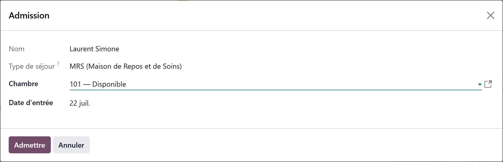

# Admitting a candidate

:::{rh-description}
Admitting a candidate in WideCare: the checks before Admitted, the admission wizard (room and start date), what is created, the next steps on the resident's record, and the safeguards including the duplicate identification number.
:::

:::{rh-faq}
What does the admission create?
: The candidate becomes a resident, their stay opens as **Confirmed** on the chosen room and date, and the resident's record opens.

Is a room required?
: Yes. The wizard offers the rooms of the request's establishment that are free, that free up on a known date, or that are waiting-list rooms.

The identification number already belongs to a resident. What do I do?
: Click **Link to that resident**: the request is repointed at the existing record, and the empty duplicate is archived. This is also the normal path for readmitting a former resident.

What happens if I move an admitted request back to an earlier stage?
: Stays still in draft or confirmed are cancelled automatically. A stay that has already started is left untouched.

What do I do after the admission?
: Follow the button at the top of the resident's record: **Validate the admission** opens the stay, where you enter the admission date and click **Start Stay** the day the resident arrives.
:::

When the file is ready, the candidate becomes a resident. Two equivalent
actions open the **Admission** wizard: drag the card into the **Admitted**
column, or click the **Admitted** stage at the top of the request.

## 1. Pass the checks

WideCare refuses the admission, on every path, as long as:

- the **Desired stay type** is empty — the documents for the health insurer
  cannot be produced without it;
- the **insurability** has not been verified, where the country has an
  electronic check — unless the request waives it.

A third check is about identity: if the national identification number entered
already belongs to a resident, a banner names the existing record. **The
admission will be refused** as long as the request points at a separate one.

:::{admonition} One person, one record
:class: warning

The **Link to that resident** button fixes it in one click: the request is
repointed at the existing record, and the empty duplicate created along the way
is archived. A record already in use is never archived — the two are then merged
by hand.

This is the normal path for **readmitting a former resident**: their history,
evaluations and documents come back with them.
:::

:::{admonition} In Belgium
:class: rh-country rh-country-be

The stay type is needed to produce Annexe 7, the insurability check is the MDA,
waived by unticking **MDA check required**, and the duplicate is detected on the
NISS. See [Admitting a resident in Belgium](../belgique/admission.md).
:::

## 2. Fill in the wizard

- **Stay Type** — carried over from the request, read-only.
- **Room** — required. The list offers, for the establishment of the request:
  - the rooms free today, a shared room saying how many beds are left;
  - the rooms that **free up** on a known date — choosing one moves the start
    date to the first free day;
  - the **waiting-list rooms**, to record the admission before a bed is free
    (see [The waiting list](liste-attente.md)).

  A stay that comes by day is offered the day places only; when the house has a
  single day place, it is proposed on its own.
- **Stay start date** — today by default.
- **Notes** — what was agreed with the family; copied into the stay's
  admission reason.

Depending on the modules installed, the wizard also carries the **invoice type**
and the [split billing debtors](../facturation-partagee/index.md). For a
resident billed in advance, the admission also creates the first accommodation
invoice: see [Invoice type: in advance or in arrears](../facturation/type-de-facture.md).

Click **Admit**. The wizard closes at the first click.

## 3. Check what was created

WideCare then:

- turns the request's person into a **resident**, with everything typed on the
  request;
- opens the **stay** in the **Confirmed** state, on the chosen room and date;
- marks the request **Admitted**;
- opens the **resident's record**, marked **Expected** until the stay starts;
- schedules the [move-in tasks](../residents/procedure-emmenagement.md) and the
  preparation of the room.

## 4. Validate the admission on arrival

The top of the resident's record names the **next step** of the admission, one
at a time:

1. **Create the stay** — shown only when no stay is confirmed yet (a resident
   created by hand, a stay left in draft).
2. **Validate the admission** — opens the confirmed stay. On the day the
   resident arrives, enter the **Admission Date** and **Admission Time**, then
   click **Start Stay**: the stay becomes **Active**.

Once nothing is left to do, the header shows no admission button. See [Manage a
resident](../residents/gerer-un-resident.md).

:::{admonition} Two dates not to confuse
:class: note

- **Stay start date** — when billing for accommodation (the room) begins. This
  is the one in the wizard.
- **Admission Date** — the resident's effective entry, when the care allowance
  paid by the health insurer begins. It is entered when the stay is
  **started**.

They are often identical, but can differ.
:::

:::{admonition} In Belgium
:class: rh-country rh-country-be

The admission guide adds the Belgian steps (Katz, admission agreement), and
starting the stay prepares the admission agreement (Annexe 7) sent to the
mutuality through eAgreement. See [Admitting a resident in
Belgium](../belgique/admission.md).
:::

## Safeguards

- **Closing the wizard** creates nothing and brings the card back to its
  previous stage: the request is only admitted by **Admit**.
- **Moving a request out of Admitted** cancels the stays still in **Draft** or
  **Confirmed**; a stay already **Active** is left untouched.
- **No duplicate stay**: the wizard reuses the request's existing stay, or a
  stay of the resident that belongs to no request — never one belonging to
  another request. The room, the date and the stay type are pre-filled.
- **No double booking**: a room whose bed is already promised to another
  admission on that date is refused, with the date it frees up.

## What's next

- [Manage a resident](../residents/gerer-un-resident.md)
- [The move-in procedure](../residents/procedure-emmenagement.md)
- [Billing](../facturation/index.md)
- [Invoice type: in advance or in arrears](../facturation/type-de-facture.md)
