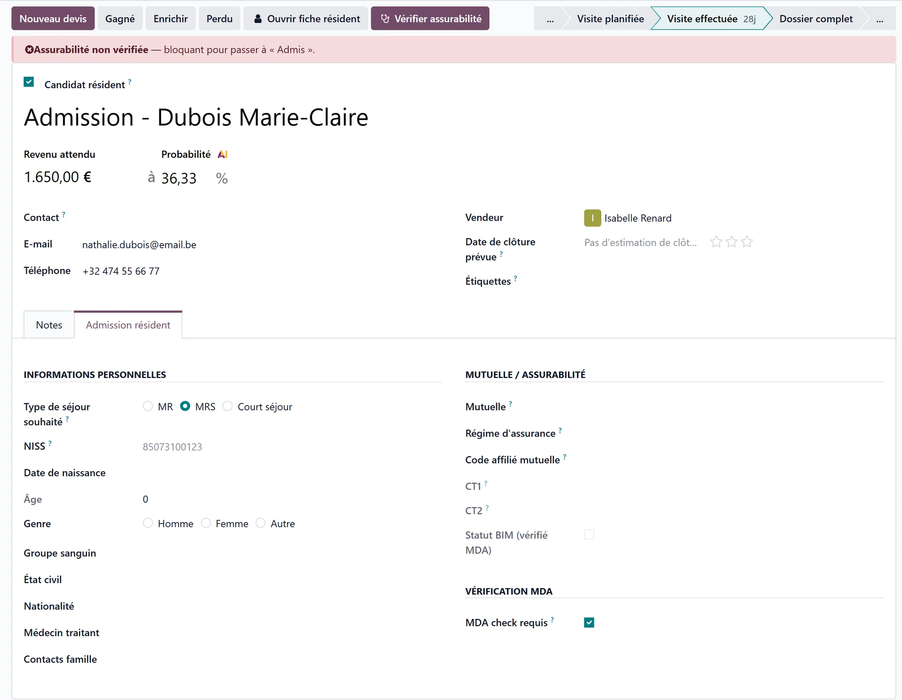

# The candidate's file

:::{rh-description}
The admission request in WideCare: the person to admit and their photo, the caller, the establishment, the desired stay type and room type with the places free, identity, health insurer and key contacts.
:::

:::{rh-faq}
Where do I enter the candidate's identity?
: In the **Resident Admission** tab of the request, which replaces the commercial tabs of a sales pipeline.

Why is there an Establishment field?
: For whoever works for several houses. The places free, the room type, the dependency suggestion and the rooms offered at admission are those of the establishment chosen on the request.

Why can't I choose a stay type?
: Because no approval is recorded for the establishment yet. A banner says so and offers **Record the approvals**; the stay types on offer come from those approvals.

Where do I see how many places are free?
: Next to the desired stay type and in the **Room type** list, each option says what is left. **See the details** opens the **Places available** table.

What are the three key contacts?
: The **emergency contact**, the **legal representative** and the **trusted person**. Each has a box to tick when there is none, so an empty field is never mistaken for an oversight.
:::

The request is where the candidate's file is built, without leaving the
pipeline. Everything typed here is kept on the future resident's record: it is
the same person, before and after the admission.

<!-- screenshot to update: the Establishment field now heads Personal information, with See the details and the Room type below the desired stay type -->

## The top of the request

- **Photo** of the candidate — click the image next to the title to add it. It
  is stored on the resident's record and shown on the pipeline card, then on
  the resident card.
- **Resident candidate** — ticked by default; see [Admissions](index.md).
- The title — the request is named after the person to admit.
- **Contact Person** — the relative or social worker who called, with their
  **Relationship**; their e-mail and phone are theirs, not the candidate's.
- **Resident Email** and **Resident Phone** — the candidate's own details.
- **Followed by** — the person of the admissions desk in charge of the request.

The **Open resident record** button opens the future resident's record at any
time.

## Personal information

- **Establishment** — the house the request is for, shown when you work for
  several houses. Only the houses ticked in the company switcher are offered.
- **Desired stay type** — offered according to the sectors the establishment is
  licensed for, each with its places free. It is not required to fill in the
  file, but it is required to admit: it determines the bed and the documents
  the health insurer expects. **See the details** opens the **Places
  available** table.
- **Room type** — the type of room planned, each option with its beds free. It
  is what the family is told and what the price follows; the room number itself
  is chosen at admission.
- Identity: **ID card number** and **ID card expiry**, **Date of birth**,
  **Age**, **Gender**, **Blood type**, **Marital status**, **Nationality**,
  **Place of birth**.
- **Resident language**, **Spoken languages**, **Religion**.
- **Attending physician** and **Deputy physician**.
- **Family contacts**, phone, e-mail.

### The Places available table

**See the details** opens a table of the beds of the establishment, room type by
room type:

| Column | Meaning |
|---|---|
| **Room type** | The type of room; the one planned on the request is highlighted. |
| **Price per day** | The accommodation price of the type. |
| **Beds** | The beds of that type in the house. |
| **Free** | The beds free today. |
| **Waiting list** | The people already waiting for that type. |

Where the country licenses places per sector, the table also shows the places of
each sector.

:::{admonition} No approval on file
:class: warning

If the establishment has no approval recorded, no stay type can be offered. The
banner **This establishment has no approval on file yet, so no stay type can be
offered** appears, with a **Record the approvals** link — fill them in first.
:::

:::{admonition} In Belgium
:class: rh-country rh-country-be

The stay types are MR, MRS, the short stay and the day care centre; the
identification number is the NISS, at the top of the request, read from the
eID card if you wish ([Reading the eID card](../belgique/lecture-eid.md)). The tab also shows
the candidate's Katz (**New Katz**, **Import a Katz**) and, when the validated
Katz points to another sector, suggests it with **Apply**: see [Admitting a
resident in Belgium](../belgique/admission.md).
:::

## Health insurer and insurability

This block records the resident's **health insurer** and the membership details
the country asks for.

Where the country has electronic exchanges with the health insurer, the block
also carries an **insurability check**: one button queries the insurer and
fills in the insurer and the membership details on its own. It needs the
national identification number: without it, WideCare asks for it first.

:::{admonition} The insurability check gates the admission
:class: warning

Where the check exists, moving to **Admitted** is refused as long as it has not
succeeded. For a case that does not require it — a candidate with no national
identification number, for example — untick the box that makes the check
required.

If the answer comes back **not insured**, the admission is still possible: a
banner warns that billing will have to be addressed to the resident, and the
answer is recorded in the request's history.
:::

:::{admonition} In Belgium
:class: rh-country rh-country-be

The block, **Mutuelle / Insurability**, holds the mutuality, the CT1/CT2 codes
and the BIM status, and the check is an MDA request sent with **Check
insurability**. On the pipeline list, **Check insurability (MDA)** checks the
whole waiting list at once. See [Admitting a resident in
Belgium](../belgique/admission.md) and [Insurability
(MDA)](../belgique/ehealth/mda.md).
:::

## Key contacts

Three roles, each with a box to tick when the person does not exist:

- **Emergency contact** — or **No emergency contact**
- **Legal representative** — or **No legal representative**
- **Trusted person** — or **No trusted person**

The box matters: it tells the team that the question was asked, rather than
leaving an empty field that looks like an oversight. A name typed in one of
these fields opens a short contact form.

## What's next

- [The waiting list](liste-attente.md)
- [Admitting a candidate](admettre.md)
- [Manage a resident](../residents/gerer-un-resident.md)
