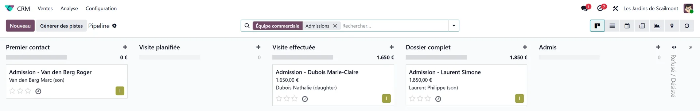

# Admissions

:::{rh-description}
The Resthome Admissions application: a pipeline from the first call to the move-in, one card per person waiting for a place, the waiting list and the admission that creates the resident and their stay.
:::

:::{rh-faq}
Where is the admissions pipeline?
: In the **Admissions** application. Each request is a card that you move from stage to stage on a kanban board. The board opens on every request of the house, not only on yours.

Who is the card about, the resident or the relative who calls?
: The card is about the person to admit: their name, age, sex, dependency category and the room planned. The relative who calls is recorded as their **Contact Person**, with their own e-mail and phone.

Why is there no amount on the cards?
: Because a request for a place is not a sale. The expected revenue, the column totals and the quotation buttons are hidden on an admission request.

How do I close a request that does not go ahead?
: Click **Give up** on the request and choose the reason: admitted to another home, withdrew and staying at home, or died before admission.

What is the waiting list?
: Every request still open — not admitted, not refused or withdrawn, not given up. The **Waiting list** filter shows it. See [The waiting list](liste-attente.md).
:::

:::{toctree}
:hidden:

dossier-candidat
liste-attente
admettre
:::

The **Admissions** application follows every request for a place, from a
relative's first phone call to the day the resident moves in. Each request is a
**card** that you move forward on a kanban board; when the file is ready, one
action turns the candidate into a **resident**, with their room and their stay.

<!-- screenshot to update: the cards now show the person (photo, age, sex, dependency category, room type planned) and no amount -->

## The stages

| Stage | Meaning |
| --- | --- |
| **First Contact** | Request received, to be followed up. |
| **Visit Scheduled** | A visit to the facility has been booked. |
| **Visit Completed** | The visit has taken place. |
| **File Complete** | The administrative and medical file is ready. |
| **Admitted** | Triggers the admission — see [Admitting a candidate](admettre.md). |
| **Refused / Withdrawn** | The request does not go ahead (folded column). |

Drag a card from one column to the next, at the actual pace of the case, or
click the stage at the top of the request. Visits are booked from the request
itself: the meetings button (**No Meeting** while none is booked) opens the
shared calendar, and the meeting carries the request's name.

## Creating a request

1. In the pipeline, click **New** above the **First Contact** column.
2. Fill in the quick card:
   - **Future resident** — the name of the person to admit; the request is
     named after them;
   - **Contact Person** — who is calling: a relative, a social worker… Pick a
     known contact, or type a new name: it is created as a family contact of
     the person to admit;
   - **Relationship** — what the caller is to the person to admit;
   - **Contact Email** and **Contact Phone** — the caller's own details.
3. Click **Add** to file the card, or **Edit** to open the whole request.

The caller then appears in the **Contact Persons** of the future resident's
record, with their relationship, and stays there after the admission.

## Reading a card

Each card shows the **person**, drawn like the resident card they are about to
become:

- the **name**, and the resident code once they have one;
- the **age**, the **sex** and the **dependency category** when it is known;
- the **room type** planned, then the **room** once admitted (a sun instead of a
  bed for a day place);
- the **photo** — added on the request, it is kept on the resident's record;
- badges for what still has to be done.

No amount appears anywhere on the board: the column totals, the expected revenue
and the salesperson's avatar are hidden on an admission request.

## A request made for a place

Each request carries the **Resident candidate** box, ticked by default. It
opens the [candidate's file](dossier-candidat.md) and hides what belongs to a
sales pipeline and not to an admission: expected revenue, probability,
quotations, the **Won** and **Lost** buttons. **Salesperson** reads **Followed
by**: the person of the admissions desk who follows the request.

Untick the box only for a real business opportunity, if your house also uses
the pipeline for that.

:::{admonition} In Belgium
:class: rh-country rh-country-be

The request also carries the NISS, the MR/MRS stay type, the Katz brought by the
candidate and the MDA insurability check, and the cards show **Katz to
validate**, **MDA not checked** or **Not insured**: see [Admitting a resident in
Belgium](../belgique/admission.md).
:::

## Searching and grouping

The search bar of the pipeline offers, beside Odoo's own filters:

- **Waiting list** — the requests still open (see [The waiting
  list](liste-attente.md));
- **Room type** in the **Group By** menu, to see the requests per price;
- a search on the **Room type** planned.

The **My Pipeline** filter is not applied on opening: the admissions desk shares
one board. It stays one click away in the search panel.

## Giving up a request

When a request does not go ahead, click **Give up** on the request (the
**Give up this application** window opens) and choose the reason:

- **Admitted to another home**
- **Withdrew — staying at home**
- **Died before admission**

Add a closing note if needed, then click **Give up**. The reason stays on the
request: it is what lets you read, months later, why the place was not taken.
The button is hidden once the person is admitted.

## Once admitted

An admitted request shows the **Admitted** ribbon. The person is now a
resident: continue on their record — see [Manage a
resident](../residents/gerer-un-resident.md).

An application for a serviced residence uses the **Residence** field of the
request and ends on a contract to sign: see
[Contracts and occupants](../residences-services/contrats.md).

## What's next

- [The candidate's file](dossier-candidat.md) — identity, establishment, room type, key contacts.
- [The waiting list](liste-attente.md) — the open requests, the rooms freeing up and the waiting-list rooms.
- [Admitting a candidate](admettre.md) — the checks, the wizard, the stay.
- [Manage a resident](../residents/gerer-un-resident.md) — once admitted.
