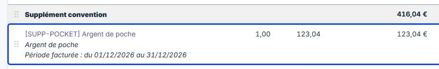
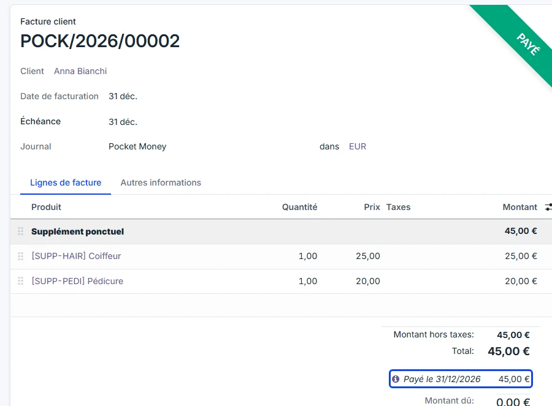

# Purchases and settlement

:::{rh-description}
The month of a pocket money resident in WideCare: two invoices, the purchases paid automatically out of the balance, and the entries passed in each journal.
:::

:::{rh-faq}
Why does a pocket money resident receive two invoices?
: The ordinary invoice carries the accommodation, the agreed supplements and the pocket money provision. The second one carries what the home bought for the resident during the month, and is paid out of their pocket money.

Which purchases go on the second invoice?
: The supplements of the resident's monthly envelope — the hairdresser, the pedicure, a newspaper. The recurring supplements of the stay agreement stay on the ordinary invoice.

Why does the second invoice show Paid straight away?
: Because it is paid out of money the home already holds for the resident: posting it passes the settlement entry at the same time.

Can I put the second invoice back to draft?
: Yes. The automatic settlement is undone at the same time, and the balance goes back up.

What if the balance is not enough?
: The invoice is settled all the same and the balance becomes negative: the resident's record shows **Pocket money overdrawn**.
:::

For a resident with pocket money, the monthly billing produces **two
invoices**, once the **Pocket money journal** is set (see
[Setting up pocket money](mise-en-place.md)).

## Two invoices a month

| Invoice | What it carries | Journal |
| --- | --- | --- |
| **Ordinary invoice** | Accommodation, the recurring supplements of the stay agreement, and the pocket money **provision** | The resident journal |
| **Second invoice** | The supplements of the monthly envelope: what the home bought for the resident | **Pocket money journal** |

The second invoice exists only when the month holds envelope supplements. In
every other case — no pocket money, no journal set, nothing bought this month —
the resident receives the single invoice they always received.

## The month, step by step

1. **During the month** — the purchases made for the resident (the
   hairdresser, the pedicure) are added to their **supplement envelope**, as
   for any resident. See [Supplements](../facturation/supplements.md).
2. **At the end of the month** — generate the period and create the invoices
   as usual. See [Invoice a month, step by step](../facturation/facturer-un-mois.md).
3. **Post the ordinary invoice** — it carries the **provision**, under
   **Convention supplement**. Once posted, the provision is credited to the
   resident's pocket money: the balance goes up.

   

4. **Post the second invoice** — WideCare pays it out of the pocket money at
   once: the invoice shows **Paid**, with the date of the settlement under the
   total, and the balance goes down by the same amount.

   

   To open the settlement entry, click the ⓘ icon on the **Paid on** line
   under the total, then **View**. The entry carries the invoice's date and
   the reference **Pocket money settlement — POCK/…**, with the number of the
   invoice it paid.

The ordinary invoice, for its part, stays **to be paid** by whoever pays it —
the resident, the family or the public body — like any invoice.

:::{admonition} Split billing
:class: note

When the resident share is split between several debtors, the split concerns
the ordinary invoice. The second invoice is paid out of money the home already
holds for the resident, and is not split. The provision billed to a debtor
still credits the resident's own balance.
:::

## What is booked in the journals

With the provision of 123.04, a hairdresser of 25.00 and a pedicure of 20.00,
the month passes these entries. Only the pocket money lines move the balance.

| Document | Journal | Debit | Credit |
| --- | --- | --- | --- |
| Ordinary invoice — provision line | Resident journal | Receivable of the payer 123.04 | **Pocket money account 123.04** |
| Second invoice | Pocket money journal | Receivable of the resident 45.00 | Revenue (hairdresser, pedicure) 45.00 |
| Automatic settlement | Miscellaneous Operations | **Pocket money account 45.00** | Receivable of the resident 45.00 |

- The **provision** is not revenue for the home: it is money it now holds for
  the resident, so it is **credited** to the pocket money account.
- The **second invoice** is an ordinary sale: the home sold the hairdresser and
  the pedicure, which are its revenue.
- The **settlement** pays that invoice with the resident's money: it
  **debits** the pocket money account and clears the receivable. The two are
  reconciled, which is why the invoice shows **Paid**.

Every pocket money line carries the **resident's name**, even when the
invoice is addressed to someone else: that is how WideCare finds each
resident's share on the one account.

:::{admonition} In Belgium
:class: rh-country rh-country-be

With the Belgian chart of accounts, the accounts are typically **400000
Clients** for the receivables, **700000** for the revenue and the pocket money
account of class 4, for instance **489500**.
:::

## Cash handed to the resident

When the home gives the resident money in hand, the accountant passes a
**miscellaneous entry**:

| Debit | Credit |
| --- | --- |
| **Pocket money account**, with the **resident** as partner | Cash |

The balance goes down by the amount handed over. Without the resident as
partner on the pocket money line, the entry is not counted in their balance.

## When something differs

- **Back to draft** — putting the second invoice back to draft deletes the
  settlement entry, and the balance goes back up.
- **A purchase billed by mistake** — on the second invoice, click
  **Credit Note**, then **Reverse**, and post the credit note: the amount goes
  back into the balance. **Reverse and Create Invoice** cancels the invoice
  and its settlement, and opens a new second invoice to correct and post.
- **A purchase added after the month was posted** — add it to the resident's
  envelope as usual. It goes on a corrective invoice in the pocket money
  journal, listed under **Corrective documents** on the period (**Refresh** if
  it is not there yet). Posting it pays it out of the balance.
- **Not enough money** — the settlement is passed anyway; the balance becomes
  negative and the record shows **Pocket money overdrawn**.
- **No settlement journal** — nothing happens on posting: the accountant
  passes the settlement by hand, and the balance only shows what came in.
- **No pocket money journal** — the purchases stay on the ordinary invoice and
  are not paid out of the pocket money.
- **Pocket money ticked after the invoices were created** — on the period,
  click **Reset to Draft**, then **Generate** and **Create Invoices** again:
  the purchases move to a second invoice in the pocket money journal.
  Residents whose invoice is already posted are not changed.
- **Pocket money journal changed** — a draft second invoice moves to the new
  journal the next time the period is generated. One that already has a
  number stays in its journal.

## What's next

- [Pocket money](index.md) — read a balance and the entries behind it
- [Supplements](../facturation/supplements.md)
- [Invoice a month, step by step](../facturation/facturer-un-mois.md)
