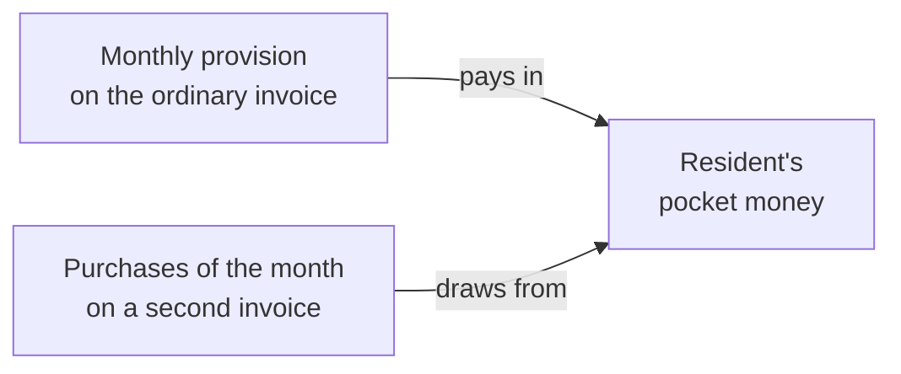

# Pocket money

:::{rh-description}
The pocket money a nursing home holds on a resident's behalf in Resthome: the balance on the resident's record, the entries behind it and the overdrawn warning.
:::

:::{rh-faq}
What is pocket money in Resthome?
: Money paid to the home by a third party (a public welfare body, the family) and kept for the resident. The resident's purchases are drawn from it. Resthome shows what is left.

Where do I see a resident's balance?
: On the resident's record: the **Pocket money** button at the top shows the balance. Click it to see the entries that make it up.

What happens when the balance is negative?
: A red **Pocket money overdrawn** banner appears on the resident's record. Nothing is blocked: the home decides whether to keep selling supplements.

Can I see every resident's balance at once?
: Yes. In the residents list, show the optional **Pocket money balance** column.
:::

:::{toctree}
:hidden:

mise-en-place
achats-reglement
:::

Some residents do not handle their own spending money: a third party pays a
monthly amount to the home, which **holds it for them**. The hairdresser, the
pedicure or a newspaper bought for the resident are then **drawn from that
money**. Resthome keeps the account of it: what was paid in, what was spent,
what is left.

:::{admonition} In Belgium
:class: rh-country rh-country-be

The pocket money of a resident supported by the CPAS is paid by the CPAS. See
[CPAS support](../belgique/cpas.md).
:::

## How the money moves

- **Paid in** — the provision is billed every month, as a supplement, on the
  resident's ordinary invoice (or on the invoice of whoever pays it). Once that
  invoice is posted, the balance rises.
- **Spent** — what the home bought for the resident during the month goes on a
  **second invoice**, which is paid out of the balance.

The setup is described in [Setting up pocket money](mise-en-place.md), the
monthly invoices in [Purchases and settlement](achats-reglement.md).

:::{admonition} Requires the accounting in Resthome
:class: note

The balance is read from the home's accounting entries. Pocket money is only
available where the home keeps its accounts in Resthome.
:::

## The balance on the resident's record

Once the resident is set up, a **Pocket money** button at the top of their
record shows the **available balance**: what was paid in, minus what was drawn
from it. Only posted entries count.

Click it to open the **entries** behind the balance, grouped by accounting
entry: the list adds up, line by line, to the figure on the button.

<!-- screenshot to add: resident record with the Pocket money button and its balance -->

:::{admonition} Pocket money overdrawn
:class: warning

When the resident has spent more than was paid in, a red **Pocket money
overdrawn** banner appears at the top of their record. Resthome blocks
nothing: the home decides whether to keep selling supplements to the resident.
:::

## Every balance in one list

In the **residents list**, the optional **Pocket money balance** column shows
who holds what, without opening each record. It is hidden by default: add it
from the optional columns of the list. The cell stays empty for a resident
without pocket money — an empty cell is not a zero balance.

## Several facilities

The balance is that of the **company you are working in**. A group running
several homes reads each home's balances by switching to that home.

## What's next

- [Setting up pocket money](mise-en-place.md)
- [Purchases and settlement](achats-reglement.md)
- [Supplements](../facturation/supplements.md)
