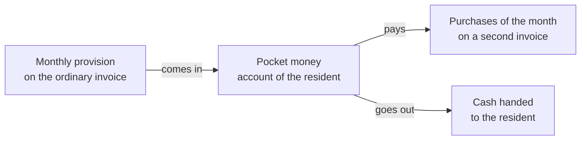
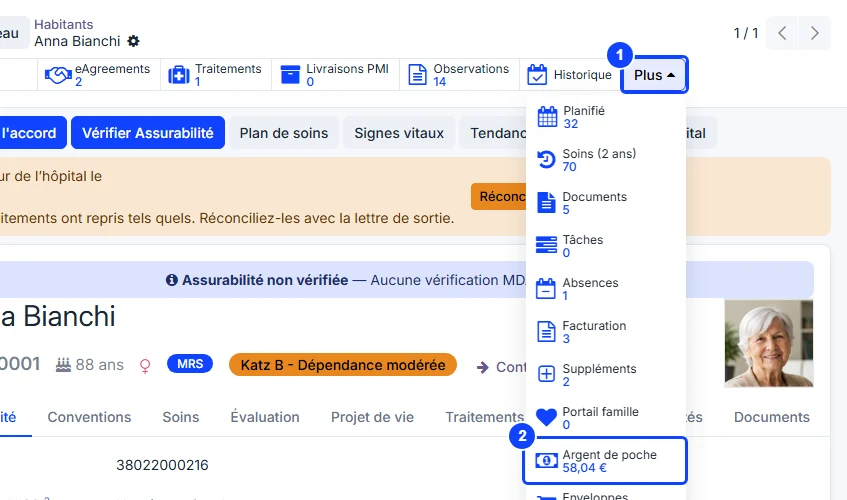
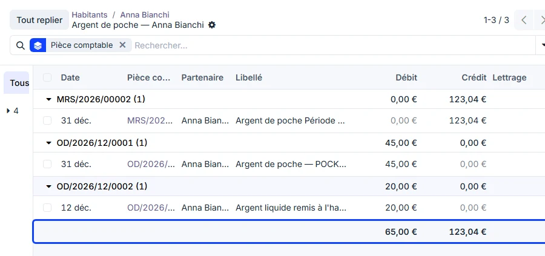

# Pocket money

:::{rh-description}
The pocket money a nursing home holds on a resident's behalf in WideCare: where the money comes from, what is drawn from it, where to read the balance and the entries behind it.
:::

:::{rh-faq}
What is pocket money in WideCare?
: Money paid to the home every month by a third party (a public welfare body, the family) and kept for the resident. The resident's purchases — the hairdresser, the pedicure — are drawn from it. WideCare keeps the account and shows what is left.

Where do I see a resident's balance?
: On the resident's record, click **More** in the row of buttons at the top, then **Pocket money**: the button shows the balance, and opens the entries that make it up.

When does the balance go up?
: When the invoice carrying the monthly provision is **posted** — not when it is paid.

What happens when the balance is negative?
: A red **Pocket money overdrawn** banner appears on the resident's record. Nothing is blocked: the home decides whether to keep buying for the resident.

Can I see every resident's balance at once?
: Yes. In the residents list, show the optional **Pocket money balance** column.
:::

:::{toctree}
:hidden:

mise-en-place
achats-reglement
:::

Some residents do not handle their own spending money: a third party pays a
monthly amount to the home, which **holds it for them**. The hairdresser, the
pedicure or a newspaper bought for the resident are then **paid out of that
money**. WideCare keeps the account of it, resident by resident: what came in,
what went out, what is left.

:::{admonition} In Belgium
:class: rh-country rh-country-be

The pocket money of a resident supported by the CPAS is paid by the CPAS. See
[CPAS support](../belgique/cpas.md).
:::

## How the money moves

All the money of the residents sits on **one accounting account**, the pocket
money account. WideCare reads on it, for each resident, the entries in their
name. Three movements change a balance:

1. **The money comes in** — every month, the **provision** is billed on the
   resident's ordinary invoice, with the accommodation. Its line is not booked
   as revenue but on the pocket money account: as soon as that invoice is
   posted, the balance goes up.
2. **The purchases are paid** — what the home bought for the resident during
   the month goes on a **second invoice**. When it is posted, WideCare pays it
   out of the pocket money: the balance goes down and the invoice shows
   **Paid**.
3. **Cash handed to the resident** — when the home gives the resident money in
   hand, the accountant passes an entry that draws it from the pocket money
   account in the resident's name.

The setup is described in [Setting up pocket money](mise-en-place.md), the
month and the entries passed in the journals in
[Purchases and settlement](achats-reglement.md).

:::{admonition} Requires the accounting in WideCare
:class: note

The balance is read from the home's accounting entries. Pocket money is only
available where the home keeps its accounts in WideCare.
:::

## Read a resident's balance

1. On the resident's record, click **More** at the end of the row of buttons
   at the top.
2. The **Pocket money** button shows the **available balance**: what came in,
   minus what went out. Only posted entries count.

Click **Pocket money** to open the **entries** behind the balance, one group
per accounting document:

- **Credit** — the money that came in: the provision of each month.
- **Debit** — the money that went out: the purchases paid, the cash handed
  over.
- **Balance** = total credit − total debit. Here 123.04 − 65.00 = **58.04**, the
  figure on the button.

The **Journal Entry** column names the source: the ordinary invoice for a
provision, a miscellaneous operation for a settlement or a cash payment. The
entries themselves are detailed in [Purchases and settlement](achats-reglement.md).

:::{admonition} Pocket money overdrawn
:class: warning

When the resident has spent more than came in, a red **Pocket money
overdrawn** banner appears at the top of their record. WideCare blocks
nothing: the home decides whether to keep buying for the resident.
:::

## Every balance in one list

In the **residents list**, the optional **Pocket money balance** column shows
who holds what, without opening each record. It is hidden by default: add it
from the optional columns of the list. The cell stays empty for a resident
without pocket money — an empty cell is not a zero balance.

## Several facilities

The balance is that of the **company you are working in**. A group running
several homes reads each home's balances by switching to that home.

## What's next

- [Setting up pocket money](mise-en-place.md)
- [Purchases and settlement](achats-reglement.md)
- [Supplements](../facturation/supplements.md)
