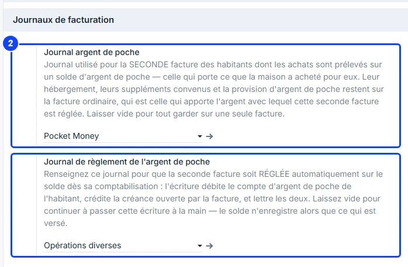
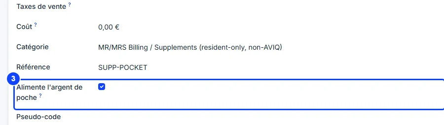
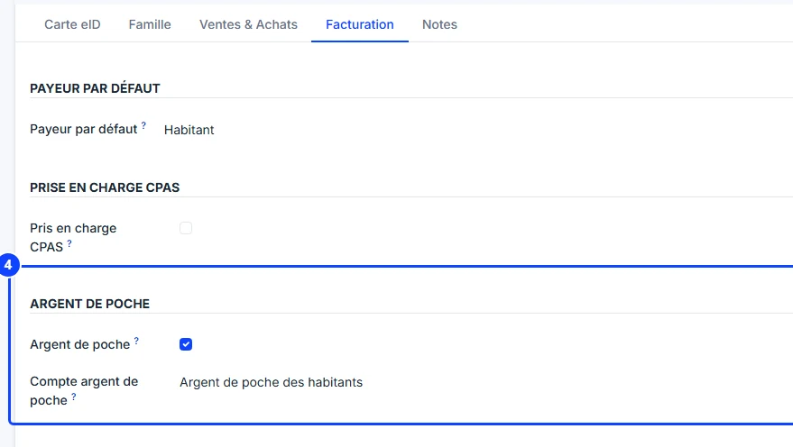
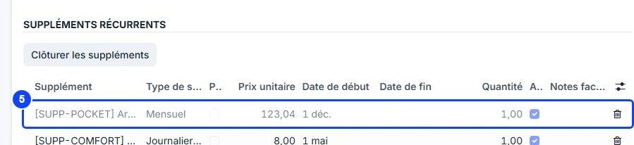

# Setting up pocket money

:::{rh-description}
Setting up pocket money in WideCare, in five steps: the pocket money account, the two journals, the product that pays in, the resident's record and the monthly provision.
:::

:::{rh-faq}
Do I need one accounting account per resident?
: No. One account for the whole home is enough: WideCare reads each resident's share from the entries in their name.

What if I leave the pocket money journal empty?
: The resident keeps a single invoice a month: their purchases are not paid out of the pocket money.

What if I leave the settlement journal empty?
: The second invoice is not paid automatically out of the balance: the accountant passes that entry by hand, and until then the balance only shows what came in.

Does the provision have to be billed to the resident?
: No. It may be billed to whoever pays it — a billing contact or a debtor of a split. It still credits the resident's own balance.
:::

Setting up pocket money is done once for the home (steps 1 to 3), then once
per resident (steps 4 and 5). Prepare steps 1 and 2 with your accountant.

## 1. The pocket money account

Ask your accountant to create **one** accounting account for the money held on
behalf of the residents. It is a **liability** of the home — money it owes the
residents — not a revenue account. One account is enough for every resident:
each entry on it carries the resident's name.

:::{admonition} In Belgium
:class: rh-country rh-country-be

The account is created in class 4 of the chart of accounts, for instance
**489500 Argent de poche des habitants** under 489 *Autres dettes diverses*.
:::

## 2. The two journals

In **Settings → Billing**, block **Billing Journals**, fill in the two pocket
money journals:

- **Pocket money journal** — a **sales** journal of its own (for instance with
  the code POCK) for the **second invoice**, the one carrying what the home
  bought for the resident. Having it apart makes these invoices easy to find.
  Left empty, everything stays on a single invoice.
- **Pocket money settlement journal** — the **Miscellaneous Operations**
  journal. Filled in, the second invoice is **paid automatically** out of the
  balance when it is posted. Left empty, the accountant passes that entry by
  hand.

:::{admonition} Settling automatically is an accounting decision
:class: note

That is why the settlement journal is empty by default: WideCare never draws on
money held for someone else unless the home has asked for it.
:::

## 3. The product that pays in

Open the product billed as the monthly provision, and in the **General
Information** tab tick **Pays into pocket money**, under the internal
reference.

Its invoice line is then booked on the resident's pocket money account
instead of a revenue account. A home may pay in through more than one product
(a public provision and a family top-up, for instance): tick each of them.

:::{admonition} In Belgium
:class: rh-country rh-country-be

The Belgian billing provides the **Pocket money** product (reference
SUPP-POCKET, 123.04 € a month, the amount paid by the CPAS). The box is **not
ticked** when it is installed: tick it, or the provision is booked as revenue
and the balance stays at zero. See [CPAS support](../belgique/cpas.md).
:::

## 4. The resident's record

1. On the resident's record, click **Contact** under their name to open their
   contact record.
2. Open the **Invoicing** tab, group **Pocket Money**.
3. Tick **Pocket money**.
4. Choose the **Pocket money account** created at step 1 — required once the
   box is ticked.
5. Save.

## 5. The monthly provision

Back on the resident's record, open the **Stay Agreement** tab and add the
provision product to the **Recurring Supplements** list, with the **start
date** of the first month to bill. Change the unit price if the amount granted
differs from the product's price.

:::{admonition} Not in the supplement envelope
:class: warning

The provision goes in the **Recurring Supplements** of the stay agreement,
never in the monthly supplement envelope. The envelope holds the purchases of
the month, which go on the second invoice; the provision belongs on the
ordinary invoice, which is what brings the money in. See
[Supplements](../facturation/supplements.md).
:::

## Check the setup

The **Pocket money** button appears on the resident's record, under **More**,
as soon as the box is ticked and the account chosen. It shows **0.00** until
the first invoice carrying the provision is posted. See
[Pocket money](index.md).

:::{admonition} A choice of its own
:class: tip

Pocket money is ticked per resident, never deduced from who funds the stay: a
resident supported by a public body does not automatically receive pocket
money, and a resident funded by their family may.
:::

## What's next

- [Purchases and settlement](achats-reglement.md)
- [Pocket money](index.md)
- [Billing settings](../configuration/reglages-facturation.md)
