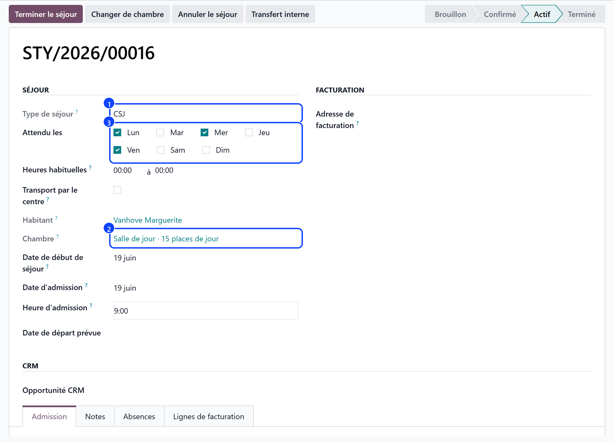
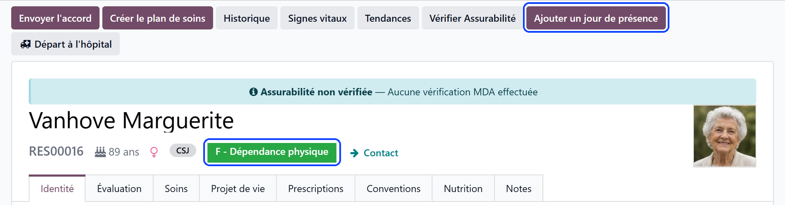

# Admitting a day care user

:::{rh-description}
Admitting a day care user in WideCare: the CSJ stay in a day place, the days expected, the move-in steps, the CSJ category and the respite in the rest home.
:::

:::{rh-faq}
Which stay type do I choose?
: CSJ. The room picker then offers the day places only.

Do I have to tick the days the user comes?
: Only when a rhythm was agreed with the family. Left empty, the user is expected on every day the centre opens.

Why does the stay warn me about the admission day?
: In day care, the admission is the first day of attendance. The stay says so when that day is one the centre is closed, or not one of the days agreed with the family. It is said, never blocked.

How is the day price billed?
: At the price of the day place, on the days attended, one line a month. Nothing is subscribed at admission; while the place is still at 0.00 EUR, a note on the user's file says so.

Which category does the health insurer see?
: The CSJ category read from the Katz evaluation — F, Fp, Fd or D. The badge on the user's file shows that letter, not the rest home one.

A user comes back after leaving. Do I tick the days again?
: No. **Readmit** opens a new stay with the days, the hours and the transport of the last one.
:::

A day care user is admitted like any resident, with a **CSJ** stay in a **day
place**. What changes is what the stay carries: the days the user comes, their
usual hours, the transport, and a day place billed on the days attended
instead of every night.

## From the admission pipeline

The candidate's file says which sector they are asked for. In the
[admission pipeline](../../admissions/admettre.md):

- the **CSJ** filter keeps the candidates for the day care centre;
- the free places of the day care centre are counted **day by day**: a user
  takes a place on each day they are expected, so the centre reads its
  tightest opening day, and the places free on each weekday;
- when the candidate's Katz evaluation meets none of the day care profiles,
  the file says so: **This Katz gives no day care category (none of F, Fd or
  D): no allowance is due for this user.**

When the candidate is admitted with **CSJ** as sector, the admission dialog
also asks for **Expected on** and **Usual hours**, proposed at the centre's
hours. Both are written on the stay.

## Open the stay

Admit the user from the pipeline or from their file, with **CSJ** as
**Stay Type** (1):

- the **Room** picker (2) offers the **day places** only;
- the stay shows no nightly rate, no short-stay option and no invoice type:
  there is no bed, and a day care month is billed after the days happened.

From a day room, **Assign Resident** opens a CSJ stay straight away. The day
care stays are listed under **Day care centre → Day care stays**, and the
users under **Day care centre → Day care users**.

## The days the user is expected

On the stay, **Expected on** (3) holds the days agreed with the family:
**Mon** to **Sun**. They drive everything that plans work for the user — the
screen at the door, care tasks, medication, the missed-care count.

- Nothing ticked: the user is expected on **every day the centre opens**.
- A day recorded in the register always counts, even outside the agreed days.
- **Usual hours** says when the user usually arrives and leaves. Left blank,
  the centre's hours apply. They place the care and the medication of the day
  until the register says when the user actually came.
- When the admission day is a day the centre is closed, or not one of the
  agreed days, a banner on the stay says so: in day care, the admission is
  the first day of attendance.

## Transport by the centre

When the centre drives the user between home and the centre, tick
**Transport by the Centre** on the stay:

- under **Driven on**, the days of the transport — none ticked: every day the
  user comes;
- under **Transporter**, who drives them — empty: the centre's own vehicle.

The register then ticks **Transported by the Centre** on those days, and the
transport supplement counts them. A transport priced at 0.00 EUR — included in
the day price, or billed by the transport firm itself — subscribes nobody.

## Start the stay

Click **Start Stay** on the user's first day. WideCare then:

- shows the **Add a day of attendance** button on the user's file, next to
  the **Attendance days** smart button that opens their days;
- checks that the day place has a price: a place at 0.00 EUR bills the user
  no day price, and a note on the file says so.

Nothing is subscribed under the **Conventions** tab: the day price is the
place's, billed on the days attended. See
[Setting up a day care centre](configuration.md).

<!-- screenshot to update: the file now carries the Attendance days smart button -->

:::{note}
Starting a stay needs the admission hour: it declares when the INAMI
intervention begins.
:::

### The move-in steps

A day care admission moves nobody into a room. Its move-in steps are staff
tasks for the administration:

1. **Hand over the house rules against a signed receipt** — before the
   agreement. Record the date under **House rules handed over on**, on the
   **Admission** tab of the stay: the task closes by itself.
2. **Sign the day care agreement** with the user or their representative.
3. **Record the agreed attendance days** — only while no day is ticked under
   **Expected on**.

## The CSJ category

The same Katz evaluation serves both sectors. For a day care user, WideCare
reads its **CSJ category**, shown under **CSJ** on the evaluation:

- **F** — dependent for washing and dressing, and for transfer or toileting;
- **Fd** — disoriented in time and space, and dependent for washing or
  dressing;
- **D** — dementia diagnosed by a specialist, with a written report;
- **Fp** — no score gives it: while the evaluation is in draft, the evaluator
  switches on **Class as Fp**.

A user in none of them earns **no** day care forfait, and the evaluation says
so. The badge on the file and the name of the evaluation carry the CSJ letter.
In the list of evaluations, **Clinical category** keeps the rest home letter
and **Billed category** shows the one sent to the insurer. See
[The Katz assessment](../katz.md).

:::{warning}
A **D** in day care is validated only with the date of the diagnostic
assessment and the specialist who made it — a neurologist, a geriatrician or
a psychiatrist. Once validated, the evaluation is locked: record them before
validating.
:::

## The agreement

A day care admission asks the health insurer for its agreement with a request
of its own and its Annexe 14, within 14 days of the admission. It runs for a
year, then is renewed. See [The day care agreement](accord.md).

## Readmission

A user who left and comes back is readmitted with **Readmit**: the new stay
starts with the days, the usual hours and the transport of the last one, so
nobody agrees them a second time. A day care readmission always asks the
insurer for a **new** agreement.

## Moving between the rest home and the day care centre

A resident who leaves a bed for the day care centre — or the other way round —
changes sector: use the **internal transfer**, which closes one stay, opens the
other and produces the annexes the insurer expects. See
[Internal transfer](../ehealth/eagreement-transfert.md).

### A respite in the rest home

A house that runs both sectors may take a day care user into a rest home bed
for a short while — the family is away, or worn out — then back to the day
care. Tick **Respite** in the internal transfer dialog, and give the day the
user is expected back under **Back at the day care on**.

- The day care is paused, not ended: its agreement runs on, so no end of
  care is notified on the way out.
- The rest home stay names the day care stay it interrupts, under
  **Respite from the day care**.
- On the way back, the day care stay resumes with its agreed days, its
  admission date and its day price, and no new request is filed while the
  agreement still covers the user.
- A respite that ends anywhere else — an end of stay, a death, a move to
  another sector — files the day care's end of care then.

## What's next

- [The day care agreement](accord.md) — the Annexe 14, the answer, the yearly renewal.
- [Recording attendance](presences.md) — marking present the users who came, one day at a time.
- [Care for a day care user](soins.md) — the care plan and the tasks of the days expected.
