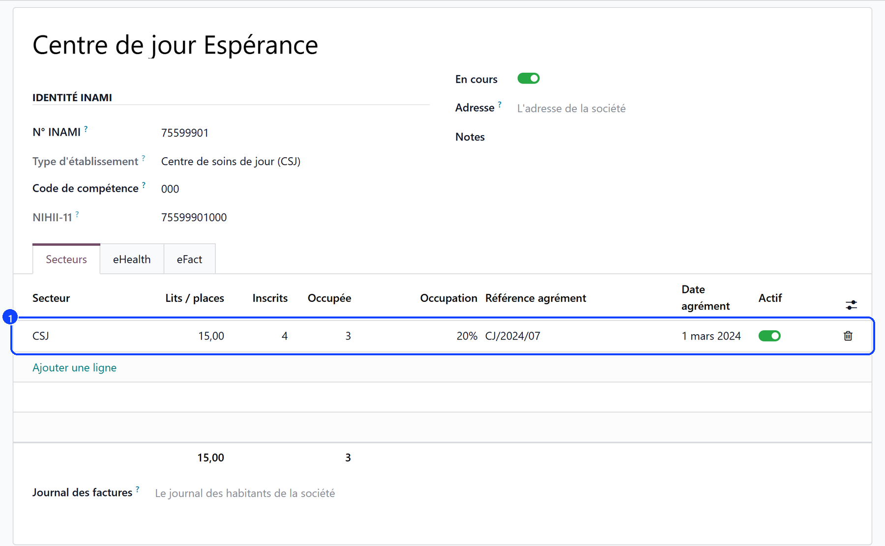
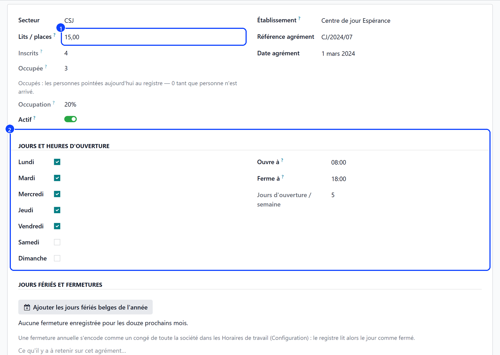
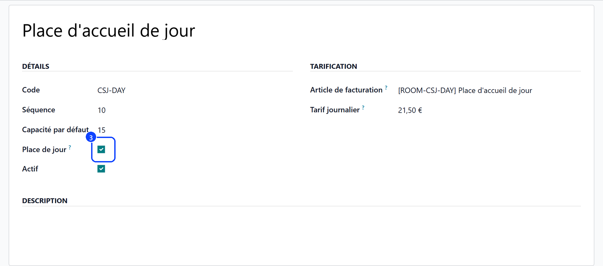
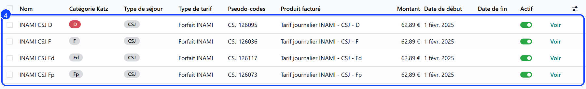
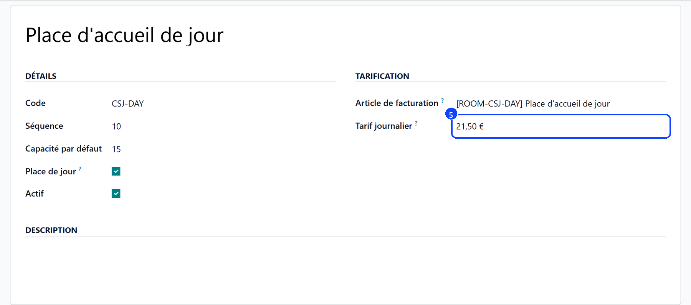

# Setting up a day care centre

:::{rh-description}
Setting up a day care centre (CSJ) in Resthome: the approval and opening hours, public holidays, the day room, CSJ forfait rates and the day price.
:::

:::{rh-faq}
Where do I enter the days the centre opens?
: On the CSJ approval: **Day care centre → Configuration → Approval and opening days**. Monday to Friday, 8:00 to 18:00, by default.

Do I have to create the day room myself?
: No. Recording the CSJ approval creates its day room, with as many places as the approval licenses. Changing the places changes the room.

Why is a bedroom refused to a day care user?
: Because a bedroom is a licensed bed. A day care stay only goes in a day place, and a residential stay never does.

How do I close the centre on public holidays?
: On the CSJ approval, click **Add the Belgian public holidays of the year**. A yearly closure is entered under **Day care centre → Configuration → Closures and public holidays**.

Does the capacity of the day room limit the admissions?
: No. A centre enrols more people than it has places, and they share them day by day. The capacity is the number of places the approval licenses.

What if the day place is still at 0.00 EUR when a user starts?
: The user is billed no day price, and a note on their file says so. Set the Daily Rate of the day place type: every day attended is then billed at that price.
:::

A day care centre needs five things before its first user: its approval, its
opening days, a day room, the amounts of the CSJ forfait and its own day price.
The day room comes with the approval; the four others are yours to enter.

## 1. Record the CSJ approval

A day care centre has **its own INAMI number** — one starting with 755 to 758,
ending in 000 — and Resthome records it on an **establishment** of its own,
with its eHealth certificate. See
[eHealth and eFact settings](../reglages-ehealth.md).

1. Go to **Settings → Approvals → Manage establishments and approvals** and
   create the establishment of the day care centre: its name and its INAMI
   number. Resthome reads the type from the number.
2. Under its **Sectors** tab, add a line with **CSJ** as sector and the number
   of places it covers under **Beds / places** (1). The line also shows the
   users **Enrolled** and the **Day room** of the approval.
3. Open the line: the approval's own form carries the reference, the date and
   the opening days below.

<!-- screenshot to update: the Sectors tab now also shows the Enrolled and Day room columns on the CSJ line -->

Once the approval exists, **Day care centre → Configuration → Approval and
opening days** opens it straight away.

A house that runs a rest home as well keeps its MR and MRS approvals next to
it, on the rest home's own establishment: an admission is only offered the
sectors the house is licensed for.

## 2. Set the opening days and hours

On the CSJ approval, the **Opening days and hours** section (2) says when the
centre opens: the days from **Monday** to **Sunday**, **Opens at** and
**Closes at**. It starts from Monday to Friday, 8:00 to 18:00 — the legal
floor.

<!-- screenshot to update: the approval now shows the Day room field and the note under Occupied -->

- **Open Days / Week** counts the days ticked.
- Under five days a week, or with a window narrower than 8:00–18:00, a banner
  says the centre is **below the norm**. It is said, never blocked: what the
  centre opens is its own to declare.
- **Enrolled** counts the users whose stay is running: more users than places
  is normal for a day care centre — they do not all come the same day.
- **Day room** is the room the users of this approval are admitted in (see
  step 3).
- **Occupied** and **Occupancy** count the users ticked in at today's
  register against the places: 0 until someone arrives. More people today
  than places is said in a banner, never blocked.

These days are read everywhere else: a day recorded in the register on a day
the centre is closed is flagged **Centre closed that day**, and a user with no
agreed days is expected on every day the centre opens.

### Public holidays and closures

The **Public holidays and closures** section of the approval says which days
the centre shuts, on top of its weekdays:

- **Add the Belgian public holidays of the year** records the ten legal
  public holidays, from New Year's Day to Christmas Day, as closures of the
  whole company. A day already recorded is skipped.
- A yearly closure, or any other day the centre shuts, is entered under
  **Day care centre → Configuration → Closures and public holidays**: a name,
  a start and an end, for the whole company.
- Below the button, the closures of the next twelve months are listed with
  their reason.

A public holiday or a closure reads as a day the centre is closed, exactly as
a weekday left unticked: nobody is expected, and the screen at the door says
**The centre is closed today**.

## 3. Check the day room

A day care user holds a **day place**, never a licensed bed. The CSJ approval
brings its own room: recording « CSJ, 15 places » creates the room
**Day room — (establishment name)** with a capacity of 15, of the room type
**Day care place**, in the day care sector. Changing the places of the
approval changes the capacity of the room.

- A room of the day place type the house already had is taken rather than
  doubled.
- The room type has **Day Place** ticked (3), under
  **Healthcare → Configuration → Rooms → Room Types**: tick it on any type of
  your own that is a day room.

<!-- screenshot to update: the room type made by the approval is named Day care place, code CSJ -->

From then on:

- a day care stay only goes in a day place, and a residential stay never does;
- every room picker offers day places to a day care stay, and beds to the
  others;
- a day room reads « 15 day places » in the pickers, never « free beds »: the
  places are shared, and a centre enrols more users than it has places.

## 4. Fill in the CSJ rates

The health insurer pays a **daily forfait** per CSJ category. Under
**Billing → Configuration → INAMI Rates**, the grid carries one row per CSJ
category, each with its own **pseudo-code**:

| Category | Pseudo-code |
| --- | --- |
| F | 126036 |
| Fp | 126073 |
| D | 126095 |
| Fd | 126117 |

Enter the amount in force from its start date (4). The amount is the **same
for every category**: the category declares the user's profile to the insurer.
The list opens on the rates with **No end date**; the **Day care (CSJ)**
filter keeps the four rows of the centre, and **Currently valid** shows the
rates in force today.

:::{warning}
A rate left at 0.00 EUR bills no forfait. Resthome never sends a claim at zero:
the month's generation says which users were left without one, and why.
:::

## 5. Set the centre's day price

What the user pays is the centre's **day price**: the **Daily Rate** of the
day place's room type, under **Healthcare → Configuration → Rooms → Room
Types** (5).

- Every day attended is billed at that price, on **one line a month** with
  the days attended as its quantity.
- Nothing is subscribed at admission: the price follows the place.
- A place left at 0.00 EUR bills the user nothing; a note on the user's file
  says so when the stay starts.

The transport between home and the centre, and the unannounced absence, are
**supplements** with a price of their own: see
[Billing a day care month](facturation.md).

## Give the team its rights

On each user, under **Settings → Users**, the **Day care** rights say who keeps
the register and who may amend a closed day:

- **Keep the register** — ticks who came and when, at the door or on the list;
- **Amend a closed register day** — corrects a past day, or an arrival after
  13:00, prints the register; every change is logged.

Care assistants and the activity team keep the register; the head nurse, the
billing managers and the managers may amend it.

:::{note}
The screen at the door shows the users of the sectors the person is assigned
to. When the day care sector is missing from an employee's file, the screen
says how many users it does not show: add the centre's sector on the employee
file.
:::

## What's next

- [Admitting a day care user](admission.md) — the stay, the days expected, the category, the move-in steps.
- [Recording attendance](presences.md) — the screen at the door, the register, one day at a time.
