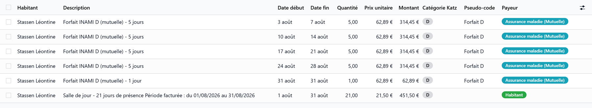

# Billing a day care month

:::{rh-description}
Billing a day care month in Resthome: the CSJ forfait on the days that earn it, the day price on every day recorded, the supplements, the checks before sending, the unticked month.
:::

:::{rh-faq}
Why does a Monday, Wednesday and Friday user have three forfait lines a week?
: Because each forfait line covers exactly the days it bills. A run of consecutive days that earn the forfait makes one line; a day without one ends the run.

Is anything billed at the start of the month?
: No. A day care centre bills the days recorded, after they happened: nothing is billed ahead, and a day nobody came is not billed at all.

A day was recorded after the month was generated. What happens?
: The month is billed again for that user, as when an absence changes: the new day reaches the forfait and the day price.

The month billed nothing for a user. Why?
: Almost always because the register of that month is empty for them. The period says so, with the last day recorded for each user concerned.

A user has no forfait line, but their day price is billed. Why?
: Their Katz scale gives no day care category, the insurer refused the agreement for these days, or the staffing norm withdrew the forfait of the year. The period says which.
:::

A day care month is generated like any other month — see
[Billing a month, step by step](../../facturation/facturer-un-mois.md). What
differs is what it counts: the days of the **attendance register**, not the
calendar.

When the day care centre runs without a rest home, the billing app is named
**Day Care Billing**, and its invoices are numbered in the centre's own
**CSJ** journal.

## The day care card of the dashboard

**Billing → Dashboard** gives the centre a card of its own, before the month
is prepared:

- **Day care today** — the users who came today against the approved places,
  with the users still expected; it opens **Today's attendance**;
- **Register not kept** — the days the centre opened over the last 30 days
  with nobody recorded; it opens the register on the latest of them;
- **Day care agreements to renew** — the agreements that run out within 30
  days, or already have. See [The day care agreement](accord.md).

<!-- screenshot to add: the day care card of the billing dashboard, with Day care today, Register not kept and Day care agreements to renew -->

## What the month bills

- **The forfait**, to the health insurer: one line per run of consecutive days
  that earn it, at the rate of the user's CSJ category. A user who comes on
  Monday, Wednesday and Friday has three runs a week.
- **The day price**, to the user: one line a month at the price of the day
  place, with the days recorded as its quantity — whether they earn the
  forfait or not.
- **The daily supplements**, on the days recorded — not on the calendar days.
- **The transport** (**Transport - Home/CSJ**), on the days the register says
  the centre drove the user in: « 3 days driven in ».
- **The unannounced absences** (**Day care unannounced absence**), on the days
  recorded as billable unannounced absences: « 1 unannounced absence ».

The transport and the unannounced absence are supplements: give them their
price under the supplement types, and add them to the conventions of the users
concerned. A user the centre drives is subscribed to the transport when their
stay starts, as soon as the transport has a price. See
[Supplements](../../facturation/supplements.md).

And what it never bills:

- no night: the day place is billed on the days recorded only;
- nothing **ahead**: the days are billed once they happened;
- no absence rebate, and no declared absence: a day nobody came is simply
  not billed;
- nothing after the last day of care — the end of the stay, the declared end
  of care or a death. A day the register still holds after it is flagged to
  the administration, not charged to the family.

A day recorded, corrected or removed after the month was generated bills the
month again for that user, as a change of absence does. On the period, the
**Stay Days** and **Presence Days** of a day care user are their days in the
register: 17, not 31.

The lines are read on the period, under its **Billing Lines** tab, or on the
stay's tab of the same name. Each forfait line carries the CSJ category, its
pseudo-code and the health insurer as payer; the day price line names the
day room.

## When no forfait is due

The month bills the user's day price, but no forfait, when:

- **the scale gives no day care category** — none of F, Fp, Fd or D: the
  period says **No day care category: no forfait**, with the users
  concerned. A user with no validated Katz at all reads **No Katz** on the
  period;
- **the insurer refused the agreement** for these days (Annexe 16), and no
  later agreement was granted. See [The day care agreement](accord.md);
- **the staffing norm withdrew the forfait** of the billing year — see below.

Resthome never sends a forfait at 0.00 EUR.

## The month nobody ticked

When a user's month bills nothing, refreshing the period says why in its
chatter: **nothing recorded in the attendance register** for them, with the
**last day recorded** of each user concerned. A recent date says the register
was not kept up; « never » says the user never came.

Fill in the register — see [Recording attendance](presences.md) — then
**Refresh** the period.

## Register days to check before sending

A day recorded after the 13:00 closure, or on a day the centre was closed, may
be true — a late arrival, an exceptional opening — or a mistake. Each
generation lists them in the period's chatter, under **Register days to check
before sending**, user by user, with the reason. Correct the register if they
are mistakes; otherwise they are billed as they are.

## When the staffing norm reduces the forfait

A staffing norm applied to the billing year reduces every CSJ forfait of that
year, and the period says so when it is generated. Under 75 % of the norm, no
forfait line is produced at all — never a claim at 0.00 EUR — and the period
says **Forfait withdrawn by the sector**. See [The staffing norm](norme-personnel.md).

## Sending to the health insurers

The forfaits go to the health insurers by **eFact**, under the day care
centre's **own INAMI number**, in their own sending. See
[Electronic invoicing (eFact)](../ehealth/efact.md).

Before the sending, two checks are proper to the day care centre:

- **Day care forfait past the agreement's yearly term** — a forfait after the
  end of the user's agreement: a warning while a renewal awaits the insurer,
  blocking when none was sent;
- **Forfait on a day the centre was closed** — a warning: correct the day in
  the register, or keep it if the centre really opened.

## What's next

- [The staffing norm](norme-personnel.md) — the yearly check that can reduce the forfait.
- [Recording attendance](presences.md) — the register every line of the month comes from.
