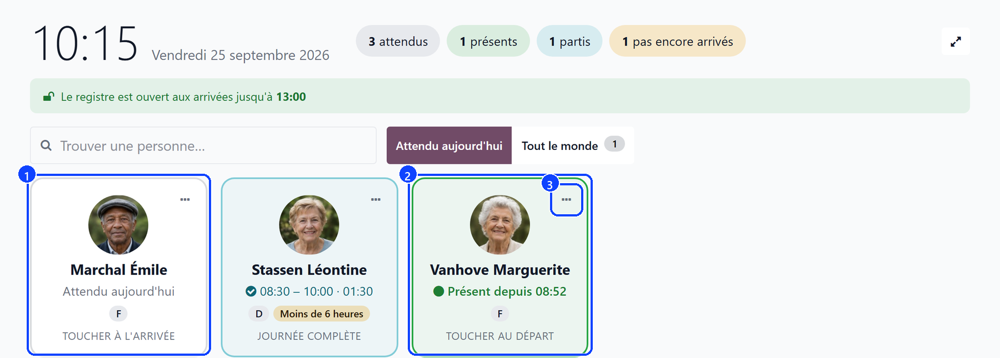
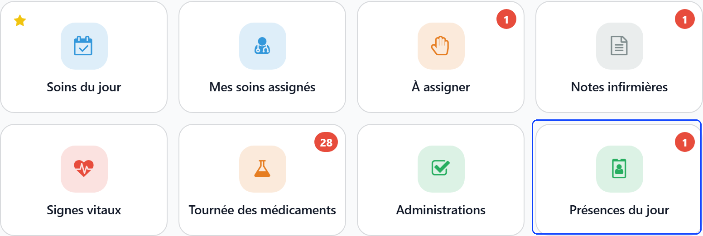
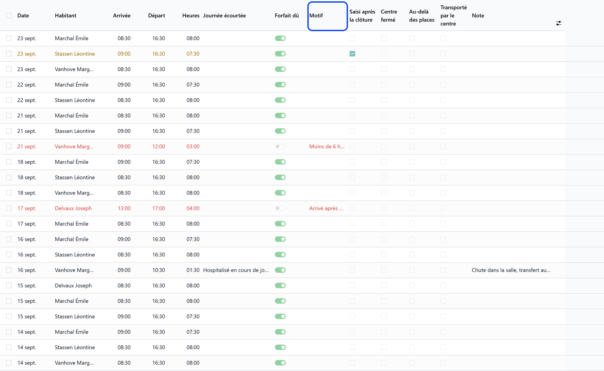
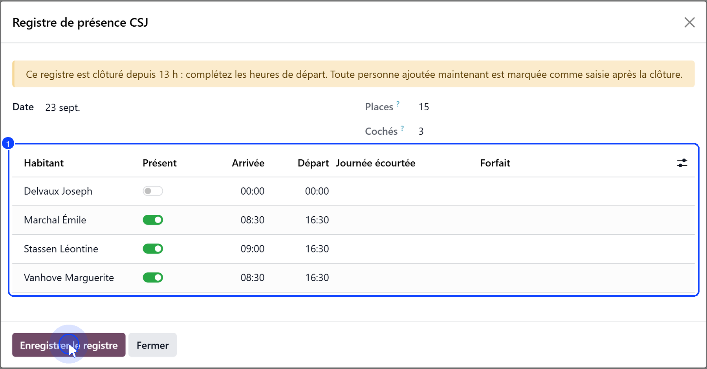
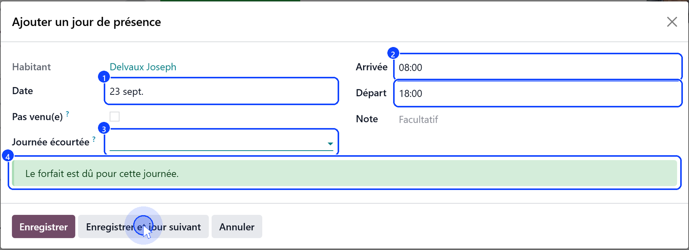

# Recording attendance

:::{rh-description}
Recording attendance in a day care centre (CSJ): the tap-in screen at the door, the register and its calendar, one day at a time, the days that earn the forfait, the 13:00 closure.
:::

:::{rh-faq}
What is the quickest way to record the arrivals of the day?
: **Today's attendance**: one card per user, one tap on arrival, one tap on departure, the hour taken from the clock. The same screen is in the WideCare app on the phone.

When does a day earn the forfait?
: When the user stayed at least 6 hours and arrived by 12:00 — or when the day was cut short by a hospitalisation or a death, however short.

A user came for three hours: do I record the day?
: Yes. The day earns no forfait, but it is a day spent at the centre: the day price and the daily supplements are billed.

Can I still record a day after 13:00?
: The departures, yes. From 13:00 the register is closed to arrivals: a late arrival is kept and marked, and a past day can only be amended by a manager; each change is kept in the audit log.

I forgot to mark a user present yesterday. What happens to their care?
: Once the register has closed, a user who was expected and not marked present is considered absent: the care of that day is cancelled, not counted as missed. A manager can still add the day; the billing then follows.

How do I see who came on which day?
: Open the register in its calendar view: **Calendar** on the screen at the door, or the calendar view of **Day care register**. Each user has a colour.
:::

The **attendance register** is what the whole day care centre rests on: it
decides the forfait, the day price and the care. It holds one line per user
and per day, with the arrival and departure hours.

## Today's attendance, at the door

**Day care centre → Today's attendance** opens a screen made for a tablet at
the entrance: one card per day care user, with their photo. The same screen
opens from the **Today's attendance** tile of the care board.

1. When a user arrives, tap their card (1): the arrival is recorded at the
   current time.
2. When they leave, tap it again (2): the departure is recorded, and the card
   says whether the day earns the forfait, or why not.
3. Tapped the wrong card? Click **Undo** in the confirmation that appears.
4. To type the hours by hand or record a day cut short, click the card's
   **⋯** button (3): it opens the **Add a day of attendance** dialog.

<!-- screenshot to update: the header now carries the expected / present / left counters, the Calendar button and the search field -->

At the top of the screen:

- the counters **expected**, **present**, **left** and **not arrived yet**
  filter the cards on their group; tapped again, they show everyone;
- **Find a person…** searches by name;
- **Expected today** lists the users expected today: on the weekdays agreed
  with the family, otherwise on the days the centre opens. **Everyone** also
  shows the others, for an unplanned visit;
- **Calendar** opens the register's month, and the full-screen button hides
  the rest of the app.

A banner says what the register allows now: open to arrivals until 13:00, or
closed to arrivals. Others say when the centre is closed today, when more
people came than the approval licenses places, and when users of a sector you
are not assigned to are not shown.

- Every tap goes through the register: the 13:00 closure, the audit log and
  the forfait rules apply exactly as in the register.
- A user on a declared absence — a holiday, a stay in hospital — is not
  expected: the card says since when they are away. See
  [Absences and hospitalisation](absences.md).
- From 13:00, a user expected and not ticked in stays on the screen, marked
  **Not ticked in by 13:00**: the register counts them absent. Tapping their
  card still records a late arrival, marked **Recorded after closure**.
- From 13:00, **Did not come** on that card records an **unannounced
  absence**; **Undo the absence** takes it back.
- Several screens can stay open at once: each one reloads every two minutes.

The tile's badge on the care board counts the users expected today who have
not arrived yet. It goes back to zero at 13:00, when the register closes to
arrivals.

### On the phone

The WideCare app carries the same screen: an **Attendance** card on the shift
screen counts the users **expected, not ticked in**, and opens
**Today's attendance**. The users are grouped under **To tick in**, **Here**,
**Gone home** and **Not expected today**.

- Swipe a line to the right: **Arrived**, then **Leaving**.
- **Undo** in the confirmation takes the tap back.
- A tap needs the network: the hour of an arrival is the register's clock at
  the tap. Without a connection, the app says so — tap again once the network
  is back.
- A day already complete is corrected at the desk.

<!-- screenshot to add: the Today's attendance screen of the WideCare app, with the To tick in, Here and Gone home groups -->

## The register

**Day care centre → Register → Day care register** lists the days recorded,
on the current month: one line per user and per day, with the arrival, the
departure, the hours and whether the forfait is due. The **Attendance** smart
button of a stay, and **Attendance days** on a user's file, open the same list
for one person.

- A day that earns no forfait shows in red, with its reason under
  **Why Not Due**; a day recorded after the closure shows in orange.
- The filters **Today**, **This month**, **Day Cut Short**, **Forfait not
  due**, **Recorded after closure**, **Centre closed that day**, **Over the
  places** and **Transported today** narrow the list; it groups by resident,
  by date, by day cut short or by transporter.
- **Over the Places** flags a day when more users came than the approval
  licenses places.
- A day recorded on a day the centre does not open is flagged **Centre
  Closed**, with the reason, never refused: it is either a date typed wrong,
  or an exceptional opening.
- **Transported by the Centre** says the centre drove the user in that day.
  It is ticked from the transport days of the stay, can be corrected on the
  line, and the transport supplement counts these days.

The date picker of a line offers only the days of the user's care: from the
admission to the last day of care.

### The calendar

Switch the register to its **calendar** view to read the month: one colour
per user, with a box per person to filter. A click on a day recorded shows
the arrival, the departure, whether the forfait is due and the transport; a
click on an empty day opens the full form.

<!-- screenshot to add: the register in its month calendar view, one colour per user -->

## Tick who came on a day

To complete or correct a whole day, click **Tick who came on a day** at the
top of the register. The dialog **Who came on (date)** lists every day care
user whose stay runs that day; the days already recorded come marked
**Present**, with their hours.

1. Pick the **Date** (1): the calendar marks the days already in the register.
2. Switch on **Present** for the users who came.
3. Enter their arrival and departure hours: without them, the day earns no
   forfait. The **Forfait** column says, before saving, why a day would earn
   none.
4. Click **Save the register**.

<!-- screenshot to update: the dialog is now opened by Tick who came on a day and shows an Absence column -->

Next to the date, **Places** shows the places the approval licenses and
**Ticked** the users marked present. More users ticked than places is said in
a banner, never blocked: saving stays allowed.

- The **Absence** column says when a user is away that day on a declared
  absence; the line is greyed.
- Switching **Present** off removes the user's day.
- From 13:00 the banner says the register is closed: the departures can still
  be completed, and a user added now is marked as recorded after the closure.
- On a past day, the banner says only a manager can amend it, and every
  change is logged.

## One day for one user

On the user's file, **Add a day of attendance** opens a dialog for a single
day — the right tool to catch up a fortnight for one person.

1. Choose the **Date** (1): today by default. Only the days of the user's care
   are offered.
2. Check **Arrival** and **Departure** (2): they start from the centre's
   hours.
3. If a hospitalisation or a death interrupted the day, choose it under
   **Day Cut Short** (3).
4. Read the verdict before saving (4): the forfait is due, or the reason it
   is not.
5. Click **Save**, or **Save and next day** to move on to the following day.

- A day already in the register is loaded, never doubled: saving updates it.
- On a day the centre is closed, a banner says so, with the reason: an
  exceptional opening is yours to record, a date typed wrong is not.
- When the user is away on an absence under way, a banner says that the day
  recorded brings them back: the absence closes at the arrival.
- **Did Not Come** records a day the user was expected and did not come,
  unannounced. Nothing is written in the register — which lists who came —:
  the day goes in as an unannounced absence. See
  [Absences and hospitalisation](absences.md).
- The next day always starts blank, on the centre's hours.
- A notification confirms each day saved, and says whether the forfait is due.

## A day that earns the forfait

A day earns the forfait when the user:

- stayed at least **6 hours**, and
- arrived by **12:00**;

or when the day was **cut short** by a hospitalisation or a death, however
short. Otherwise the register says why: **Less than 6 hours**, **Arrived after
12:00**, or **Arrival or departure time missing**.

A day that earns no forfait is still recorded: the user came, and the centre
bills them its day price.

## The 13:00 closure

- Before **13:00**, the register of the day is open.
- From **13:00**, it is closed to arrivals; departures can still be entered.
- A **past day** can only be amended by whoever holds **Day care / Amend a
  closed register day**, and every change is kept in the audit log.
- A line added after the closure is marked **Recorded after closure**.
- A line deleted keeps what it said in the audit log.

Once the register has closed, its silence is an answer: a user who was
expected and not marked present **did not come** that day.

## Print the register

**Day care centre → Register → Print the day care register** prints the
register for an inspection, between **From** and **To**:

- **One table per month**, or **One page per day**;
- every line of the period, with its hours, whether the forfait is due and
  what the register says about it — **(R)** marks a line recorded after the
  closure.

Printing is logged. The entry is shown to whoever may amend a closed day.

## What's next

- [Absences and hospitalisation](absences.md) — a holiday, a day in hospital, a day nobody announced.
- [Billing a day care month](facturation.md) — what the days recorded become on the invoices.
- [Care for a day care user](soins.md) — how the register decides the care of the day.
