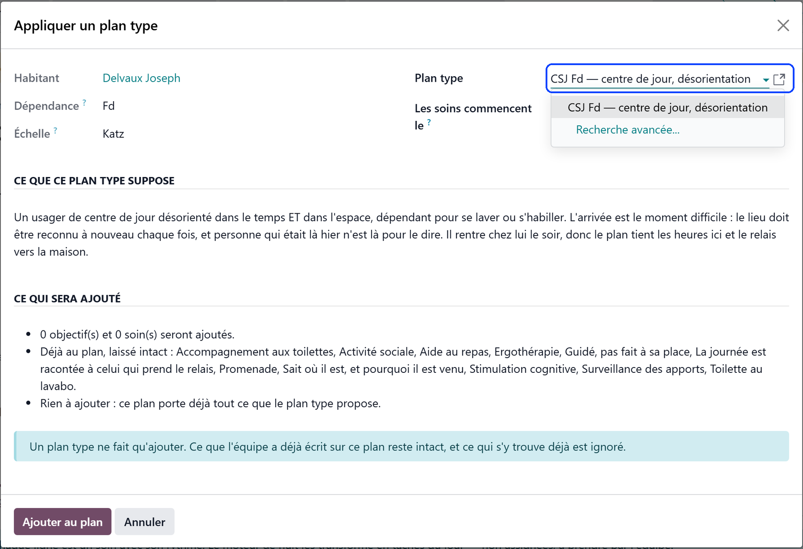
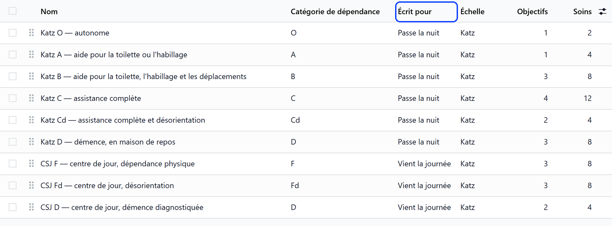
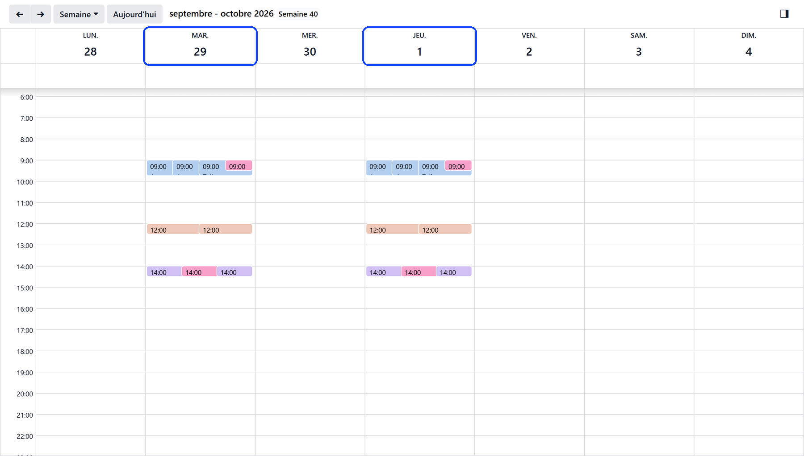
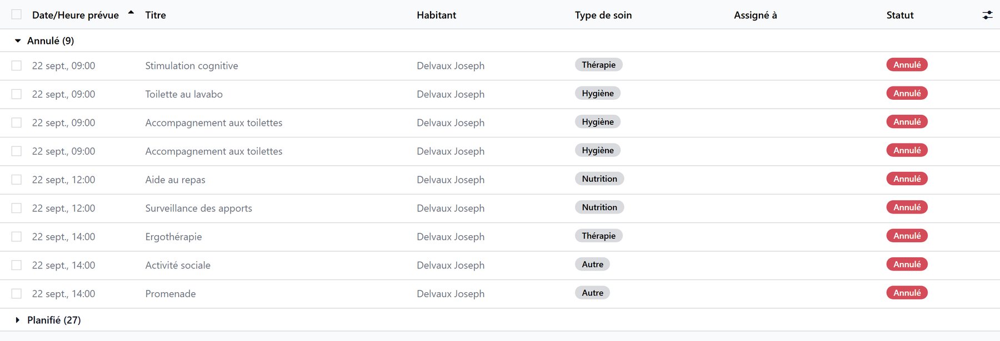

# Care for a day care user

:::{rh-description}
Care for a day care user in Resthome: care plan templates for people who come by day, tasks and medication on the days and hours they are at the centre.
:::

:::{rh-faq}
Why does a day care user have no task today?
: Because they are not expected today — it is not one of their days, they are away on a declared absence — or because the register closed without them.

Which care plan templates are offered for a day care user?
: Those written for people who come by day, or for any stay, that match their CSJ category. A template written for someone who stays the night — night round included — is never offered.

A care was not given because the user did not come. Is it missed?
: No. Once the register has closed, the care of a user who did not come is cancelled, not counted as missed.

A task was due at 9:00 and the user has not been marked present yet. Is it missed at 11:00?
: No. Until 13:00 the register may still receive the user: the task stays planned, and the check after the closure decides.

How often is the care plan of a day care user reviewed?
: Once a year, not every month.
:::

A day care user is cared for like any resident — a care plan, its tasks, the
medication — but only on the days and hours they are at the centre.
Everything that plans work reads the same answer: **is the user expected
that day, and at that hour?**

## On the care board

The care board carries a **Today's attendance** tile, among the things the
shift does today: it opens the screen at the door, and its badge counts the
users expected and not ticked in yet. It is shown to whoever keeps the
register. See [Recording attendance](presences.md).

## The care plan

On the file of a user without a plan, **Create the care plan** opens it. From
the plan, **Apply a template** adds the objectives and cares a plan of that
kind usually carries.

The **Written for** field of a template says who it is meant for:
**Any stay**, **Stays the night** or **Comes by day**. A day care user is
offered only the templates written for people who come by day or for any stay,
that match their CSJ category. Resthome ships three:

- **CSJ F — day care, physically dependent**;
- **CSJ Fd — day care, disoriented**;
- **CSJ D — day care, diagnosed dementia**, which builds on the Fd one.

Each describes a day that starts on arrival and ends when the user goes home.
See [Care plans](../../soins/plans-de-soins.md).

The plan of a day care user is reviewed **once a year**. When a user moves
from the day care centre to a bed, or the other way round, the next review
follows the cadence of the new sector.

## Tasks on the days the user comes

Care tasks are planned only on the days the user is **expected**:

- the days ticked under **Expected on**, on the stay;
- with none ticked, every day the centre opens;
- and any day actually recorded in the register, even outside those days.

A day the centre is closed, or a day of a declared absence, plans nothing.

## Medication and meals within the day

The medication follows the same days, and the same hours: a dose is placed
only while the user is at the centre — between their arrival and their
departure in the register, or, before the register knows, within their
**Usual hours** (the centre's hours when blank). A dose outside that window is
taken at home, and filed as « away », never as « in hospital ».

The meals follow the same rule: a meal is served at the centre only while the
user is there.

## When the user does not come

- **Before 13:00**, the register is open: the care of the day stays planned,
  since the user may still arrive.
- **From 13:00**, a user expected and not marked present did not come: the
  care of the day is **cancelled**, not counted as missed.
- A **hospitalisation** pauses the care as for any resident. Recorded from
  the register as a day cut short, it suspends the prescriptions and cancels
  the care of the day in the same way. See
  [Absences and hospitalisation](absences.md).
- A user who comes back from an absence is ticked in as usual: the absence
  closes, and the care and treatments resume.

## On the phone

The WideCare app shows the same tasks: the cares of the day, for the users who
are expected. Its **Attendance** card opens today's attendance, to tick the
users in and out. See [Tasks](../../soins-mobile/soins.md) and
[Recording attendance](presences.md).

## What's next

- [Recording attendance](presences.md) — the register that decides who is there.
- [Admitting a day care user](admission.md) — the days expected, set on the stay.
