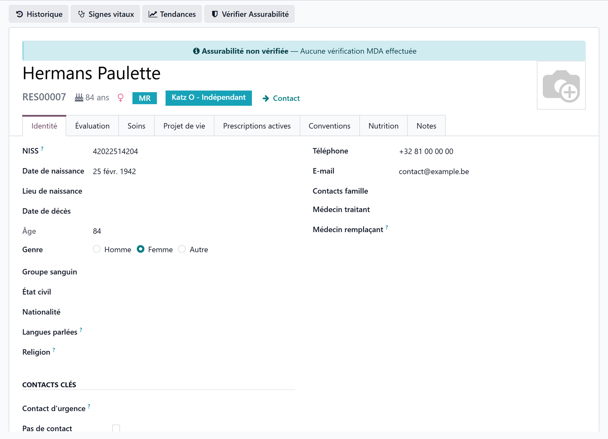

# CPAS coverage

:::{rh-description}
CPAS coverage in a nursing home (MR/MRS): recording the decision, full or partial coverage, routing the resident-share invoice, and checking a MediPrima medical card.
:::

:::{rh-faq}
How do I record that a resident is covered by the CPAS?
: On the resident's contact (the Contact link under their name), open the Invoicing tab, tick **CPAS Supported**, choose the responsible CPAS and the **CPAS Coverage** (full or partial). These fields record the CPAS decision and are tracked in the financial audit log.

Does the CPAS pay everything or only part of it?
: Both cases are supported. **Full Coverage**: the CPAS covers the entire resident share. **Partial Coverage**: the CPAS pays a share and you enter the **CPAS Monthly Amount**; the rest is borne by the resident or their family.

Does ticking "CPAS Supported" automatically send the invoice to the CPAS?
: No. The CPAS section is a record of the decision, not a splitting engine. To send the resident share to the CPAS, fill in the resident's **Billing Contact** (the CPAS); to split between the CPAS and another payer, use maintenance debtors (split billing).

Where do you create a CPAS in Resthome?
: In **Billing → Configuration → CPAS**. Create the contact (company): it is flagged as a CPAS from this menu. Only contacts flagged this way appear in the CPAS field of the resident record.

Is the dependency allowance affected by CPAS coverage?
: No. The dependency allowance goes to the health insurance fund via eFact (third-party payer). CPAS coverage concerns only the resident share: accommodation (the room) and supplements.

Is the CPAS monthly amount the same for all residents?
: No. The amount depends on the CPAS decision for that resident: it is a value specific to each case, to be entered based on the notification received from the CPAS.

What is MediPrima?
: The federal register of the medical aid decisions CPAS take for people who have no mutuality. Resthome can consult the medical card of a resident through eHealth, when the MediPrima module is installed.
:::

When a resident cannot afford their **personal share** (accommodation and
supplements), the **CPAS** (Public Centre for Social Welfare) of their
municipality can **cover it**, in full or in part. Resthome lets you **record
this decision** on the resident record and **route the invoice** to the right
debtor.

You'll find these settings in the **Invoicing** tab of the resident's contact
(the **Contact** link under their name), and the
list of CPAS in **Billing → Configuration → CPAS**.

:::{admonition} What the CPAS covers
:class: note

The CPAS steps in on the **resident share** (room + supplements), not on the
**dependency allowance**: the latter is covered 100% by the health insurance fund
and billed via [eFact](ehealth/efact.md). See
[The INAMI dependency allowance](forfait-inami.md).
:::

## What CPAS coverage is for

Two notions must be distinguished:

- **Record the decision** — who the CPAS is, from when, under which reference, for
  what coverage and what amount. This information documents the case and is
  **tracked in the audit log** (financial category).
- **Route the invoice** — decide **who** Resthome sends the resident share to: the
  resident, their family, or the CPAS. This routing is driven by the **Billing
  contact** or by **maintenance debtors** (see below).

## 1. Declare the CPAS as an organisation

Before linking a resident to a CPAS, the CPAS must exist as a contact.

1. Open **Billing → Configuration → CPAS**.
2. Click **New** and enter the CPAS **name**, its city, phone and email.
3. Check that the **Is CPAS** box, next to the name, is ticked (it is by default from this menu).
4. **Save.**

:::{admonition} Why tick "Is CPAS"
:class: tip

The **CPAS** field on the resident record only offers contacts flagged as a
CPAS. A CPAS created elsewhere (in the generic contacts) appears in the list
only once **Is CPAS** is ticked on its record.
:::

## 2. Enter the coverage on the resident record

1. Open the resident's contact (the **Contact** link under their name) and
   the **Invoicing** tab.
2. In the **CPAS Support** group, next to **Default Payer**, tick **CPAS
   Supported**.
3. Select the responsible **CPAS**.
4. Choose the **CPAS Coverage**: **Full Coverage** or **Partial Coverage**.
5. In the **CPAS Decision** group, fill in the **CPAS Decision Date**, the
   **CPAS Decision Reference** and, for partial coverage, the **CPAS Monthly
   Amount**; add **CPAS Notes** if needed.

| Field | Role |
|---|---|
| **CPAS Supported** | Activates the coverage and switches the **Default Payer** to CPAS |
| **CPAS** | The responsible organisation (only contacts flagged as a CPAS) |
| **CPAS Coverage** | **Full Coverage** (the CPAS pays everything) or **Partial Coverage** (the CPAS pays a share) |
| **CPAS Decision Date** | Date of the grant decision |
| **CPAS Decision Reference** | Number or reference of the decision received |
| **CPAS Monthly Amount** | Amount paid by the CPAS — **partial coverage only** |
| **CPAS Notes** | Free text (conditions, contact, remarks) |

:::{admonition} Fields that appear as you go
:class: info

The CPAS, the coverage and the **CPAS Decision** group only show once **CPAS
Supported** is ticked. The **CPAS Monthly Amount** only appears for **partial**
coverage. Unticking the box sets the **Default Payer** back to the resident.
:::

## 3. Route the invoice to the CPAS

This is the step that decides **who** the resident-share invoice goes to.

- **The CPAS pays everything** → set the resident's **Billing Contact** (in the
  **Default Payer** group) to the **CPAS** contact. The monthly resident-share
  invoice will then be **sent to the CPAS**.
- **The CPAS pays part of it** → use
  [maintenance debtors (split billing)](../facturation-partagee/index.md): add the CPAS as a debtor
  with its **percentage**, and the remaining payers (resident, family) for the
  balance.

:::{admonition} The CPAS fields are a record, not a splitting engine
:class: warning

The **CPAS Support** and **CPAS Decision** fields document the decision and
switch the **Default Payer** to CPAS, but **they do not redirect or split the
invoice**. The invoice recipient stays determined by the resident's **Billing
Contact** (or the stay's billing contact), and the partial split by **split
billing**. Without one of these two levers, the resident share keeps being sent
**to the resident**.
:::

## What Resthome does — and does not do

| Action | Automatic? |
|---|---|
| Track the CPAS decision (financial audit) | Yes, as soon as it's entered |
| Switch the **Default Payer** to CPAS when you tick **CPAS Supported** | Yes |
| Send the invoice to the CPAS | No — via the **Billing Contact** |
| Split the resident share between CPAS and family | No — via [split billing](../facturation-partagee/index.md) |
| Deduct the **CPAS monthly amount** from the billed amounts | No — informational field |

## Key points to remember

- CPAS coverage concerns the **resident share** (room + supplements), not the
  **dependency allowance** (health-insurance-fund share, via eFact).
- First create the CPAS in **Billing → Configuration → CPAS**, then link it to
  the resident in the **Billing** tab.
- Coverage is **full** or **partial**; the **CPAS Monthly Amount** only applies
  to partial coverage.
- The CPAS fields **record** the decision; to **route** the invoice, use the
  **Billing Contact** (full coverage) or **split billing** (partial coverage).
- The **CPAS Monthly Amount** and the decision reference are **specific to each
  case**, based on the CPAS notification.

## Checking a MediPrima medical card

A person who has no mutuality — someone in a reception centre, without papers —
may have their care paid by a CPAS under **MediPrima**, the federal register of
the medical aid decisions. With the MediPrima module installed, Resthome asks
that register through eHealth.

1. On the resident's record, open the **MediPrima** smart button, or **eHealth →
   MediPrima → Consultations**.
2. Create a consultation for the resident, with the **reference date**.
3. Click **Consult MediPrima**.

The answer comes back as:

- **Covered by a CPAS** — the decision: the medical card number, the CPAS, the
  validity dates and, in **Covered care**, what the CPAS supports per category
  of care (the INAMI part, the patient part, supplements);
- **No medical card** — no decision for that date;
- **Error** — the platform's message is shown on the consultation.

When the answer is **Covered by a CPAS** and the resident's **Insurance
Regime** is empty or standard, Resthome sets it to **MediPrima (CPAS medical
card)**: like the other special regimes, the resident is then left out of the MDA
batches. **Consult again** refreshes the answer. MediPrima is a practitioner
service: the menu is reserved to eHealth practitioners and managers.

:::{admonition} MediPrima does not replace the CPAS fields
:class: note

The consultation tells you what the CPAS decided for the care. The resident
share of the nursing home is still recorded and routed with the CPAS fields
above.
:::

## Going further

- [Manage a resident](../residents/gerer-un-resident.md)
- [Bill a month](../facturation/facturer-un-mois.md) · [Billing a month in Belgium](facturation.md)
- [Maintenance debtors (split billing)](../facturation-partagee/index.md)
- [Pocket money](../argent-de-poche/index.md) — the money the home holds for a resident; tick **Pays into pocket money** on the **Pocket money** product.
- [The INAMI dependency allowance](forfait-inami.md)
