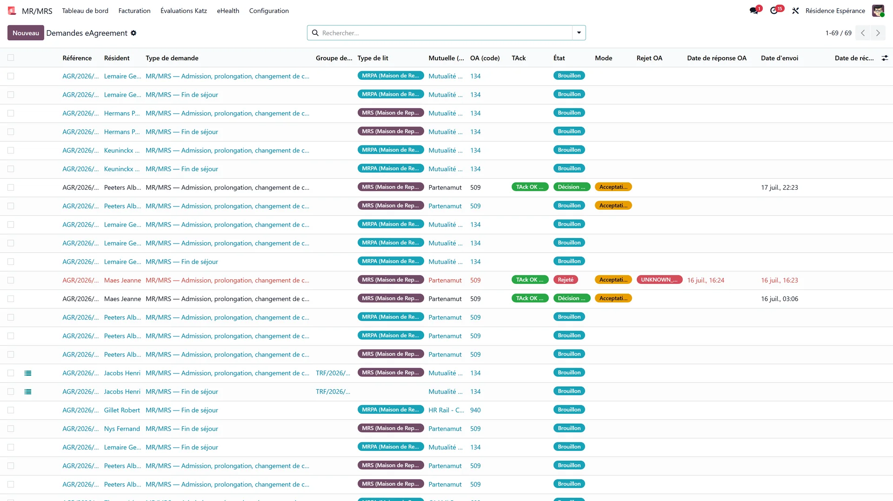
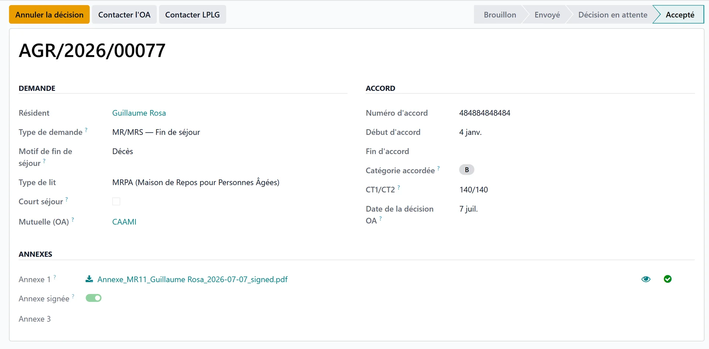

# Agreements (eAgreement)

:::{rh-description}
eAgreement and eAgreement Light for a nursing home (MR/MRS): request an agreement and notify the mutuality on admission, absence, departure and return.
:::

:::{rh-faq}
How do I make an agreement request (eAgreement) in WideCare?
: In most cases you don't have to create it by hand: WideCare automatically prepares the notification matching your business action — start a stay (admission agreement, Annexe 7), validate a Katz aggravation (care agreement update, Annexe 10), record an absence or a departure (departure notification, Annexe 11). Check that the resident has a valid NISS and mutuality and that the eHealth certificate is active, then send. You then follow the status: Draft → Sent → Accepted or Rejected.

Where do I see the status of an agreement or a request in WideCare?
: From the resident record or the billing period: you see the list of agreements and their status (Draft, Sent, Accepted, Rejected), with a link to the detail.

What is the difference between eAgreement and eAgreement Light?
: eAgreement is the care coverage agreement, linked to the Katz category and the allowance. eAgreement Light groups the simpler notifications related to the resident's movements (admission, absence, departure, return), which WideCare generates automatically as you go.

What should I do if an agreement request is rejected?
: WideCare displays the rejection reason in plain language (French and Dutch) directly on the agreement. Fix the cause — most often the NISS, the mutuality or the dates — then resend.
:::

When a resident is admitted, is absent, returns or leaves the facility, the
**mutuality (insurance organisation)** must be informed electronically. WideCare
takes care of it: at the right moment, it **automatically prepares** the eHealth
notification matching your action. Most of the time you have **nothing extra to
enter** — just to check and, if needed, to send.

:::{admonition} Two related concepts
:class: note

- **eAgreement**: the care coverage agreement (linked to the **Katz** category
  and the allowance).
- **eAgreement Light**: the simpler notifications related to the resident's
  **movements** — admission, absence, departure, return. These are the ones
  WideCare generates on its own as you go.
:::

## When does WideCare create an agreement?

You perform the usual business action; WideCare deduces the notification.

| Your action in WideCare | Notification prepared | Document |
|---|---|---|
| **Start a stay** (admission) | Admission agreement | Annexe 7 |
| **Record an absence** / hospitalisation | Departure notification | Annexe 11 |
| **Return** of the resident (end of absence) | Readmission | Annexe 7 |
| **Katz aggravation** validated | Care agreement update | Annexe 10 |
| **End of stay / death** | Departure notification | Annexe 11 |

:::{admonition} The principle, in one sentence
:class: tip

You manage the **resident** (admission, absence, return, departure); WideCare
manages the **eHealth** behind the scenes. The billing and agreement operations
you see appear are the automatic reflection of what you have just done.
:::

## What you need before sending

:::{admonition} To check
:class: warning

- The resident has a valid **NISS** (national number).
- Their **mutuality** is filled in.
- The facility's **eHealth certificate** is active.

Without a NISS, the agreement cannot be transmitted. You can still record the
movement (admission, absence…): WideCare notes it and invites you to complete
the NISS as soon as possible.
:::

## Checking the annexes (PDF preview)

Each annex attached to a request has a **preview** button (eye icon) next to it:
it opens the PDF in a new tab so you can check its content **before sending** —
no download needed.

Once the request has been sent, the **Preview sent annexes** button shows the
**merged PDF exactly as it was embedded in the message transmitted** to the
health insurer. This is the authoritative view of *what the insurer actually
received*: handy to confirm that every annex page really went out.

:::{admonition} Before or after sending
:class: tip

- **Eye icon next to an annex** — the *source* document, available from the
  Draft state onwards.
- **Preview sent annexes** — the *transmitted* document, available only once
  the request has been sent.
:::

## Following an agreement

Each agreement goes through clear **statuses**:

1. **Draft** — prepared by WideCare, not yet sent.
2. **Sent (platform)** — received by the platform, not yet proven to reach the
   mutuality.
3. **Awaiting the OA** — the mutuality's legal acknowledgement is back; its
   decision comes by post.
4. **Accepted** or **Refused** — the decision you record from the mutuality's
   letter (or a tacit agreement after 15 days).

Other outcomes: **Rejected** — the mutuality returned the request
electronically, with a **reason**, to correct and resend; **Transmitted** — an
end of stay, which is declared and never answered; **Cancelled**. See
[Following a request](eagreement-suivi.md) and
[Refused agreement](eagreement-refus.md).

From the resident record or the billing period, you see the list of agreements
and their status, with a link to the detail.

### Answers that arrive by post or e-mail

Not every fund answers electronically. Some send a **scanned letter** instead.
WideCare collects those in the **eAgreement inbox**, and reads what it can from
the incoming message:

- the **NISS**, when it appears in the subject or the file name;
- the fund's **reference**, when the pattern is recognisable;
- the **type of document** — Annexe 8 (acceptance) or 9 (refusal) for MR/MRS,
  Annexe 15 or 16 for short stays, or a **tacit agreement**.

The **PDF** stays attached to the entry. What the extraction finds is a
starting point, not a verdict: you confirm and attach it to the right request.

### In case of rejection

If the mutuality rejects a request, WideCare displays the **rejection reason in
plain language, in French and Dutch**, directly on the agreement. You immediately
know what to fix (often: NISS, mutuality, or dates) before resending.

## Useful special cases

- **Short absence**: an absence of more than **72 h** (or any
  **hospitalisation**) triggers the departure **Annexe 11**; the **return**
  generates the readmission **Annexe 7**. See [Absences and
  hospitalisations](../../facturation/absences.md).
- **Billing already closed**: if the invoice of the month concerned is **already
  posted** for this resident, WideCare **does not recreate** a duplicate
  agreement for this month — it protects consistency. Reset the invoice to draft
  (or issue a credit note) if you really must modify this month, then refresh.
- **Readmission after a long leave**: depending on the duration, the readmission
  may require a **new Katz evaluation** — WideCare flags it for you.
- **Day care centre**: a day care user has their own requests, **csj-in** with
  Annexe 14 when the stay starts and **csj-out** at the end of care. See
  [The day care agreement](../centre-de-jour/accord.md).

## Going further

- [Refused agreement (eAgreement) — causes and solutions](eagreement-refus.md)
- [Absences and hospitalisations](../../facturation/absences.md)
- [Departure and death](../../facturation/depart-deces.md)
- [eHealth overview](index.md)
