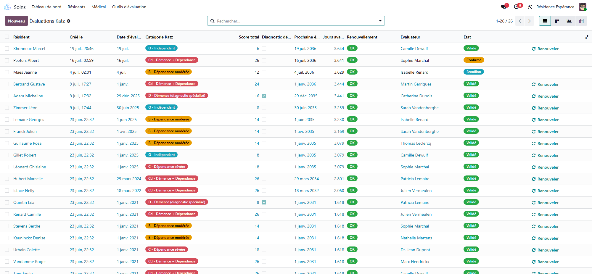
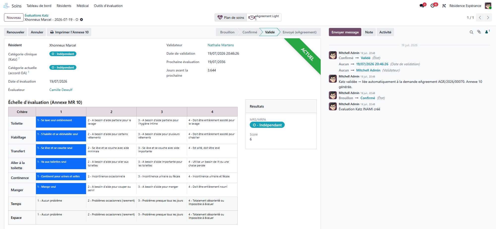
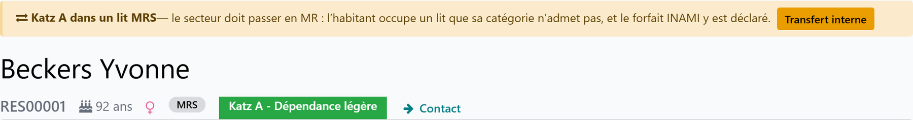
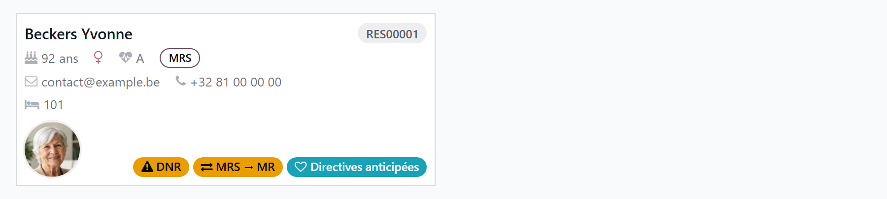
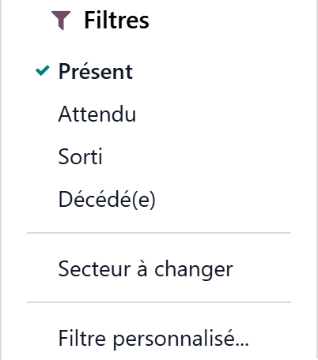

# The Katz assessment

:::{rh-description}
The Katz scale in a nursing home with WideCare: rate the criteria, sign and validate, read the category (O, A, B, C, Cd, D) declared for the INAMI dependency allowance, and renew it on time.
:::

:::{rh-faq}
How do I calculate a resident's Katz category?
: Rate the six activities of daily living (washing, dressing, transfer and mobility, going to the toilet, continence, eating) and the orientation in time and space from 1 to 4. WideCare derives the category (O, A, B, C, Cd, D), which is declared to the mutuality for the INAMI allowance.

Why can't I validate my assessment?
: An assessment is signed before it is validated. Click **Sign**, then **Validate**. Validating is reserved to a head nurse or a physician; a nurse can sign, and the assessment then waits for their validation.

What does category O mean?
: Category O corresponds to an independent resident. Under the AViQ tariffs, the dependency allowance is the same amount for every category, including O.

What happens if a resident has no validated Katz?
: They have no category at all: no INAMI allowance is billed for them and the billing period shows **No Katz** on their row. Validate their Katz, then regenerate the period.

How do I handle a worsening of dependency?
: Enter a new Katz assessment. When the category gets worse, the form asks for the reason; WideCare prepares Annexe 10 with it, and the new category is only billed once the mutuality agrees.
:::

The **Katz scale** measures a resident's degree of **dependency**. It decides
their care **category**, which is declared to the mutuality for the **INAMI
dependency allowance**. In WideCare, data entry is guided and the category is
computed for you.

The same list of assessments opens wherever you work:

- **Nursing Care → Evaluation Tools**, entry **Katz (INAMI)**;
- **Nursing Care → Care → Assessments → Katz Evaluations**;
- **Billing → Katz Evaluations**.

## The criteria

Each criterion is rated from **1** (no help) to **4** (fully dependent), each
level spelled out on the form:

1. **Washing**
2. **Dressing**
3. **Transferring**
4. **Toileting**
5. **Continence**
6. **Eating**
7. **Time Orientation**
8. **Space Orientation**

The two orientation criteria separate the categories with disorientation (Cd)
from the others; they are not required when a specialist has diagnosed
dementia. The **Dementia** and **Coma** blocks of the form record those
diagnoses.

From these ratings, WideCare computes the **category** and the **total score**
according to the regulations.

## The categories

| Category | Meaning |
|---|---|
| **O** | Independent |
| **A** | Mild dependency |
| **B** | Moderate dependency |
| **C** | Severe dependency |
| **Cd** | Severe dependency with disorientation |
| **D** | Dementia diagnosed by a specialist |
| **Ccoma** | Comatose patient (special federal allowance, see [Belgian settings](reglages.md)) |

:::{admonition} The allowance is the same for every category
:class: info

Under the **AViQ** tariffs, the amount of the dependency allowance is
**identical for every category**, including **O**. The category does not change
the amount: it declares the right profile to the mutuality (see [The INAMI
allowance](forfait-inami.md)).
:::

:::{admonition} No validated Katz, no category
:class: warning

A resident who has no **validated** Katz has **no category**. When the period
is generated, no INAMI allowance is billed for them, their row shows **No
Katz**, and the period's thread names them: validate their Katz, then
regenerate. The **Katz à faire** counter of the period lists them.
:::

## Entering an assessment

1. Open the resident's **Katz** smart button, or **New** in the Katz list.
2. Fill in the **Date**, the **Evaluator** and rate each criterion. If the
   assessment was done elsewhere (hospital, previous home), tick **Assessed
   elsewhere** and fill in **Assessed by** and **Institution**.
3. Click **Confirm**.
4. Click **Sign**: draw the signature, or tick **Use my saved signature** if
   your employee record carries one. **Save as my signature** keeps a drawing
   for the next assessments and for the eAgreement annexes.
5. Click **Validate**.

<!-- screenshot to update: the header now shows Sign before Validate on a confirmed assessment -->

The assessment then moves through **Draft → Confirmed → Validated → Sent
(eAgreement)**. A nurse can confirm and sign; **Validate** is reserved to a
**head nurse** or a **physician**, and a banner **Awaiting validation** says so
to everyone else. A **Current** ribbon marks the assessment in force; a
**Category Changed** ribbon marks one whose category differs from the previous
one.

**Print Annexe 10** prints the official grid at any time.

:::{admonition} What WideCare does for you
:class: tip

On validation, WideCare takes the category into billing and, when the category
changes, prepares the agreement request for the mutuality (Annexe 10). You
never re-enter the category anywhere else. See [Agreements
(eAgreement)](ehealth/eagreement.md).
:::

### Assessing a candidate before admission

On an admission request, the **Katz scale** block of the **Resident Admission**
tab offers **New Katz** and **Import a Katz** (an assessment done elsewhere).
The category is read in the sector the candidate asks for. See [Admitting a
resident in Belgium](admission.md).

## Renewal of the assessment

Each assessment carries a **Next Evaluation** date, and the list shows how many
days remain. The filters **Reassessment Overdue**, **Reassessment Due Soon (30
days)**, **No Katz** and **All Needs Attention** gather what to do; the last
one also lists the Katz assessments still in draft or confirmed, which
[Evaluations to validate](../soins/evaluations-a-valider.md) shows with the
other scales. To renew, click **Renew** on a validated assessment: a new draft
is created and the history is kept.

On the billing side, the dashboard counts the **Katz to assess** (no assessment,
or reassessment due).

## Worsening during the stay

If the resident's condition deteriorates, enter a **new assessment**. When the
category gets worse, the form asks for the **Aggravation Justification**:
WideCare carries it into the agreement update (**Annexe 10**), which the
clinician signs. The new category is billed once the mutuality agrees — see
[The INAMI dependency allowance](forfait-inami.md).

A readmission after a long hospital stay may require a **new assessment**:
WideCare prepares the draft and assigns an activity — see [Belgian
settings](reglages.md).

## When the category no longer matches the bed

An **MRS** bed only takes categories **B and above**. A resident assessed at
**O or A** belongs in an **MR** bed. WideCare refuses to **put or keep a stay in
MRS** for a resident assessed at O or A — at admission and at transfer time.
A **room change is not blocked**, though: the resident can still be moved from
one room to another while the banner below stays up.

When a new assessment comes out at A while the resident occupies an MRS bed,
WideCare says so instead of letting it pass. The banner appears **as soon as
you validate** the assessment, and stays on the resident's record until the
sector is changed:

The **Internal Transfer** button on the banner opens the transfer wizard with
the destination already set to MR — see
[Internal transfer (MR ↔ MRS)](ehealth/eagreement-transfert.md).

The same signal follows the resident everywhere they are listed. On the board,
the card carries an **MRS → MR** badge:

And the residents list has a **Sector to be changed** filter, to see everyone
waiting for a transfer in one go:

The other way round, the [occupancy board](occupation-mr-mrs.md) lists the MR
residents an MRS bed admits, when MRS beds are free.

:::{admonition} What this changes for billing
:class: warning

Until the transfer is done, the stay is still declared to the mutuality **in
MRS**, with a category that sector does not accept. The banner is a task, not
an informational note: the sooner the transfer is entered, the shorter the
period to correct.
:::

## Learn more

- [The INAMI dependency allowance](forfait-inami.md) — from category to billed amount.
- [The resident's file in Belgium](dossier-resident.md)
- [Responsible practitioner and annex signatures](ehealth/eagreement-signature.md)
- [Agreements (eAgreement)](ehealth/eagreement.md)
- [Geriatric assessments](../residents/evaluations.md) — the international scales beside Katz.
- [Billing](../facturation/index.md)
- [Management reports](rapports-gestion.md) — the KAPPA control documents.
- [Evaluations to validate](../soins/evaluations-a-valider.md)
