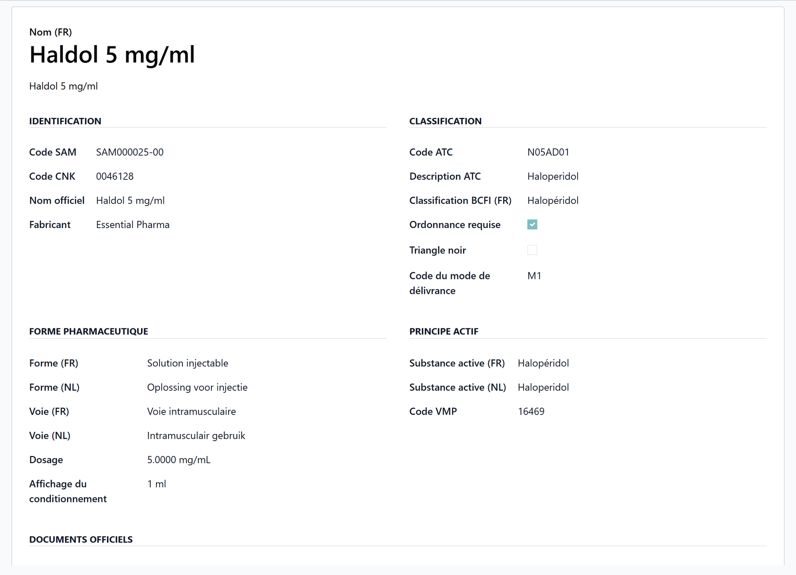
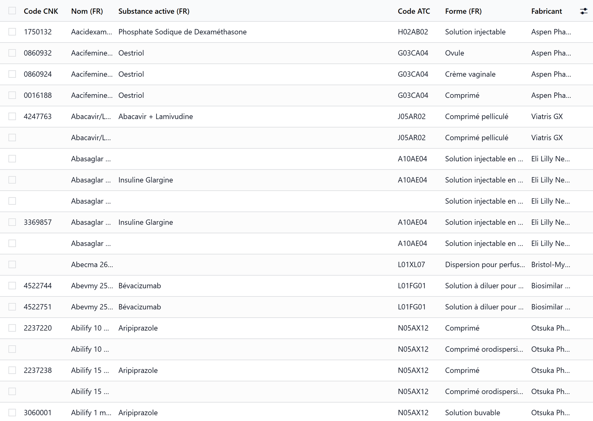

# The SAM medication database

:::{rh-description}
SAM, the Belgian authentic source of medicines, in WideCare: a new medicine made from its SAM package, the SAM tab of a medicine, the SAM database, the catalogue without CNK and the settings of the central service.
:::

:::{rh-faq}
What is SAM?
: SAM (Source Authentique des Médicaments) is the official Belgian medicines database, published by the FAMHP, the INAMI and eHealth. WideCare uses it to fill the house's medicine catalogue with reliable data: CNK code, active ingredient, ATC code, form, strength, manufacturer, official documents.

How do I add a medicine from SAM?
: In the catalogue, click **New** and type the name or the CNK in **Find the medicine in SAM**. Pick the package: the whole record fills itself. Or, in the SAM database, tick the packages and click **Add to Catalogue**.

How do I add a product SAM does not list?
: Tick **Not in SAM: Typed In** on the new record: the form opens empty, for a preparation or a food supplement.

Why can't I change the CNK or the active ingredient of a medicine?
: Because they come from the SAM package linked to the medicine. They stay read-only while a package is linked; pick another package, or tick **Not in SAM: Typed In**, to change them. The name, the category and the particulars of the intake remain the house's.

Does SAM tell me the contraindications or the allergens of a medicine?
: No. SAM gives the identity of the package and the links to the SmPC, the leaflet and the BCFI page. Indications, contraindications, side effects and allergens are what the house records on the medicine.

Where do I find the SAM database?
: On the Medicines workstation (**Nursing Care → Medicines**), **Catalogue** tab, **SAM Database**.
:::

**SAM** (Source Authentique des Médicaments, the authentic source of
medicines) is the official Belgian medicines database. In WideCare it is the
starting point of the house's [medicine catalogue](../medicaments/catalogue.md):
rather than typing a medicine in, you pick its **package** in SAM and the
record fills itself.

SAM installs itself with the Belgian pack and the Care app. It works on a
**local copy** of the SAM packages, searched by name and by CNK, available
without any connection. When the house is connected to the **central SAM
service**, the SAM data of each medicine (price, reimbursement, availability)
is also refreshed every night.

## Settings

In **Nursing Care → Configuration → Settings**, block **SAM medicines**:

- **Address and key** — where the central SAM service is and the key that
  opens it. **Test the connection**, **Synchronise now** and **Read everything
  next time** sit below. Only CNK codes leave the database, never resident
  data.
- **Tariff** — which SAM price and reimbursement to read: *Public pharmacy*
  (the usual answer, a resident staying an ambulatory patient of a public
  pharmacy), *Residential care*, *Hospital* or *Ambulatory*.

Without the central service, everything below works on the local copy, except
the **SAM** tab of a medicine.

## Add a medicine from SAM

1. Open the catalogue: on the Medicines workstation (**Nursing Care →
   Medicines**), **Catalogue** tab, **The Medicines**, then **New**.
2. In **Find the medicine in SAM**, type the name or the CNK (for example
   *dafalgan*).
3. Pick the package. The record fills itself: name, active ingredient, form,
   strength, category, CNK, ATC, manufacturer, prescription required, the
   narcotic, the glucose check of an insulin, what must not be crushed, and the
   links to the SmPC, the leaflet and the BCFI page.
4. Adjust what belongs to the house (the name, the category, the particulars
   of the intake), then save.

For a preparation, a food supplement or any product SAM does not list, tick
**Not in SAM: Typed In**: the form opens empty, to fill in by hand.

While a **SAM Package** is linked, the identity of the package — **CNK Code**,
**Active Ingredient**, **Form**, **Strength**, **Manufacturer**, **Prescription
Required**, the SmPC, leaflet and BCFI links — is read-only. Pick another
package to change it.

<!-- screenshot to add: new medicine record with the Find the medicine in SAM field -->

## What the medicine record shows from SAM

Next to the name, badges show what the SAM obligations want seen at a glance:
**▼ Additional monitoring** (the black triangle), **RMA**, **Narcotic**,
**Specially regulated**, **INN prescription required**, **Chapter IV**,
**Chapter VIII**, **Cheap**, **Orphan drug**. Banners above the name announce a
**supply problem declared to the FAMHP** (with its expected end), a medicine
**no longer commercialised**, and the **RMA key messages**.

For a medicine synchronised with the central service, the **SAM** tab holds:

| Group | What it shows |
| --- | --- |
| **Identity** | SAM name, pack size, SAM status, CTI-extended. |
| **Price and reimbursement** | Delivery environment, SAM public price, reimbursable or not, reimbursement category, patient fee (ordinary and preferential). |
| **Availability** | Commercialised, end of commercialisation, supply problem and its end. |
| **Synchronisation** | Last synchronisation, **Unknown to SAM**; **Search SAM** and **Refresh from SAM**. |
| **Regulatory information** | Delivery conditions, special regulation, INN prescription, black triangle, reimbursement chapters, cheap, orphan drug. |
| **Documents** | RMA material for professionals and for patients, DHPC, the link to report an adverse reaction. |

In the catalogue list, a medicine with a supply problem is shown in orange and
one no longer commercialised is greyed out. Filters: **Supply problem**, **No
longer commercialised**, **Without CNK**, **Unknown to SAM**, **Additional
monitoring ▼**, **Narcotics**, **Chapter IV**, **With CNK**.

## The SAM database

On the Medicines workstation, **Catalogue** tab, **SAM Database** opens the
local copy of SAM, read-only. The list shows the CNK code, the name, the active
ingredient, the ATC code, the form, the manufacturer and whether the package is
already **in the catalogue**.

- **Search** by name or CNK.
- **Filters**: **Prescription Required**, **Black Triangle**, **With CNK**;
  groupings by **ATC Code**, **Form** and **Manufacturer**.
- A record details the identification (CNK, official name, manufacturer), the
  classification (ATC code and description, BCFI class, prescription required,
  black triangle, delivery mode), the pharmaceutical form and route (FR and NL),
  the active ingredient, and the official documents (SmPC and leaflet in French
  and Dutch, BCFI page).

Tick one or more packages and click **Add to Catalogue**: each becomes a
medicine of the catalogue, filled from SAM.

## Search SAM for a medicine already kept

On a medicine's **SAM** tab, **Search SAM** (medication manager) opens the
search window, pre-filled with the medicine's name:

1. Choose **By Name** or **By CNK Code**, type the term and click **Search
   SAM**. The search ignores accents and accepts several words (*Amlodipine
   5mg*).
2. The results show, per package, the CNK, the black triangle, the name, the
   active ingredient, the strength, the form, the price, *cheap*, *off market*
   and *narcotic*, and in optional columns the manufacturer, the ATC code, the
   BCFI class and the SmPC and leaflet links. **In Catalog** says whether the
   package is already in the catalogue.
3. Toggle **Select** on the right package, then **Update Medication** (or
   **Import Selected** to add packages to the catalogue). **Search Again**
   starts over.

A package whose CNK is already in the catalogue **updates** that medicine,
which keeps the name the house gave it, instead of creating a second one.

**Refresh from SAM** reads the SAM data of a medicine again from its CNK.

## The catalogue without CNK

A medicine without a CNK code cannot be found by a pharmacy. The Medicines
workstation shows a **Without CNK** smart button, and **Catalogue Without CNK**
in its **Catalogue** tab, as long as such medicines remain. Link each one to
its SAM package, or tick **Not in SAM: Typed In** for a product SAM does not
list.

## Key takeaways

- SAM is the **official Belgian medicines database**, the starting point of the
  catalogue.
- **New** in the catalogue starts with one search in SAM; the package fills the
  record and keeps its identity read-only.
- The **SAM Database** door of the workstation lists the packages; **Add to
  Catalogue** imports them.
- With the **central service**, the SAM tab shows price, reimbursement,
  availability and regulatory information, refreshed every night.
- SAM carries **no clinical text**: indications, contraindications and
  allergens are the house's to record.

## Further reading

- [The medicine catalogue](../medicaments/catalogue.md)
- [Medication rules in Belgium](medicaments-regles.md)
- [The pharmacy link](medicaments-lien-pharmacie.md)
- [Care in Belgium](soins.md)
