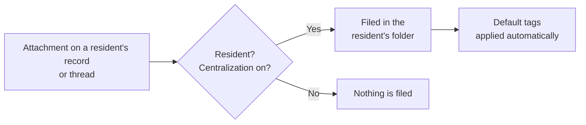
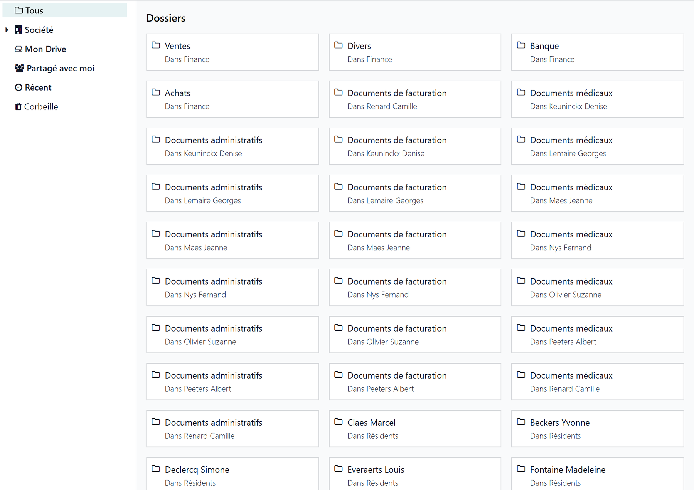

# Automatic centralization of attachments

:::{rh-description}
In a nursing home, every attachment added to a resident's record or message thread is automatically filed in their Documents folder, with its default tags.
:::

:::{rh-faq}
What is automatic centralization of attachments?
: Every file attached to a resident's discussion thread or record is automatically filed in that resident's folder in the Documents app, with the facility's default tags. You find all their files in one place, with no manual filing.

Which documents are centralized, and which are not?
: Only attachments on resident records. Files added to an ordinary contact, a vendor or an employee are not: centralization applies only to people marked as residents.

Where exactly do centralized documents end up?
: In the resident's own folder, under the **Residents** folder of the Documents app. The **Document Workspace** tile of the record's **Documents** tab opens it; its counter includes the files in the subfolders.

Can I turn off automatic centralization?
: Yes, in **Settings → Documents**: untick **Nursing Home** (Odoo's Documents app) or **Resident Documents** (open-source Documents app). Documents already filed stay in place. It is on by default.

Who can see the centralized documents?
: Those who may open the resident's folder. The documents have no individual owner: they follow the folder's rights, which keeps the resident folder consistent.
:::

In a nursing home, a single resident accumulates dozens of files: stay
agreement, medical forms, insurance statements, GDPR consents… Without filing,
they end up scattered across discussion threads. **Automatic centralization**
solves this: **every attachment added to a resident's record or discussion
thread is filed in their folder** in the **Documents** app, with the **default
tags** applied.

You have nothing to do: filing is **automatic** and **on by default**.

:::{admonition} Prerequisites
:class: info

Centralization needs the **Documents** app — Odoo's own or the open-source one,
depending on your installation. The **Residents** folder and each resident's
folder are created automatically.
:::

## How it works

As soon as a file is attached to a resident — **on a message of the discussion
thread** or **directly on their record** — WideCare files it in that resident's
folder.

Three conditions trigger the filing:

- the record is that of a **resident** (a person marked as a resident);
- **centralization** is **on** for the facility;
- the **Documents** app is installed.

If one is missing, the attachment simply stays on the message or the record.

:::{admonition} What is NOT centralized
:class: note

Centralization concerns **residents only**. Attachments added to an **ordinary
contact**, a **vendor** or an **employee** are not filed in a resident folder.
:::

## Where documents end up

Every centralized document is filed in the **resident's folder**, under the
**Residents** folder. That folder, created with the resident, holds three
subfolders — **Medical documents**, **Administrative documents**, **Billing
documents** — where you can move a document to sort it.

:::{admonition} From the resident's record
:class: tip

On the resident's record, **Documents** tab, the **Document Workspace** tile
opens their folder directly. Its counter includes the files of the subfolders.
With the open-source Documents app, the shortcut is the **Documents** button at
the top of the record.
:::

## Default tags

With Odoo's Documents app, WideCare applies the facility's **default tags** to
every centralized document. They let you **filter** and **find** documents
quickly. The predefined tags
(**Medical form**, **Stay agreement**, **Billing**, **GDPR consent**, **End of
stay**, and those that follow the country's rules) are listed on
[Resident documents](index.md).

:::{admonition} Start light
:class: tip

**Default Tags** is **optional**. Leave it **empty** to start, or put a single
generic tag in it: you can always tag each document more precisely afterwards.
:::

## Who can see the documents

Centralized documents **follow the rights of the resident's folder**. They have
no individual owner, which prevents a file from "belonging" to a single staff
member and keeps the whole resident folder consistent.

:::{admonition} Separated by facility
:class: note

In multi-company, **each facility has its own Residents folder** and its own
centralization settings. A resident's documents stay within their company.
:::

## Settings

The settings are per facility, in **Settings → Documents**.

With Odoo's Documents app, under **File centralization**:

- **Nursing Home** — on by default; unticking it stops the filing of **future**
  attachments. Documents already filed **stay in place**, nothing is deleted or
  moved.
- **Root Folder** — the folder that holds the resident folders (**Residents**
  by default).
- **Default Tags** — the tags applied to every centralized document.

With the open-source Documents app, under **Nursing Home**:

- **Resident Documents** — on by default: each resident gets their folder,
  where the files attached to them are filed. Unticked, new residents no longer
  get one; existing folders stay as they are.
- **Root Folder** — the **Residents** folder.
- **Blank Forms** — the folder for your templates.
- **Default Tags** — the tags kept for resident documents. With the
  open-source app, they are not applied by themselves: tag each document in
  the Documents app.

The settings are described with the other configuration screens on the
[Document settings](../configuration/reglages-documents.md) page.

## Key takeaways

- Every attachment added to a resident's **discussion thread** or **record** is
  **filed automatically** in their folder.
- Filing concerns **residents only** — not contacts, vendors or employees.
- With Odoo's Documents app, the facility's **default tags** are applied to
  every centralized document.
- The **Documents** tab of the record opens the folder directly.
- Centralization is **on by default**; turning it off leaves the documents
  already filed in place.
- The settings and folders are **specific to each facility**.

## Further reading

- [Resident documents](index.md)
- [Document settings](../configuration/reglages-documents.md)
- [Managing a resident](../residents/gerer-un-resident.md)
