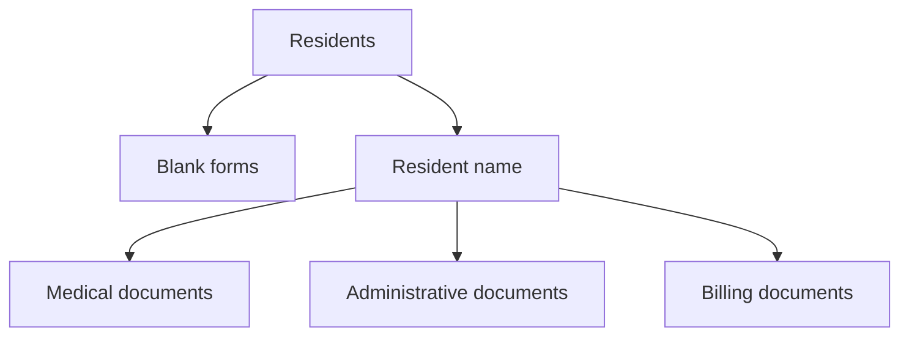
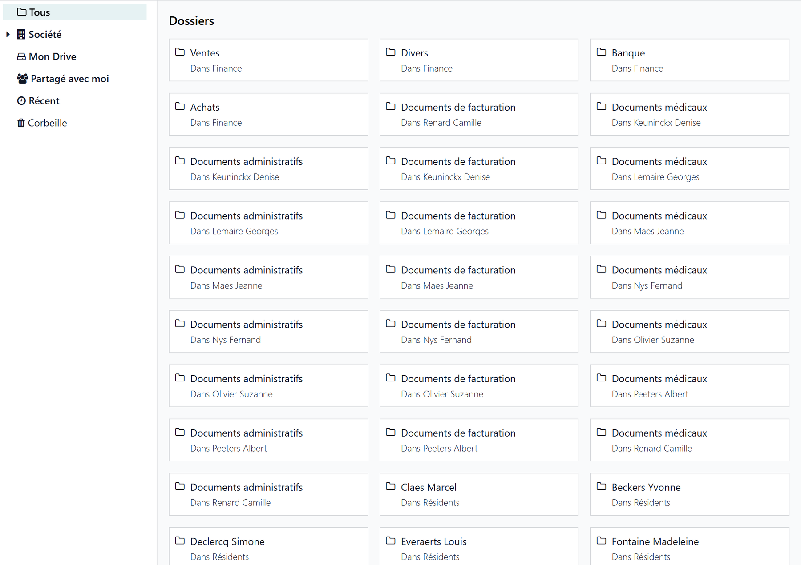

# Resident documents

:::{rh-description}
The document folder of every nursing home resident: the Documents tab of the record, the automatic folder and subfolders, the predefined tags.
:::

:::{toctree}
:hidden:

centralisation
:::

:::{rh-faq}
Where is a resident's document folder?
: In the **Documents** app, under the **Residents** folder. The quickest way: open the resident's record, **Documents** tab, and click **Document Workspace** — or, depending on your installation, the **Documents** button at the top of the record.

Do I have to create the folder and subfolders myself?
: No. Resthome creates the resident's folder and its three subfolders (medical, administrative and billing documents) automatically, as soon as the resident is created or their record becomes a resident record.

What does the number on the shortcut count?
: The files stored in the resident's folder, subfolders included. The subfolders themselves are not counted.

Can I delete a resident folder by mistake?
: With Odoo's Documents app, no: the folders Resthome creates belong to no one in particular and an ordinary user can open them but not delete or rename them. The resident's folder renames itself when the resident's name changes.

Is this what the family sees?
: No. The resident's folder stays with the team. What the family sees is chosen document by document, in the family portal's shared documents.

Does each facility have its own folders?
: Yes. In multi-company, each facility has its own **Residents** and **Blank forms** folders, which keeps documents separated per home.
:::

For **each resident**, Resthome keeps a **document folder** in the **Documents**
app: scans, signed agreements, letters received. You have nothing to create or
file by hand: the folder, its subfolders and the filing of attachments are
automatic.

:::{admonition} Prerequisite
:class: info

This page needs the **Documents** app. Depending on your installation, it is
Odoo's own Documents app or the open-source Documents app; Resthome builds the
same resident folders in both, and a few screens differ — they are pointed out
below. Once installed, the resident folders and tags are set up automatically.
:::

## The Documents tab of the resident's record

The resident's record has a **Documents** tab: *everything printed or opened
for this resident, in one place*. Each tile opens or prints one document — the
medical record, the medication sheet, the invoices, the residence certificate…
depending on the apps installed.

The **Document Workspace** tile opens the resident's folder in the Documents
app. It shows how many files the folder holds — *Scans, signed agreements,
letters received* — subfolders included. It only appears for users who have
access to the Documents app.

<!-- screenshot to add: resident record, Documents tab, with the Document Workspace tile and its counter -->

:::{admonition} With the open-source Documents app
:class: note

The shortcut is a **Documents** button at the top of the resident's record,
with the same counter. It opens the resident's files, in a view that shows the
folder and its subfolders; an **eye** icon on each card previews the file
without opening it.
:::

## One folder per resident, created automatically

As soon as a resident is created (or as soon as their record becomes a resident
record), Resthome creates their **personal folder** under the **Residents**
folder, with **three subfolders**:

| Subfolder | What goes in it |
|---|---|
| **Medical documents** | The resident's assessments, forms and medical items. |
| **Administrative documents** | Stay agreement, ID documents, agreements, letters. |
| **Billing documents** | Invoices and items related to the resident's billing. |

The folder carries the **resident's name** and **renames itself** when the name
changes. Folders are **sorted alphabetically**. Two residents with the same
name each get their own folder.

:::{admonition} Protected folders
:class: note

The resident's folder belongs to no individual staff member. With Odoo's
Documents app, the team can open it, but an ordinary user cannot delete or
rename it. This keeps you from losing a resident's whole document structure by
accident.
:::

## Folders created for the facility

When the company (the facility) is created, Resthome sets up two folders in the
Documents app:

- **Residents** — the folder that contains all resident folders.
- **Blank forms** — your **templates** and documents to fill in (standard
  agreements, blank medical forms…).

With Odoo's Documents app, **Blank forms** sits inside **Residents**; with the
open-source Documents app, both are top-level folders side by side.

:::{admonition} Separated by facility
:class: note

In multi-company, **each facility has its own** **Residents** and **Blank
forms** folders. Documents stay separated from one home to another.
:::

## Predefined tags

Resthome provides ready-to-use **tags** to **categorise** documents and **find
them by filter**:

| Tag | Typical use |
|---|---|
| **Medical form** | Medical forms and documents. |
| **Stay agreement** | The agreement signed with the resident. |
| **Billing** | Invoices and billing items. |
| **GDPR consent** | Consents and privacy-related documents. |
| **End of stay** | Departure or death documents. |

The other predefined tags are for documents that follow the country's rules:
the dependency assessment, the agreements and decisions of the health insurer,
and the coverage granted by a public welfare body.

:::{admonition} In Belgium
:class: rh-country rh-country-be

These tags are **Katz evaluation**, **MR/MRS agreement (eAgreement)**, **OA
allocation** and **CPAS**. See [Care in Belgium](../belgique/soins.md).
:::

:::{admonition} Apply tags automatically
:class: tip

With Odoo's Documents app, one or more of these tags can be applied
**automatically** to every centralized document, with the **Default Tags**
setting. See
[Automatic centralization of attachments](centralisation.md).
:::

## Automatic filing of attachments

A file attached to a resident's record or discussion thread lands in their
folder by itself, with the default tags. See
[Automatic centralization of attachments](centralisation.md).

## Not to be confused with the family's documents

The resident's folder is the team's. To hand a document to the family, add it
to the resident's **family space**, where its category decides which relatives
see it: see [Notebook, documents and invoices](../portail-famille/carnet-documents.md).

## Key points to remember

- Each resident has an **automatic folder** with three subfolders:
  **medical**, **administrative**, **billing**.
- The **Documents** tab of the record opens it, with a counter that includes
  the subfolders.
- The folder follows the **resident's name** and belongs to no individual
  staff member.
- Each facility has its own **Residents** and **Blank forms** folders.
- Predefined **tags** make filtering easier.

## Further reading

- [Automatic centralization of attachments](centralisation.md)
- [Managing a resident](../residents/gerer-un-resident.md)
- [Document settings](../configuration/reglages-documents.md)
- [FAQ](../faq.md) · [Glossary](../glossaire.md)
