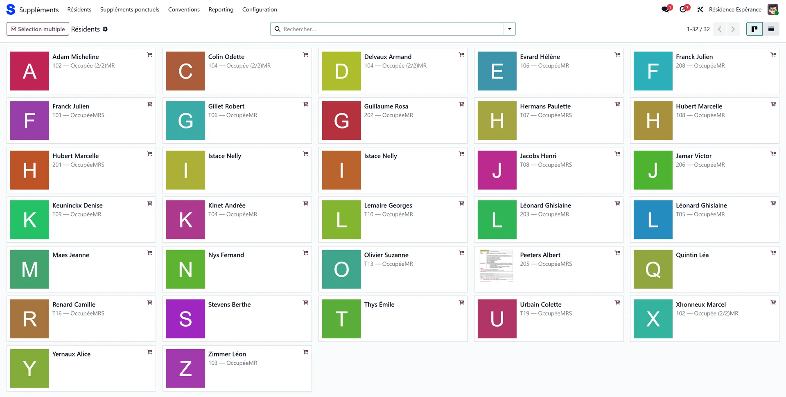
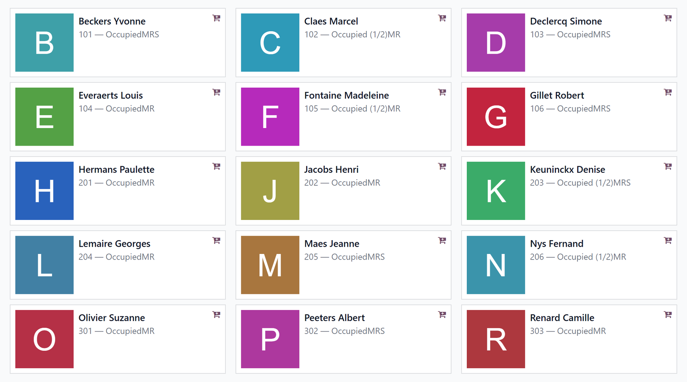
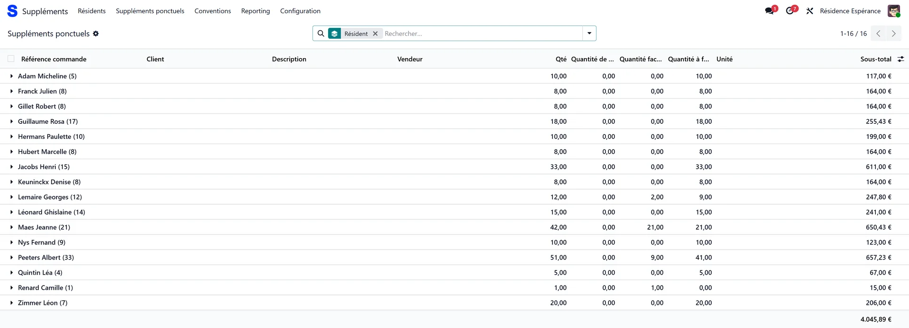
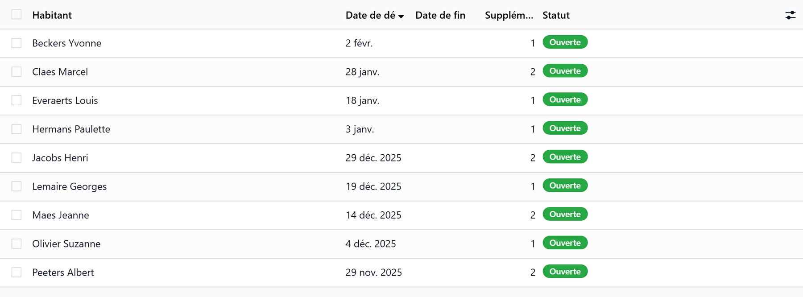
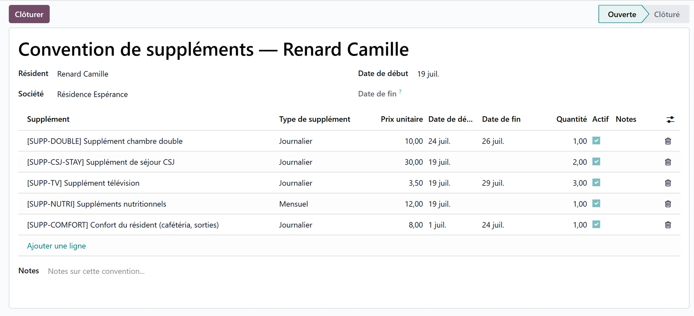
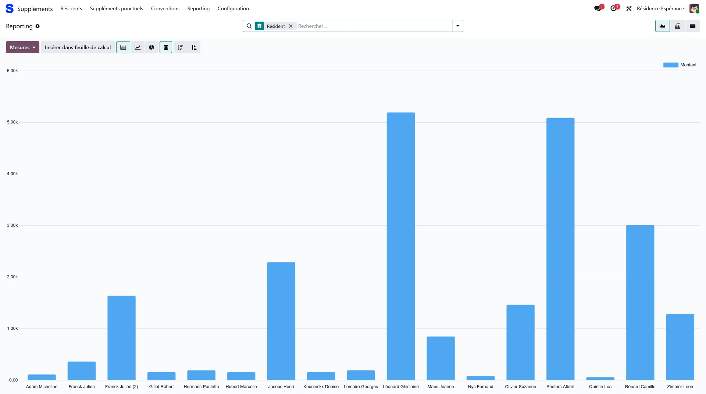

# The Supplements app

:::{rh-description}
The Supplements app of a care home: multi-resident entry via the catalog, one-time or recurring supplements, conventions, catalog and reporting.
:::

:::{rh-faq}
What is the Supplements app for in a care home?
: It is the screen dedicated to entering supplements: opening a resident's catalog, adding supplements to several residents at once, managing recurring conventions, maintaining the supplements catalog and tracking billed amounts.

How do I add a supplement to several residents at once?
: On the Residents screen, select several residents (Ctrl+click on a computer, long press on a tablet, or the "Multiple selection" button), then click "Supplements (N)". A single catalog opens and every added supplement is applied to the open envelope of each selected resident.

What is the difference between a one-time supplement and a convention?
: A one-time supplement is billed once on the month's envelope (hairdresser, drink…). A convention groups the resident's recurring supplements (single room, TV, phone): it lives on the resident and survives a room change or a transfer.

Where do I define the list of supplements and their prices?
: In Configuration → Catalogue. Each supplement has a supplement type (monthly, one-time, daily on accommodation days or daily on presence days) and a price specific to the facility.

Which residents does the app list?
: Those who can be charged now: residents whose stay has started, and residents who left while the month of their departure is not invoiced yet.

Can I track the supplements billed per resident or per month?
: Yes, via the Reporting menu: graph, pivot table and list views break down the billed supplements per resident, per product and per month.
:::

The **Supplements** app is the screen dedicated to entering and managing
residents' supplements. It brings together in one place what would otherwise
be split between the resident record and the billing period: opening a
resident's catalog, adding supplements to several residents at once, managing
recurring conventions, maintaining the catalog and tracking billed amounts.

You will find it in the **main menu → Supplements app**. When the Meals app is
installed too, a **Supplements** entry in the Meals menu opens the same screen.

:::{admonition} This page complements "Supplements"
:class: info

The basic concepts — the **supplements envelope** per resident and per month,
the **automatic synchronization** of the invoice, the protection when a month
is already posted — are explained in
[Supplements](supplements.md). This page describes the **dedicated
app** and its entry shortcuts. The app does not create any parallel
data: it acts on the same envelopes and the same conventions.
:::

<!-- screenshot to update: the Residents screen now uses the shared resident card and has a Presence / Sector side panel -->

## The Residents screen (the starting point)

On opening, the app displays the **Residents** screen, in **kanban view**
(cards) or **list view**. It lists the residents who can be charged now: those
whose stay has started, and those who left while the month of their departure
is not invoiced yet. Each card is the usual resident card (photo, name, room,
sector, presence badges), with a basket icon "Add supplements".

- **Click a resident**: WideCare directly opens the **catalog** of their
  supplements envelope for the current month. You land on the entry
  grid, without going through the record.
- In **list view**, each row shows the resident's **Open envelope** and an
  **Add supplements** button; the header has an **Add via catalog** button to
  act on the checked residents.

:::{admonition} Filter and group
:class: tip

The side panel filters by **Presence** (in the house, in hospital, on leave…)
and by **Sector**. The search bar groups by **Room** or **Sector**, and the
**Departed, last month still open** filter finds the residents who left but
can still be charged for their last month.
:::

:::{admonition} In Belgium
:class: rh-country rh-country-be

The sector is **MR** or **MRS**, and the search bar offers **MR** / **MRS**
filters. See [Billing a month in Belgium](../belgique/facturation.md).
:::

## Adding supplements to several residents

This is the app's central shortcut: applying the same supplement to
several residents without reopening each record.

1. On the **Residents** screen, **select several residents**:
   - **Ctrl+click** (or Cmd+click) on a computer adds/removes a resident;
     **Shift+click** extends the selection to a range;
   - **long press** on a touch tablet;
   - or enable the **Multiple selection** button, which selects on a single
     click.
2. Click the **Supplements (N)** button that appears (N = number of selected
   residents). In list view, use **Add via catalog**.
3. **A single catalog** opens. Each supplement you add, modify
   or remove there is **applied to the open envelope of each selected
   resident**, for the current month.

In this shared catalog, the left panel shows a
**Residents** section: the residents concerned appear as tags, with their
number. The **Add** link lets you add more on the fly; removing a tag takes out
the resident (the last one cannot be removed). The quantities on the cards are
the supplements already recorded for this month: **+** adds one, **−** takes
one off. Each change is confirmed by a notification with an **Undo** link.

:::{admonition} A supplement already covered by a convention is skipped
:class: note

If one of the selected residents already has this product in an **active
convention**, the line is **not** added for them (it would be discarded
at billing anyway) — the other residents receive it normally.
For entry on a single resident, WideCare blocks the addition outright and
prompts you to go through the convention.
:::

## One-time and recurring supplements

The app distinguishes the two kinds of supplements already presented in
[Supplements](supplements.md).

- **One-time** — added to the month's envelope via the catalog (hairdresser,
  pedicure, drink, phone…). The **One-time supplements** menu gives the
  **list**, with the resident, the period, the supplement, the quantity and the
  price, and the **Vendor bill** it was recharged from, if any. Group it by
  resident, period, supplement or vendor bill; the **Recharged from a vendor
  bill** filter isolates the [recharges](refacturation-fournisseur.md). This
  is the place to review everything entered over the month.
- **Recurring** — renewed each month via a **convention** (see the next
  section).

<!-- screenshot to update: menu renamed One-time supplements, new Vendor bill column -->

:::{admonition} Where did my supplement go?
:class: tip

On each addition, WideCare shows a notification indicating **which
period(s)** the supplement was billed on — or warns you that **no open
period** yet matches its date (it will then only be billed once the
relevant month is generated). Check the **start date** if the
supplement does not appear where you expected.
:::

## Supplement conventions

A **convention** groups a resident's **recurring** supplements (single
room, TV, phone…). It lives on the **resident**, not on the stay:
it **survives** a room change or a transfer between sectors.
Each resident has **one single** convention, which gathers all their
recurring lines; starting a second one shows a warning with a link to the
existing one.

In the app, the **Conventions** menu lists the recurring supplement
lines (resident, convention, product, supplement type, unit price, dates,
quantity, active). The convention itself — with its status and its buttons — is
managed from **Billing → Facturation → Supplement Conventions**, or from the
**Supplements** smart button on the resident's record.

On the convention:

| Element | Role |
|---|---|
| **Status** | **Open** or **Closed** (at the top of the record). |
| **Close** button | Asks for an **end date** and stops billing each line beyond it. |
| **Reopen** button | Clears the end date and reopens the lines it had capped. |
| **Lines** | Product, supplement type, **Negotiated price**, unit price, start date, end date, quantity, active, notes. Greyed lines are no longer billed. |

A line follows the official price, including its yearly
[indexation](indexation-des-prix.md), unless **Negotiated price** is ticked:
the **Unit Price** typed on the line is then charged.

<!-- screenshot to update: the convention lines now carry a Negotiated price column -->

:::{admonition} A product under a convention cannot be entered as one-time
:class: warning

As long as a product is covered by an **active convention**, it cannot be
added as a one-time supplement for the same resident. Add it **to
the convention**, or **close** that convention first.
:::

## The supplements catalog

The **Configuration → Catalogue** menu holds the list of billable
**Supplement Types** (the same list as **Billing → Configuration → Supplement
Types**). Each supplement has:

| Field | Description |
|---|---|
| **Reference** | Internal code of the supplement. |
| **Name** | Label shown in the catalog. |
| **Supplement Type** | **Monthly**, **One-time**, **Daily — accommodation days** (billed even during an absence) or **Daily — presence days** (not billed during an absence). |
| **Price** | Unit amount — **value specific to the facility**. |

The search bar filters the catalog by supplement type.

:::{admonition} In Belgium
:class: rh-country rh-country-be

The catalog carries an **AViQ code** field — the declaration pseudo-code of the
supplement. Depending on its product category, a supplement is either declared
to the mutuality in the eFact (ET50 record) or billed only on the resident's
invoice. See [Billing a month in Belgium](../belgique/facturation.md).
:::

## Reporting

The **Reporting** menu opens an analysis view of **billed** supplements:

- a **graph** of amounts per product;
- a **pivot table** (residents × months);
- a detailed **list** of supplement lines.

You can filter between **One-time** and **Convention** supplements, and
group by **Resident**, **Supplement** or **Month**.

:::{admonition} After generation only
:class: note

Supplements only appear in the reporting once the **billing period is
generated** for the relevant month.
:::

## Key points to remember

- The **Supplements** app is a dedicated entry screen; it acts on the
  **same envelopes and conventions** as billing — no duplicate data.
- The **Residents** screen is the starting point: click a resident to open
  their catalog, or **select several** (Ctrl+click / long press /
  **Multiple selection**) then **Supplements (N)** to serve them all at once.
- **One-time** = once on the envelope; **convention** = recurring, on the
  resident, surviving stay changes.
- A product under an **active convention** cannot be entered as one-time.
- The **catalog** carries the type and the price (value specific to the
  facility); the **reporting** tracks amounts per resident, product and month.

## Further reading

- [Supplements](supplements.md)
- [Recharging a vendor bill](refacturation-fournisseur.md)
- [Billing a month, step by step](facturer-un-mois.md)
- [Billing overview](index.md)
- [Billing settings](../configuration/reglages-facturation.md)
