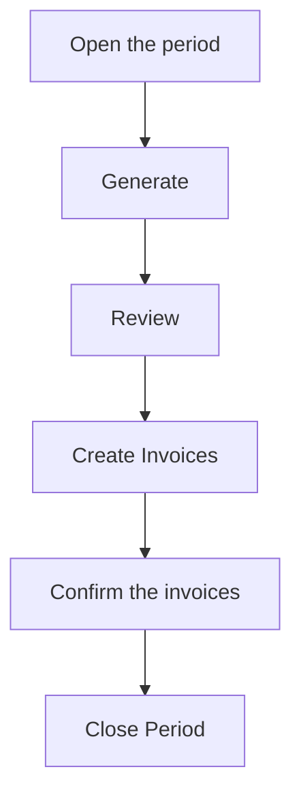

# Billing a month, step by step

:::{rh-description}
Billing a month in a care home with Resthome, step by step: from opening the period to closing it once the invoices are confirmed.
:::

:::{rh-faq}
How do I bill a month in Resthome?
: Open the month's period, click Generate, review the result, click Create Invoices, check and confirm the invoices, then close the period.

In what order should I bill?
: Always: Generate → review → Create Invoices → confirm the invoices → Close Period. On the period, the next step is always the leftmost button, highlighted.

Can I make corrections after billing?
: Yes. A change that reaches a resident whose invoice is already posted shows a "Corrections pending" banner on the period: click Refresh to create the supplementary invoice or credit note. Other residents are not affected.

Why can't I create the invoices?
: Either a resident's row is yellow (their invoice type for the month must be applied first), or the period is not generated yet. The message names the residents to open.

Can I start the month again from scratch?
: Yes, with Reset to Draft: it clears the lines, the residents and the draft invoices. Residents whose invoice is already posted are kept untouched.
:::

This guide walks you **from start to finish** through a billing month: open the
period, generate the billing, create and confirm the invoices, then close the
month. Follow it with Resthome open alongside: each step tells you **where to
click**.

:::{admonition} The idea in two parts
:class: tip

Each month can be billed in **two flows**:

- the **resident's share** — accommodation, supplements and supplement
  conventions, medication, adjusted for absences → standard invoices, the
  subject of this page;
- the **insurer's share** (the care allowance paid by the health insurer), where
  the country pack bills one → sent to the health insurers according to the
  country's rules.

Resthome runs them in parallel on a single **period**.
:::

:::{admonition} A guided tour
:class: tip

When guided tours are turned on in the
[general settings](../configuration/reglages-generaux.md), the **Monthly
billing** tour walks you through these steps on screen, from the **?** menu at
the top.
:::

:::{admonition} In Belgium
:class: rh-country rh-country-be

The insurer's share is the INAMI allowance: between **Generate** and **Create
Invoices**, the period adds a **Check MDA** step (insurability) and a
**Generate eFact** step; the batches are then sent and followed up in the eFact
Cockpit before the close. See
[Billing a month in Belgium](../belgique/facturation.md).
:::

## Step 1 — Open the month's period

1. Open the **Billing** app.
2. Go to **Facturation → Billing Periods**.
3. Open the month's period. To create it, click **New** in the list, or use the
   **+** button of the [billing dashboard](tableau-de-bord.md) and choose
   **Billing period**.

The list shows, for each month, a **To do** column: the step it is waiting for.
The months that need something are in bold.

On the period, the **status** is at the top (Draft → Generated → Invoiced →
Closed). The button for the next step is always the **leftmost** one,
highlighted.

## Step 2 — Generate the billing lines

1. Click **Generate**. The **Generate Billing** window opens.
2. Leave **Residents** empty to bill all active residents (or pick one
   resident for a specific case), then click **Generate**.
3. For each resident, Resthome computes the **accommodation**, the
   **supplements** and **supplement conventions** and the **medication**,
   applies the **absences**, and adds the **care allowance** where the country
   pack bills one.

The period becomes **Generated**.

:::{admonition} A resident without an active stay
:class: warning

If some residents have no active stay covering the month, generation stops and
a **Missing active stay** window lists them. Click **Open stay** or **Create
stay** on a row to fix it, then click **Generate** again. You can also leave
those residents out of the selection.
:::

:::{admonition} Advance billing
:class: note

For residents billed in advance, accommodation is billed **one month ahead**;
the care allowance and supplements for the month served. See
[Invoice type: in advance or in arrears](type-de-facture.md).
:::

## Step 3 — Review the result

Before invoicing, read what was generated:

- the **Residents** tab — one row per resident, with their invoice type for the
  month, the room, the stay type, who the invoice goes to, the presence and
  absence days and the amounts;
- the **Billing Lines** tab — the detail, line by line, with the payer;
- the smart buttons at the top — **Absences** (the absences that reduced the
  presence days) and **Unbilled** (the residents absent for the whole month,
  not billed at all);
- the **Info** tab and the messages Resthome posts in the period's thread.

<!-- screenshot to add: the Residents tab of a generated period, with one yellow row -->

### The detail of a resident

Click a resident in the **Residents** tab to open their **Resident Billing**
detail, across the whole width of the screen:

- **Resident Info** — the stay, the stay type, the room, the **Stay Days**,
  **Presence Days** and **Absence Days**, **Invoice To**, and the **Invoice
  Type (this period)**;
- **Totals** — **Accommodation**, **Supplements**, **Resident Part** and
  **Total**;
- the **Billing Lines** tab — the month's lines, with a **Calc.** column that
  explains each quantity;
- the **Lines** and **Absences** smart buttons.

The lines are **read-only**: every refresh rebuilds them from the stays, the
absences and the supplements. To change a price, edit the resident's supplement
convention (**Negotiated price**) or add a one-time supplement.

:::{admonition} A yellow row
:class: warning

A yellow row means the resident's invoice type for this month changed after
the lines were built. Open it and click **Apply the Invoice Type**: until then,
the period refuses to create their invoices. See
[Invoice type: in advance or in arrears](type-de-facture.md).
:::

A mistake is cheaper to fix now: correct the source (stay, absence,
supplement), then run **Refresh** from the gear menu of the period. With
automatic billing refresh turned on, most changes reach the period on their
own.

:::{admonition} In Belgium
:class: rh-country rh-country-be

Before creating the invoices, the period asks for two more steps: **Check MDA**
(the insurability of the residents; **Retry Failed MDA** for the requests that
failed), then **Generate eFact**, which builds one batch per union of
mutualities from the period's lines. See
[Billing a month in Belgium](../belgique/facturation.md).
:::

## Step 4 — Create the invoices (resident's share)

1. Click **Create Invoices**.
2. The **draft** invoices for the resident's share are generated, in the
   **Invoices** tab, with the journal and the person each one is addressed to.
3. Check them, then **Confirm** them.

The period becomes **Invoiced**.

To send the invoices, open them with the **Invoices** smart button, tick the
ones to send and click **Send**.

:::{admonition} A confirmed invoice "freezes" the month
:class: warning

Once **posted**, a resident's invoice is never rebuilt silently. When a change
reaches that resident afterwards (a late absence, a departure, a supplement), a
**Corrections pending** banner appears on the period: click **Refresh** to
create the **supplementary invoice** or **credit note**, then find it under the
**Corrective docs** smart button. Other residents are not affected.
:::

:::{admonition} In Belgium
:class: rh-country rh-country-be

The eFact batches built before the invoices are then sent to the mutualities,
and their acknowledgements, settlements and rejections followed up; the period
closes only once every batch has reached a final outcome. See
[Billing a month in Belgium](../belgique/facturation.md) and
[Electronic invoicing (eFact)](../belgique/ehealth/efact.md).
:::

## Step 5 — Close the period

Once no invoice is left in draft, click **Close Period**. The month is locked.

If the button does not show, a **Cannot close yet** message under the header
says what is still blocking. A closed period can be reopened with **Reopen**.

## Start the month again

**Reset to Draft** (on a generated or invoiced period) clears the billing lines,
the residents and the **draft** invoices, so the period can be generated again.
Residents whose billing is finalised — a posted invoice — are kept untouched.

## Process recap

## Going further

- [The billing dashboard](tableau-de-bord.md)
- [Month-end checklist](checklist-fin-de-mois.md)
- [Invoice type: in advance or in arrears](type-de-facture.md)
- [Absences and hospitalisations](absences.md)
- [Departure and death](depart-deces.md)
- [Split billing](../facturation-partagee/index.md)
- [Billing a residence](../residences-services/facturation.md) — its residents join the same monthly period with their unit and contract.
