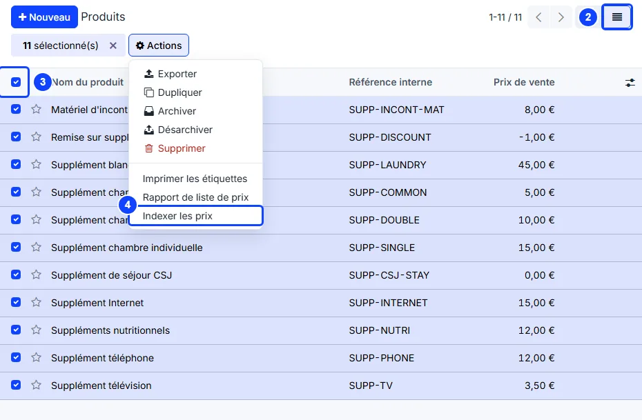
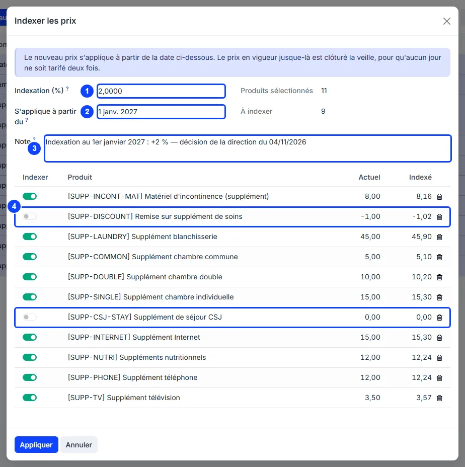
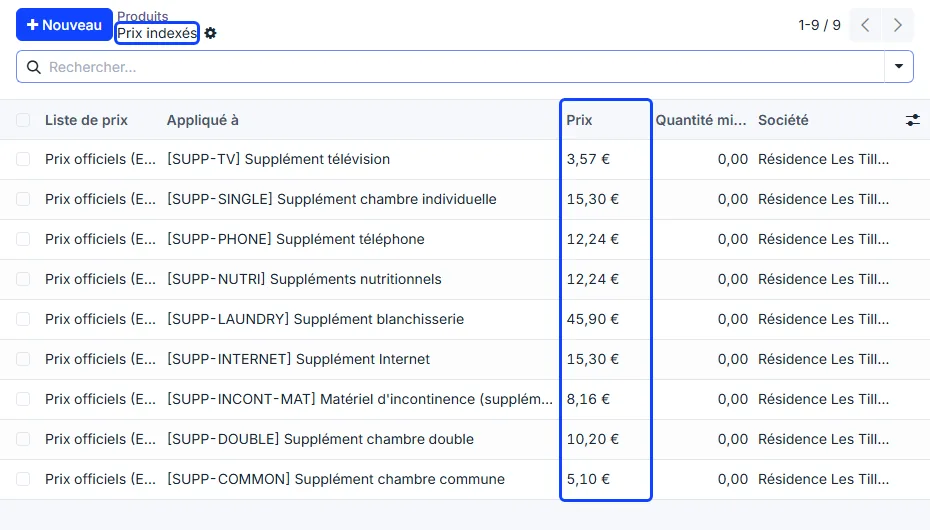
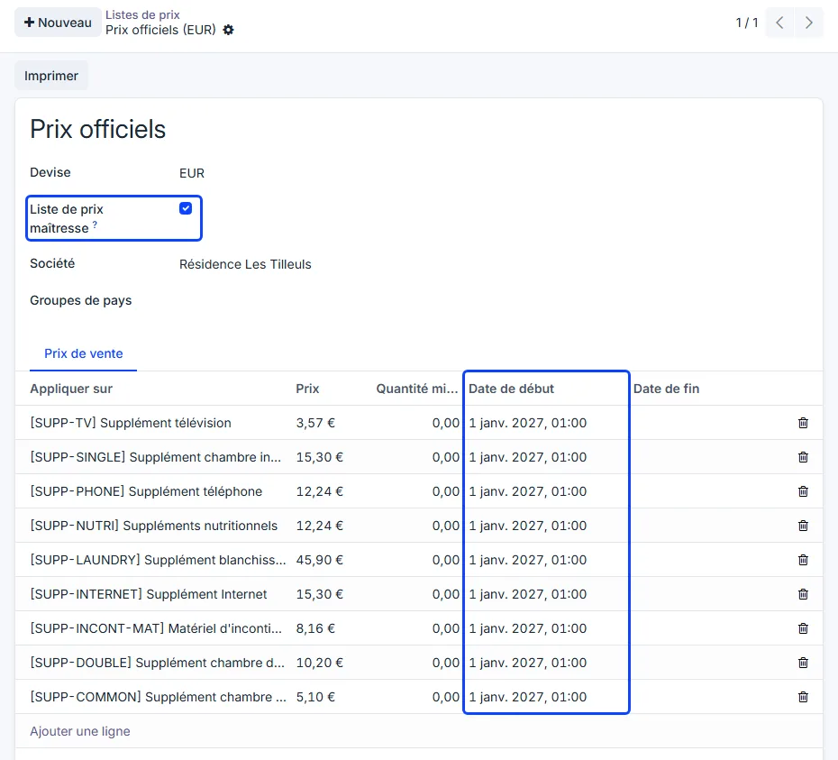

# Price indexation

:::{rh-description}
Raise the selling prices of supplements by a percentage from a given date, keep the history of every price, and bill each month at the price in force.
:::

:::{rh-faq}
How do I index the prices of the supplements?
: In Billing → Facturation → Products, switch to the list view and tick the products, then Actions → Index prices. Enter the percentage, the date it applies from and a note, then click Apply.

Why is Index prices missing from the Actions menu?
: The products open as cards, which do not offer it: switch to the list view. It is not in Configuration → Supplement Types either, and only billing managers and the home's managers see it.

Can I record an indexation before it applies?
: Yes. The new price starts on the date you enter; the product's sales price changes on its own that morning.

Does an indexation change the price of residents' conventions?
: Yes, for every line that follows the official price. A line with Negotiated price ticked keeps its own price.

Does an indexation change the room price of a resident already staying?
: No. Indexing the product of a room type changes the price of that type, given to the admissions from that date. A running stay keeps the Daily Rate it was given at admission.

Which price is used when an old month is billed again?
: The price in force that month. A period regenerated in September bills July at July's price.

Can I delete the price history?
: No. The master pricelist holds every price already charged to residents: it cannot be deleted, only archived.
:::

Selling prices move every year: an index is published with a date, and every
supplement price follows. WideCare records each indexation as a new price
starting on its date, and keeps the previous ones. Each month is then billed at
the price in force during that month.

## 1. Select the products

1. Open the **Billing** app → **Facturation → Products**.
2. Switch to the list view, with the button at the top right: the products open
   as cards, and the cards do not offer the action.
3. Search for the products to index — part of their name, or their **Product
   Category** — and tick them. The box at the top of the column ticks every
   line shown.
4. Click **Actions → Index prices**.

The action is shown to billing managers and to the home's managers only. It is
not offered in **Billing → Configuration → Supplement Types**.

## 2. Enter the indexation

The **Index prices** window opens, with one line per selected product, all
ticked.

1. **Indexation (%)** — how much every price moves: 2 means +2 %. A negative
   value lowers the prices.
2. **Applies from** — the first day the new prices are charged. Today by
   default; a later date records the indexation in advance.
3. **Note** — where the number comes from: the decision or the publication that
   sets it. It is required and copied onto every new price: it is the whole
   audit trail.
4. Untick **Index** on a product to leave its price alone.

**Current** is the price in force on the **Applies from** date, an indexation
already recorded before that date included, and **Indexed** the new price,
rounded to the cent. **Products selected** counts the lines, **To be indexed**
the ticked ones.

## 3. Apply

Click **Apply**. For each ticked product, the price in force is closed the day
before the date, and the new one starts on that date, so no day is priced twice.
The list of the **Indexed prices** just created opens.

## Where the new price applies

- **The product's sales price** — on the date itself, by a job that runs every
  morning. An indexation can therefore be recorded weeks in advance; until that
  date, the products keep showing the old price.
- **Supplement conventions** — every line that follows the official price.
  A line with **Negotiated price** ticked keeps its own **Unit Price**.
- **One-time supplements** — at the price in force for the month of the
  envelope.
- **Rooms** — the product of a room type is indexed like any other: its price
  is the **Daily Rate** of the type, given to the admissions from that date.
  A stay already running keeps its own **Daily Rate**: the indexation does not
  change it.

:::{admonition} Serviced residences
:class: rh-sector rh-sector-rs

The price of a housing contract is its own amount, not the price of a product.
Change it from the contracts, where the notice and the yearly cap are checked:
see [Changing the price](../residences-services/changement-prix.md).
:::

## Read the price history

Every price an indexation creates lives in the **Official prices** pricelist:

- **Sales → Products → Pricelists**, then **Official prices**: every product,
  each price with its **Start Date** and, once a later indexation has replaced
  it, its **End Date**;
- on a product, the **Prices** tab: the prices of that product. Open one to read
  its **Validity Period** and its **Note**.

The **Pricelists** menu and the **Prices** tab show when **Pricelists** is
ticked in the **Sales** settings.

:::{admonition} The master pricelist
:class: note

**Official prices** is created at the first indexation and flagged **Master
pricelist**. A company has only one, and it cannot be deleted: it explains every
price already invoiced. Each of its rules carries the **Note** of the
indexation that created it.
:::

## Going further

- [Supplements](supplements.md)
- [The Supplements app](application-supplements.md)
- [Billing overview](index.md)
