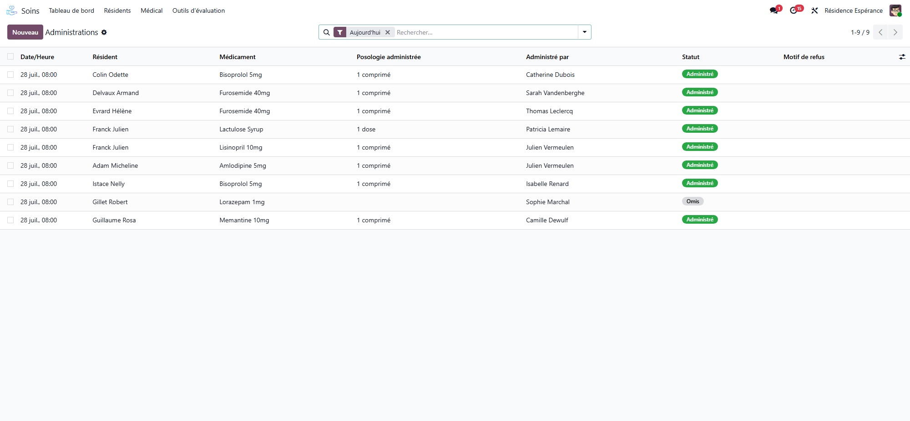

# The medication round at the desk

:::{rh-description}
Follow and record the medication round from the office in Resthome: the doses of the day and their statuses, Distributed and Given, a dose given earlier, a refusal, the correction of a wrong record and the medication incidents.
:::

:::{rh-faq}
Where do the doses of the round come from?
: From the active treatments. Each night, just after midnight in the house's time, Resthome places the day's doses, one per treatment and per moment.

What is the difference between Distributed and Given?
: **Distributed** means the dose is in the resident's hands; **Given** means the intake was seen. Given straight away records both at once, by the same person.

A dose was given on time but not recorded. What do I do?
: Use **Given Earlier**: say when it was really given and by whom. It works up to seven days back; the record keeps who wrote it afterwards, and when.

How do I correct a dose recorded by mistake?
: Within fifteen minutes, the person who ticked it takes it back in the care app. After that, a nurse or a physician opens the dose and clicks **Correct this record**, with the reason. The correction is kept and never changed.

Where do I see the medication incidents?
: In the **Follow-up** tab of the Medicines workstation, **Incidents**: missed, refused, not taken or not available doses, issues found at the check, and corrected records, month by month.
:::

The round is usually recorded on the phone, at the resident's side (see
[Medication round on the care app](../soins-mobile/tour-medicaments.md)). At
the desk, the [Medicines workstation](index.md) shows the same doses and lets
you record, complete or correct them.

## How the round is built

Each night, just after midnight in the house's time, Resthome places the day's
doses from the **active** treatments: one dose per treatment and per moment of
the day. A suspended, cancelled or completed treatment gives no dose; an *as
needed* treatment has no place on the round.

A dose goes through these statuses:

| Status | Meaning |
| --- | --- |
| **Due** | To give at its moment. |
| **Distributed** | In the resident's hands; the intake is still to confirm. |
| **Given** | Taken in front of the person who records it. |
| **Missed** | Its moment passed and nobody recorded it. |
| **Refused by Resident** | The resident refused it. |
| **Not Taken** | Given but not taken: *Spat out*, *Vomited after the intake*, *Asleep*, *Found (tray, floor, pocket)*, *Other*. |
| **Not Available** | The medicine was missing: it enters the pharmacy's basket. |
| **Resident Hospitalized**, **Away**, **Skipped** | Not given, for that reason. |

## Recording from the desk

Open the **Round** tab of the workstation, or **The Round** / **The Whole
Round** for the full list (by default: today, still to give, grouped by
moment). On each dose:

- **Distributed** — in the resident's hands now, by you; the intake is ticked
  after.
- **Given** — given now, by you. On a distributed dose, it confirms the intake.
- **Given Earlier** — given at its hour and not recorded then: choose when and
  by whom, for one dose or several. Never an hour to come, never more than
  seven days back.
- **Say Why** — opens the dose to record that it was refused, not taken or not
  available.

The filters **Still to give**, **Missed**, **Incidents** and **Corrected**,
and the grouping **By Moment**, narrow the list. **Administrations** opens all
the doses recorded, with the filters **Administered**, **Distributed, intake to
confirm**, **Refused**, **Not Taken**, **If Needed** and **Unplanned**.

:::{admonition} The right hand for each dose
:class: warning

Resthome refuses a gesture the person may not do: a dose already recorded is
not given again, a dose of a past care day is only recorded with **Given
Earlier** or as not given, and a care assistant gives only what their role and
the pillbox rules allow (see [Pillboxes and the pharmacy's sachets](piluliers.md)).
A critical allergy recorded after the treatment blocks its doses.
:::

<!-- screenshot to update: administration statuses now include Distributed, Missed and Not Taken -->

### What the workstation asks for

The **To Do Now** tab lists **Missed doses** and **Intakes to confirm** (doses
distributed some time ago whose intake nobody confirmed). Both open the round
on the right sector.

### The four gestures on a dose

Open a dose to read, in **The Four Gestures**, who **prepared** it (and
whether *The house* or *The pharmacy* filled it), who **checked** it, who
**distributed** it and who **gave** it, each with the time. What happened is a
fact: the hands, the hours and a status already recorded are not typed over;
only the gestures and the correction write them.

## Correcting a wrong record

Within **fifteen minutes**, the person who ticked a dose takes it back in the
care app. After that, the record is no longer a draft: a **nurse** or a
**physician** corrects it.

1. Open the dose and click **Correct this record**.
2. Under **What Happened**, choose what really happened (not given, given — and
   by whom —, refused, not taken, not available).
3. Write **Why the Record Was Wrong** (required), then **Record the
   correction**.

The correction is a record of its own, **never changed or deleted**: what was
recorded (**Was Recorded As**, **Recorded By**, **Recorded At**), what is
recorded now, who corrected it and when. The dose is marked **Corrected** and
counts among the incidents. A correction also puts the box right: units
taken back for a dose that was not given, counted down for one that was.
**Corrections** in the **Follow-up** tab lists them all.

## Medication incidents

There is no separate register: the incidents are the doses themselves.
**Incidents**, in the **Follow-up** tab of the workstation (medication manager
and head nurse), counts month by month the doses **missed**, **refused**, **not
taken** or **not available**, those with an **issue found at the check**, and
the **corrected** records — in a pivot, a graph or a list, grouped by
resident. Use it for the quality report.

## Going further

- [Medication round on the care app](../soins-mobile/tour-medicaments.md)
- [Pillboxes and the pharmacy's sachets](piluliers.md)
- [Medication follow-up](suivi.md)
- [Treatments](traitements.md)
