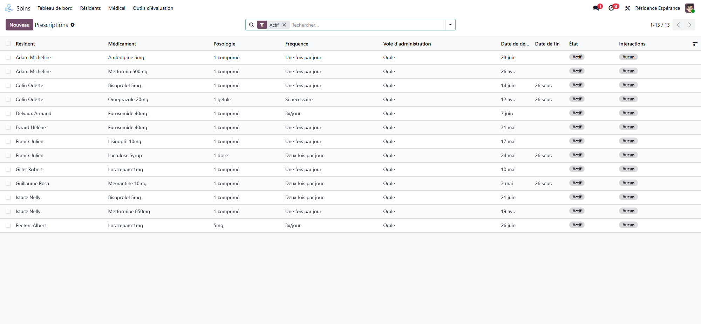

# Treatments

:::{rh-description}
A resident's treatment in WideCare: the medicine, the dose, the moments of the day, how it is taken, the checks against allergies and interactions, the box, and suspending, resuming or ending it.
:::

:::{rh-faq}
What is the difference between a prescription and a treatment?
: The prescription is the physician's document. Each of its lines, once the prescription is confirmed, becomes a treatment: what the resident takes, every day, on the round.

How do I add a treatment without a prescription document?
: Click **New Treatment** on the Medicines workstation, or **Add a line** in the **Treatments** tab of the resident's record. Nurses and physicians can do it.

How do I stop a treatment?
: Click **Complete** at the end of the treatment, **Suspend** to interrupt it for a while (then **Resume**), or **Cancel** for a treatment entered by mistake. A treatment is never deleted.

What happens to the treatments when a resident goes to hospital?
: The hospital departure suspends every active treatment. The return resumes exactly those, and asks a nurse to reconcile them with the discharge letter.

Does WideCare check allergies and interactions?
: Yes, against what the house has recorded: the resident's allergies, the allergens of the medicine and the house's list of drug interactions. A critical allergy or a contraindicated pair blocks the treatment.
:::

A **treatment** is what a resident takes: one medicine, one dose, at given
moments of the day, from a start date to an end date. The round, the
pillboxes, the pharmacy orders and the medication sheet all read it.

A treatment is created three ways:

- by **confirming a prescription**: each line becomes a treatment (see
  [Prescriptions](../soins/prescriptions.md));
- with **New Treatment** on the [Medicines workstation](index.md);
- with **Add a line** in the **Treatments** tab of the resident's record.

## The resident's Treatments tab

On the resident's record, the **Treatments** tab lists the running and
suspended treatments: medicine, dose, frequency, the moments with their hour,
route, dates, prescriber and state. **Active** is shown in green, **Suspended**
in orange. Choose more columns from the column menu (the pharmacy's sachets,
the units in the box, the stock alert).

The **Treatments** smart button gives the same count, and the **Documents**
tab prints the **Medication Sheet**: what the resident takes, on one page.

## The treatment form

### Medicine, dose and schedule

- **Resident**, **Medication**, **Prescriber**, **Prescription Date**.
- **Dosage** — picked from the list of dosages (a quantity and its unit:
  *1 tablet*, *500 mg*, *5 ml*). A dosage typed with **Create** joins the list.
- **Frequency** — *Once Daily*, *Twice Daily*, *3x Daily*, *4x Daily*, *Every
  8/6/4 Hours*, *Weekly*, *As Needed*, *Other*.
- **Administration Route** and **Meal Timing** (*Before Meal*, *With Meal*,
  *After Meal*, *Anytime*, *On Empty Stomach*).
- **Schedule** — tick the moments: **Morning**, **Noon**, **Afternoon**,
  **Evening**, **Night**, or type **Specific Times**.
- **Duration** — **Start Date**, **End Date**, or **Permanent Treatment**.

### At the moment of giving

What the round shows next to the dose:

- **Intake** — *Swallowed whole*, *Crushed*, *Dissolved*, *Capsule opened*,
  *In food*. A medicine marked **Do Not Crush** in the catalogue refuses
  *Crushed*.
- **Not Together With** — the resident's other medicines this one must not be
  given with; **Not Together With (Other)** for anything else (milk,
  grapefruit). When both fall on the same moment, **Given at the Same Moment**
  says so, on both treatments.
- **Prepared at the Moment** — a dose measured, dissolved or drawn up at the
  moment of giving (a syrup, drops): it is never prepared in advance in a
  pillbox.
- **Glucose Before Giving** — shown for an insulin: the app asks the blood
  glucose before the dose.

### If needed

For a treatment **As Needed**, the **If Needed** group sets **When Needed
For**, **Max Doses a Day** and **Hours Between Doses**, and shows **Given
Today**. An *as needed* treatment has no place on the round: the dose is given
from the resident's card in the care app, and refused past the daily maximum or
before the interval.

### Checks

- **Interaction Severity** — read on the house's list of drug interactions:
  *Not Checked* (resident or medicine missing), *None*, *Minor*, *Moderate*,
  *Major*, *Contraindicated*, with the **Interaction Warning**. A major
  interaction warns; only a pair recorded as contraindicated refuses the
  treatment.
- **Same class** — a warning names another running treatment of the same class
  (two anxiolytics, for instance).
- **Allergies** — the medicine's allergens are compared with the resident's
  allergies, cross-reactions included. A **critical** allergy blocks the
  treatment; an allergy recorded later is written on every running treatment
  that contains it, and a critical one blocks its doses.

:::{admonition} Only what the house recorded
:class: warning

The checks read the resident's allergies, the allergens of the medicine and the
interactions **the house entered**. WideCare does not deduce clinical
information that nobody recorded.
:::

### The resident's box

The **The Resident's Box** group follows the box the resident uses:

- **In the Pharmacy's Sachets** — ticked when the pharmacy prepares this
  medicine in a sachet per moment. It is proposed from the form, the dose and
  the catalogue; **Out of the Sachets Because** says why when it is not.
  Untick what the pharmacy leaves to the house.
- **Units in the Box** — counted down at each dose given (two for *2 tablets*,
  one every two doses for *½ tablet*). **Reorder Below**, **Box Expires On**,
  **Opened On** and **Discard After** set when the box must be ordered again.
- **Stock Alert** — *To reorder*, *Expired* or *Opened too long*.
- **At the Pharmacy** — where the box is when it was ordered.

**Missing: Tell the Pharmacy** (in the box group) and **Order From the
Pharmacy** (in the header) put the box into the pharmacy's basket — a care
assistant can do it. See [Pharmacy orders](pharmacie.md).

### Smart buttons and tabs

- **Prescription** — the prescription the treatment came from.
- **Administrations** and **Refusals** — the doses recorded.
- Tabs **Reason**, **Instructions** and, for a suspended treatment,
  **Suspension**.

<!-- screenshot to add: treatment form with the At the Moment of Giving, Checks and The Resident's Box groups -->

## The life of a treatment

The states are **Active**, **Suspended**, **Completed** and **Cancelled**.

- **Complete** — the treatment ends today.
- **Suspend** — interrupts it for a while (before an examination, for
  instance); write why in the **Suspension** tab.
- **Resume** — restarts a suspended treatment; only the moments still to come
  return on the round.
- **Cancel** — removes a treatment entered by mistake.

Changing a moment, the dates or the frequency replaces the doses still to come;
a dose already prepared in a pillbox is then flagged to take out (see
[Pillboxes and the pharmacy's sachets](piluliers.md)).

<!-- screenshot to update: the list is now the Treatments tab of the Medicines workstation -->

## Hospitalisation: suspend, then resume

When a resident goes to hospital, the hospital takes over the treatment.

1. On the resident's record, click **Hospital departure**, and enter the moment
   and the reason.
2. Confirm: every **active** treatment is **suspended**, and the window says
   how many. The **liaison pack** prints on confirmation: the document the
   hospital asks for on admission (identity, treatments, allergies, dependency,
   the hospitalisation preferences of the [anamnesis](../soins/anamnese.md)).

On the way back, **Return from hospital** resumes exactly the treatments the
departure suspended — never one a physician suspended for a reason of their
own — and the resident appears under **Back From Hospital** on the Medicines
workstation, to reconcile the treatments with the discharge letter. See
[Medication follow-up](suivi.md).

## Going further

- [Prescriptions](../soins/prescriptions.md)
- [The medication round at the desk](tour.md)
- [The medicine catalogue](catalogue.md)
- [Medicines](index.md)
