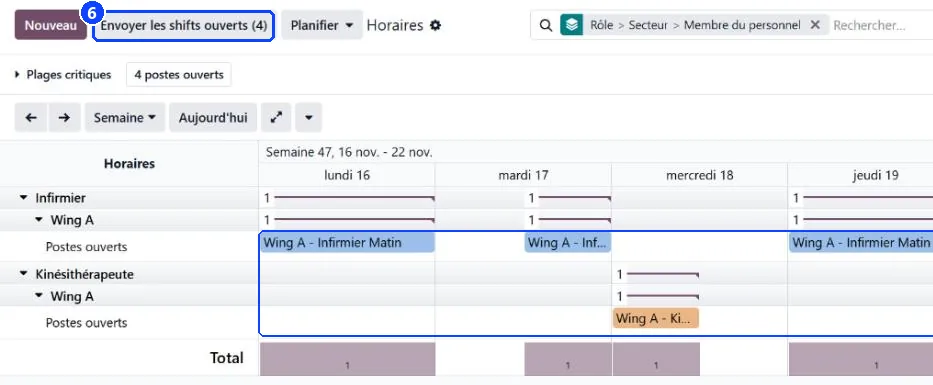
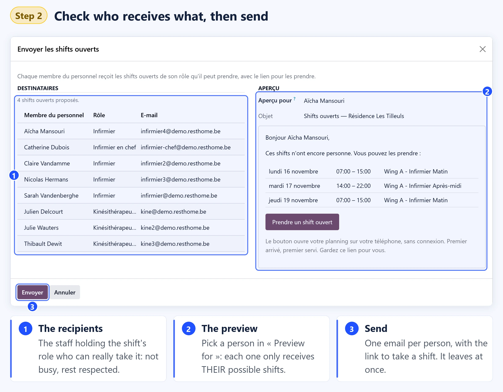

# Build the schedule

:::{rh-description}
Build the care staff schedule in WideCare: lay the shifts from a template, plan them automatically, correct by hand, then confirm and send the schedule to the staff concerned.
:::

:::{rh-faq}
Where do I build the schedule?
: In Planning → Schedule. It opens on the schedule chart for the current week, with one row per role and per staff member, and the Confirm, Send the schedule and Plan buttons at the top.

Does applying a template overwrite the shifts already planned?
: No. The template only creates the shifts that are missing, in draft and without anyone. A shift identical to one of the template (same role, sector, label, start and end) counts as already there, whoever holds it.

Does Auto plan change the shifts I assigned by hand?
: No. It only fills the shifts that have nobody. A shift you assigned yourself is never taken back.

What does a red shift mean?
: The shift is To check: it overlaps another shift of the same person, falls during a leave, asks for a role the person does not hold, or breaks a hard preference. Saving is not blocked; the reason is written on the shift.

Who receives the schedule email?
: Only the staff whose shifts changed since the last sending: a new shift, a changed shift, or a shift removed or taken back to draft. Nobody else is written to.

Who receives the open shifts email?
: The staff holding the role each open shift asks for, and only for the shifts they can actually take: not busy at that time, with enough rest, the shift not started yet.
:::

The schedule is built by a **planning manager**, usually one week at a time:
lay the empty shifts, fill them, check, confirm, then tell the staff.

## The schedule chart

Open **Planning → Schedule**. The chart shows the current week:

- **one row per role**, then **one row per staff member** holding that role; the
  **open shifts** (without anyone) come first in each role;
- on each staff row, the **hours planned against the hours of the contract**;
- the person's **leaves** grey their row;
- a **draft** shift is hatched, an **open** shift has a dashed outline, a shift
  **to check** is red.

Use the arrows and **Today** to move in time. The scale button chooses **Day**,
**Week** or **Month**, or a period of your own (**From** → **To**, then
**Apply**). Over a week or a day each shift is drawn at its hours; over a month,
as a mark per half day. The button next to it folds or unfolds every group.

On the chart:

- **click a shift** to open it;
- **drag a shift** to another staff member of the same role, or to another time;
- **drag its right edge** to stretch or shorten it;
- **click an empty cell** to create a shift (07:00–15:00 by default).

The chart also offers the **calendar**, **list**, **kanban**, **pivot** and
**graph** views of the same shifts.

<!-- screenshot to add: schedule chart over a week with the counters banner, critical period squares on the role rows, hatched drafts and a red shift to check -->

:::{note}
On databases with the Enterprise edition of Odoo, the schedule opens on Odoo's
own Gantt chart, with the same buttons and the same banner.
:::

### The banner above the chart

For managers, a banner sums up what is left to do in the period on screen. Each
counter is a button that filters the chart:

- **to check** — shifts with an issue;
- **open shift(s)** — shifts with nobody;
- **draft(s)** — shifts the staff do not see yet;
- **to send** — confirmed shifts the person concerned has not been told about.

When nothing is left: *Everything is planned, confirmed and sent.*

### Critical periods on the chart

Over a week or a day, each role row shows **one square per critical period**,
in the colour of its coverage: **red** = not enough staff, **orange** = more than
needed, **green** = covered. Click a square to read the period, its hours, the
role, the **planned / needed** staff and, for a rule per residents, the
**residents present**. Over a month, open **Critical periods** in the banner to
read the same figures as a table by role and day.

### A staff member's preferences

On a staff row, the sliders button (**Preferences**, managers only) shows what
applies to the person in the period on screen: night and weekend work, preferred
shift, personal weekly maximum and their scheduling preferences.

## 1. Lay the shifts from a template

1. In the chart, click **Plan**, then **Apply a template**.
2. Choose the **Template** and a day in the week or month to fill (**Week or
   month of**).
3. Read the summary: the shifts that already exist stay as they are; the
   missing ones will be created **in draft and without anyone**.
4. Click **Apply**.

From the list view, the **Apply a template** button does the same.

## 2. Plan the open shifts automatically

Click **Plan**, then **Auto plan the open shifts**. WideCare fills the open shifts
of the period on screen, earliest first. A message says how many shifts were
planned and, for those left open, why (nobody holds the role, on leave, weekly
maximum reached…).

The automatic planning **never** breaks:

- the role of the shift;
- the person's leaves and their other shifts at the same time;
- the rest between two working days;
- the week's maximum: the contract, plus the weekly flexibility for a full time,
  limited by the personal weekly maximum when one is filled;
- the hours of the contract over the period of the hours balance;
- "no nights" and "no weekends" on the staff record;
- the hard preferences.

Among the people allowed, it **prefers** the person assigned to the shift's
sector, the one whose preferred shift matches, the soft preferences, the person
with the most hours left in the week and the one behind on their contract hours.

In the list view, select shifts and click **Auto plan** to plan only those.

## 3. Correct by hand

Open a shift, or drag it on the chart, to change the person or the time. In
**Staff member**, only the people holding the shift's role are offered.

A shift that breaks a rule turns **red** and shows the reason at the top of its
form (*overlaps another shift*, *during a leave*, *role not held*, *breaks a
hard preference*). Use the **To check** filter to find them all.

The shift form holds the **Sector**, the **Dates**, the **Hours**, a **Label**
(AM, PM, Night…), **Notes** for the handover, the **Role**, the **Staff member**
and the **Team**.

## 4. Confirm

Click **Confirm (n)** at the top of the chart: the drafts of the period on screen
become **Confirmed** and the staff can see them. The button reappears as soon as
new drafts exist.

When some drafts have nobody, a window says how many and offers:

- **Confirm anyway** — the shifts without anyone are published as **open
  shifts** the staff holding the role can take;
- **Confirm only the assigned ones**;
- **Cancel**.

To change a published shift without the staff seeing a half-done version, open
it and click **Back to draft**, then confirm it again.

## 5. Send the schedule

Click **Send the schedule (n)**. The window lists the **Recipients**: only the
staff whose shifts changed since the last sending. Choose a person in **Preview
for** to read the email as they will receive it, then click **Send**.

- Each person receives their shifts of the period and a **See my schedule**
  button to their personal page. → [Shifts for the staff](postes-du-personnel.md)
- A person whose published shift was **removed** or **taken back to draft** is
  written to as well, even without a shift left in the period (**Schedule change
  to announce**).
- Staff without a work email are listed in a warning: they do not receive the
  schedule and their shifts stay "not sent".

A confirmed shift not sent yet shows a blue notice on its form.

<!-- screenshot to add: Send the schedule window with the recipients list and the email preview -->

## 6. Send the open shifts

When shifts are still open, offer them to the staff instead of calling round.
Click **Send the open shifts (n)**. The button appears when the period on screen
has confirmed shifts with nobody that have not started yet, and when the
establishment lets the staff take open shifts.

The window lists the **Recipients**: the staff holding the role of each open
shift (any planning role when the shift asks for none). Choose a person in
**Preview for** to read the email as they will receive it, then click **Send**.

- Each person receives only the open shifts **they can take**: the same check as
  **Take** — their role, no other shift at that time, enough rest.
- The email has a **Take an open shift** button to their personal page, where
  one tap assigns the shift. → [Shifts for the staff](postes-du-personnel.md)
- First come, first served: a shift taken by someone disappears from the page of
  the others.
- Staff without a work email are listed in a warning: they do not receive the
  email.

## Useful filters

In the search bar: **My shifts**, **Open shifts**, **Draft**, **Confirmed**,
**Not sent yet**, **To check**, **Upcoming**, and groupings by **Role**,
**Sector**, **Staff member**, **Team**, **Status** and **Day**. The **Actions**
menu of the list also offers **Confirm**, **Send the schedule**, **Send the
open shifts** and **Auto plan** on the selected shifts.

## Learn more

- [Configure the planning](configuration.md)
- [Shifts for the staff](postes-du-personnel.md)
- [Hours, balance and coverage](heures-et-couverture.md)
