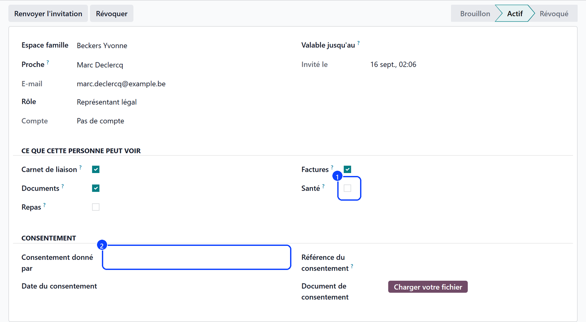

# Granting an access

:::{rh-description}
Granting, re-inviting and revoking a family portal access in WideCare: role, scopes, consent for health data, validity date and account status.
:::

:::{rh-faq}
How does a relative get their login?
: Their e-mail address becomes their login. **Grant Access** creates the portal account and sends them the invitation, with a link to choose their password.

Can I delete an access?
: Not while it is active. Revoke it first: the date it was taken back is part of the record.

What happens when the validity date passes?
: The access revokes itself the day after, automatically.

Can I give back an access that was revoked?
: Yes. Open it and click **Grant Access** again: it becomes active, with its history kept.
:::

An access joins **one resident** and **one relative**. You open it from either
side:

- from the **resident's record**, **Identity** tab: on the relative's line in
  **Contact Persons**, click **Portal**;
- from the **relative's contact record**, **Family** tab: on the resident's
  line, click **Portal**;
- from **Nursing Home → Family Portal → Accesses**, with **New**.

**Portal** opens the **Portal Access** dialog of that pair: the existing access,
or a new one ready to be granted. The **Portal Access** column next to it shows
where the relative stands: **Not invited**, **Invited, never signed in**,
**Signed in** or **Revoked**.

:::{admonition} A relative not yet in the list
:class: tip

Add them first as a **contact person** of the resident (name, relationship,
e-mail), save, then click **Portal** on their line. An access created from the
**Accesses** menu adds the person to the resident's contact persons by itself.
:::

## 1. Set who and what

1. Check the **resident** (or the **family space**) and the **relative**.
2. Check the **E-mail**: it becomes the relative's login.
3. Set the **role**: **Relative**, **Trusted Person** or **Legal
   Representative**.
4. Tick what this person may see, under **What This Person May See**:
   **Liaison Notebook**, **Documents**, **Meals**, **Invoices**, **Health**.
5. Fill in **Valid Until** if the access is temporary. Left empty, the access
   lasts until it is revoked.

## 2. Record the consent, for health data

The **Consent** group asks for:

- **Consent Given By** — **The resident** or **The legal representative**;
- **Consent Date**;
- **Consent Reference** — where the signed consent is filed, or the decision
  appointing the representative — and, if you have it, the **Consent
  Document**.

**Consent Given By** and **Consent Date** become required as soon as **Health**
is ticked: without them, WideCare refuses to save.

<!-- screenshot to update: access form with the Grant Access / Re-Invite / Revoke Access buttons and the Latest Authentication field -->

## 3. Grant the access

Click **Grant Access**. WideCare:

- creates the relative's **portal account** if they have none (login = their
  e-mail address) — someone who already has a user account keeps it;
- sets the access to **Active** and dates it in **Invited On**;
- subscribes the person to the **liaison notebook**;
- sends the **invitation e-mail**, with a button to open the family portal and,
  for a new account, a link to choose a password. When a **Valid Until** date
  is set, the e-mail states it.

On an active access, **Re-Invite** sends the invitation again — useful when the
relative lost it or never set their password.

Grant Access is refused when:

- the relative has **no e-mail address**;
- the **Valid Until** date has already passed — extend it first;
- the address is already the login of another user.

The access then follows the person: **Account** reads **No account**,
**Invited, never signed in** or **Signed in**, and **Latest Authentication**
gives the date of their last sign-in.

:::{admonition} The invitation e-mail
:class: note

The invitation is an ordinary e-mail template, **Family Portal: Invitation**.
Your administrator can adapt its wording; the **Family Portal** filter finds it
in the list of e-mail templates.
:::

## 4. Revoke

**Revoke Access** closes the access, after a confirmation: the person no longer
sees anything about the resident, and is unsubscribed from the notebook. The
date is kept in **Revoked On**.

An access whose **Valid Until** date has passed is revoked automatically the
next day.

:::{admonition} The account is not deleted
:class: note

Revoking an access does not disable the person's account: they may hold
accesses to other residents, or receive their own invoices.
:::

## Find an access

**Nursing Home → Family Portal → Accesses** opens on the **Active** accesses.
The filters **Draft**, **Revoked**, **Health Opened** and **Expiring** (an access
with a validity date) narrow the list; group it by **Resident**, **Role** or
**Status**.

Every change to an access — person, role, scopes, consent, status, validity —
is traced in its history.

## Who may do what

- Every nursing home user **reads** the accesses.
- The **administrative staff**, **managers** and **directors** create, grant,
  re-invite and revoke them; the **Portal** button only shows for them.
- An access can only be **deleted** once it is no longer active.

In other words, a nurse can write in the notebook without being able to open an
access to anybody.

## What's next

- [Notebook, documents and invoices](carnet-documents.md)
- [What the relative sees](cote-famille.md)
