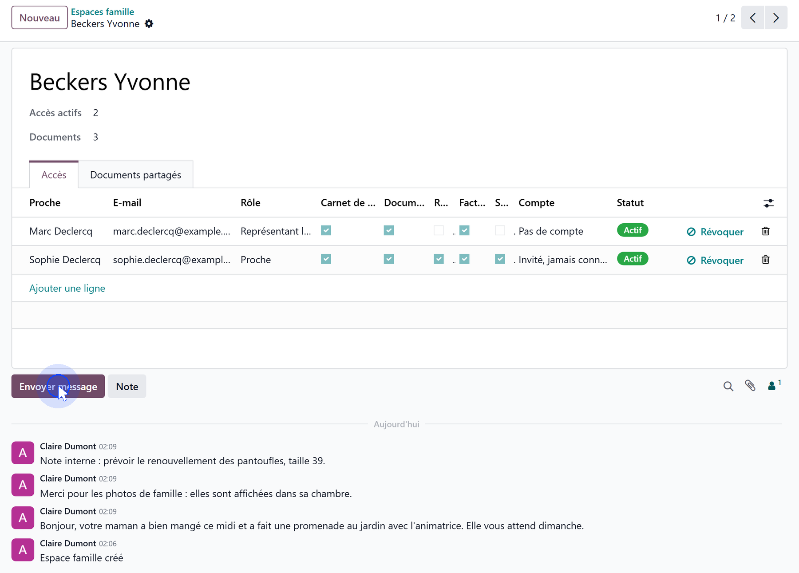
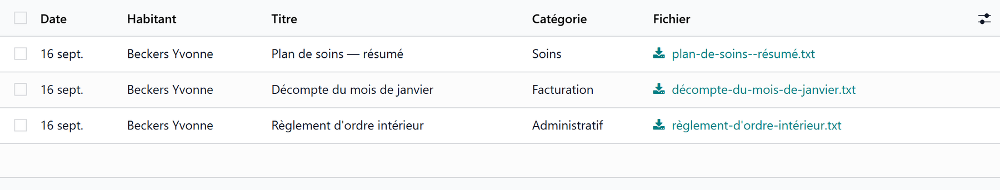

# Notebook, documents and invoices

:::{rh-description}
Writing in the liaison notebook and sharing documents with the family in WideCare: message or internal note, document category, and the invoices visible to the family.
:::

:::{rh-faq}
How do I write to the family?
: In the resident's family space, click **Send message** in the discussion thread. It reaches the relatives who hold the **Liaison Notebook** scope.

How do I note something for the team only?
: Use **Log note** instead. It stays with the team and is never shown on the portal.

Which switch reveals a document?
: Its category: administrative and other documents follow **Documents**, a billing document follows **Invoices**, a care document follows **Health** — and therefore consent.

Which invoices does a relative see?
: The resident's posted invoices, whoever they are addressed to — the resident, the billing contact or each debtor of a split. A **Customer** column says to whom each one was sent.
:::

Everything the team publishes for a family goes through the resident's **family
space**. Open it with the **Family Portal** button of the resident's record, the
**Open the family space** link under **Contact Persons**, or from **Nursing
Home → Family Portal → Family Spaces**.

The space shows the number of **Active Accesses** and **Documents**, then two
tabs, **Accesses** and **Shared Documents**, and the discussion thread.

## The liaison notebook

The discussion thread of the family space **is** the liaison notebook:

- **Send message** — the message reaches the relatives who hold the
  **Liaison Notebook** scope, and appears on their portal;
- **Log note** — an internal note, which stays with the team.

Relatives can **answer** from the portal: their reply comes back into the same
thread, and the team reads it there.

<!-- screenshot to update: family space Accesses tab with the Grant Access / Revoke Access buttons on each line -->

:::{admonition} One subscription per access
:class: note

Granting an access subscribes the relative to the notebook; revoking it
unsubscribes them. Nobody has to be added to the thread by hand.
:::

## Shared documents

Add documents in the family space, **Shared Documents** tab — or from **Nursing
Home → Family Portal → Shared Documents** for all residents at once. Each
document has:

- a **Date** (today by default);
- a **Title**;
- a **Category**: **Administrative**, **Billing**, **Care** or **Other**;
- the **File**;
- a **Note for the Family**, shown next to the document on the portal.

The category decides who sees the document:

| Category | Shown to a relative who has |
| --- | --- |
| **Administrative**, **Other** | **Documents** |
| **Billing** | **Invoices** |
| **Care** | **Health** — and therefore a recorded consent |

:::{admonition} Shared documents are chosen, one by one
:class: tip

The family sees only what someone placed here. The resident's full document
folder — scans, signed agreements, letters — stays with the team: see
[Resident documents](../documents/index.md).
:::

## Invoices

A relative with the **Invoices** scope sees the resident's **posted** invoices
and credit notes, whoever they are addressed to: the resident, their billing
contact, or each debtor when the resident share is split. For each one: the
number, the **Customer**, the billing **Period**, the date, the due date, the
amount and the status — **Paid**, **Partially paid** or **To pay** — and the
PDF to download.

:::{admonition} A debtor's own invoices
:class: note

A relative who pays a share under [split billing](../facturation-partagee/index.md)
also receives **their own** invoices, which they find in their portal as any
customer would. That does not depend on the family portal.
:::

## What's next

- [Granting an access](acces.md)
- [What the relative sees](cote-famille.md)
