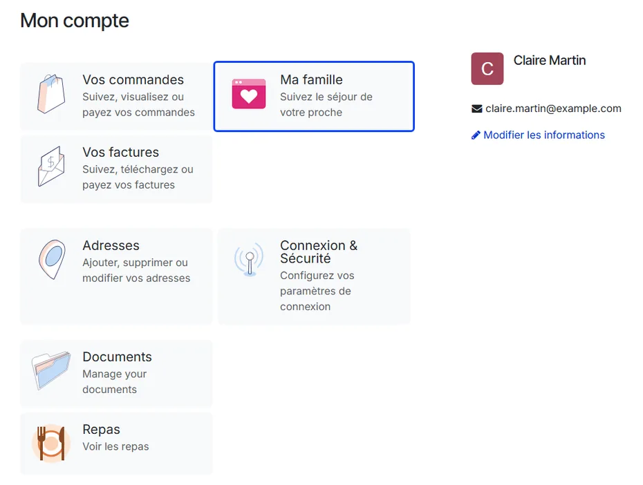
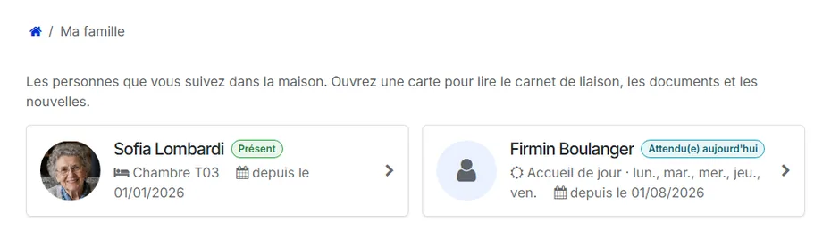
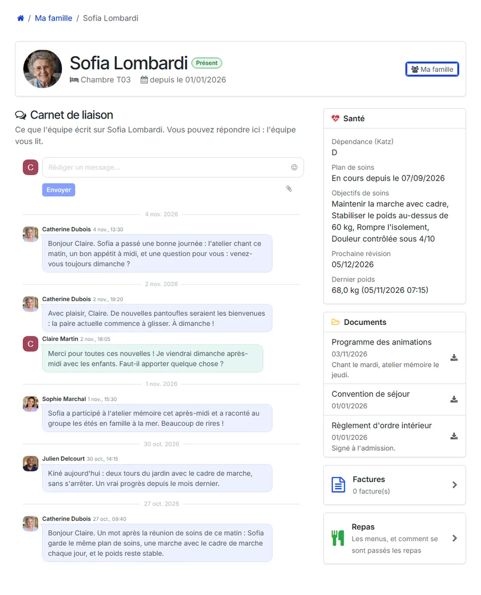
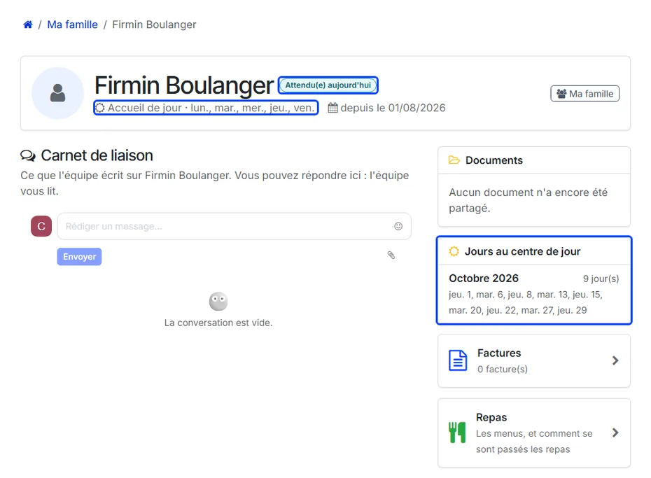
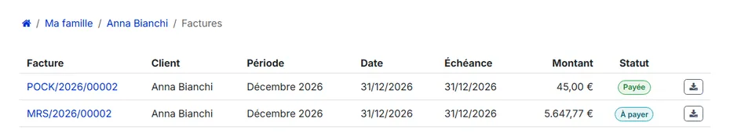
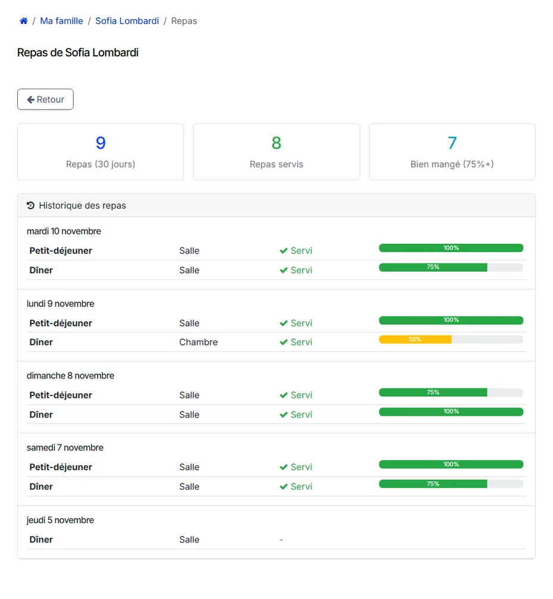

# What the relative sees

:::{rh-description}
A tour of the WideCare family portal as a relative sees it: the My Family tile, the resident's page, the notebook, the health panel, documents, invoices, meals and the way back.
:::

:::{rh-faq}
Where does a relative start?
: On their portal home page, a **My Family** tile appears as soon as they hold an access. It leads to the resident.

What if a relative follows two residents?
: They get the list of the residents they follow. With a single resident, the portal opens straight onto that resident's page.

What does the health panel show?
: A summary: the dependency category, the care plan in progress, its objectives, the next review and the last weight. Never the nursing notes.

How does a relative get back to the resident's page?
: With the trail at the top of each page: **My Family**, then the resident's name. An invoice or the meals opened from the resident's page lead back to it.
:::

## The home page

Once an access is active, the relative's portal shows a **My Family** tile —
*Follow your relative's stay*.

- **Several residents**: the **My Family** page shows one card per resident,
  with the photo, the status badge, the room and the date the stay began.
- **A single resident**: the portal goes straight to that resident's page.

Without any access, the page says so plainly: no resident is linked to this
account yet, and the home sends an invitation when it opens one.

## The resident's page

The top of the page gives the resident's photo, their status and where they
live: the **room** and the date of arrival. A relative who follows several
residents finds a **My Family** button there to switch.

The main column is the **liaison notebook**: what the team writes about the
resident, with a field to reply — the team reads the answers.

A side panel — above the notebook on a phone — carries what the access opens:

- **Health** — the dependency category, the **care plan** in progress with its
  objectives, the **next review** and the **last weight**. It is a summary,
  never the nursing notes.
- **Documents** — the documents handed over, with their date and the note for
  the family, to be downloaded.
- **Invoices** — the number of invoices, and a link to their list.
- **Meals** — a link to the meals of the last 30 days.

When a scope is not open, the page says so instead of staying empty: the
notebook announces that it is not open on this access, the health panel that
there is nothing to show yet, the documents that none has been shared.

## Someone who comes by day

For a person who attends the day care centre and sleeps at home, the page does
not show a room:

- under the name, **Day care** and the days they come;
- the badge says where they are **today**: **Expected today**, **At the day
  centre today** or **At home today**;
- with the **Invoices** scope, a **Days at the day centre** panel lists, for
  this month and the previous one, the days they came — the days billed — so
  the family can set them against the invoice.

## The invoices

The **Invoices** link opens the list of the resident's posted invoices: number,
**Customer**, **Period** (the billing month, empty for an invoice outside any
month), date, due date, amount, status — **Paid**, **Partially paid** or **To
pay** — and a button to download the PDF.

An invoice opened from this list keeps the trail **My Family / resident /
Invoices**, which leads back to the resident rather than to the relative's own
invoices.

## The meals

With the **Meals** scope, the **Meals** card opens the resident's meals of the
last 30 days:

- three counters: the **meals** of the period, the meals **served**, and the
  meals **eaten well** (75 % or more);
- the resident's **diets** and **allergies**, when they are recorded;
- the **meal history**, day by day: each meal, where it was taken (dining room
  or room), whether it was served, and how much was eaten.

The trail reads **My Family / resident / Meals**, and the **Back** button
returns to the resident's page.

:::{admonition} Meals follow the access too
:class: note

Once the family portal is installed, the meal pages read the **accesses**: a
person listed in the resident's contact persons, but without an access carrying
**Meals**, no longer sees the menus.
:::

## What's next

- [Granting an access](acces.md)
- [Family portal and public menu](../repas/portail-familles.md) — the meal pages in detail.
- [Menus, diets and allergies](../repas/menus-regimes.md)
