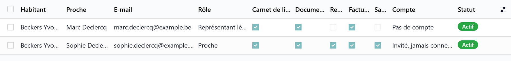

# Family portal

:::{rh-description}
The Resthome family portal: an access granted per resident and per scope, a liaison notebook, documents, invoices and a health summary for relatives.
:::

:::{rh-faq}
Is being a contact person enough to see the portal?
: No. Being in the resident's contact persons and having an access are two different things. What opens the portal is an **access**, granted scope by scope.

What can a relative see?
: Only what is ticked on their access: liaison notebook, documents, meals, invoices, health. Nothing else of the record.

Can a relative answer the team?
: Yes. The liaison notebook works both ways: a relative who can read it can reply, and the team reads the reply.

Where do I see who reads a resident's file from home?
: On the resident's record, **Identity** tab: each line of **Contact Persons** shows its **Portal Access** status. The **Family Portal** button at the top counts the active accesses.
:::

:::{toctree}
:hidden:

acces
carnet-documents
cote-famille
:::

The **family portal** gives relatives a window onto the resident's stay: what
the team writes day to day, the documents handed over, the invoices, and — if
the family has consented — a summary of the care.

The family portal is an application of its own. Once it is installed, its menu
**Nursing Home → Family Portal** appears, with **Family Spaces**, **Accesses**
and **Shared Documents**.

## Two ideas to keep apart

- **Contact person** — a name, a relationship and a phone number in the
  resident's record. It opens nothing.
- **Access** — the authorisation itself, granted to one person for one resident,
  with what they may see. This is what opens the portal.

The two meet on the same line: in the resident's **Contact Persons** list, each
relative carries a **Portal Access** status and a **Portal** button that opens
their access to this resident.

A relative may hold accesses to **several residents** (both parents, for
example); each one is granted separately, with its own scopes.

## What the access opens, scope by scope

| Scope | What it shows |
| --- | --- |
| **Liaison Notebook** | What the team writes, and the family's replies |
| **Documents** | The documents handed over to the family |
| **Meals** | The menus and how the meals went |
| **Invoices** | The resident's posted invoices, and their PDF |
| **Health** | A care summary — **requires a recorded consent** |

**Liaison Notebook**, **Documents** and **Meals** are ticked by default;
**Invoices** and **Health** are not. **Meals** only shows something when the
Meals app is installed, **Health** shows more than the dependency category when
the care app is installed.

:::{admonition} Health is never opened without consent
:class: warning

Ticking **Health** requires recording **who gave the consent** and **when**.
Resthome refuses the access otherwise. Every reading of the health panel is
logged, as is every access granted, changed or revoked.
:::

## The status of an access

| Status | Meaning |
| --- | --- |
| **Draft** | Prepared, not yet sent: the relative sees nothing. |
| **Active** | Invited: the relative sees what the access opens. |
| **Revoked** | Taken back, by hand or because its validity date has passed. |

On the resident's contact persons, the **Portal Access** column says the same
thing from the relative's side: **Not invited**, **Invited, never signed in**,
**Signed in** or **Revoked**.

## The resident's family space

Each resident has a **family space**, created the first time it is needed —
with the **Family Portal** button of the resident's record, or the first time
an access is opened. Nothing is created for a resident whose family never uses
the portal.

The space gathers the **accesses**, the **shared documents** and, in its
discussion thread, the **liaison notebook**: what the team posts there as a
message is what the family reads.

## What's next

- [Granting an access](acces.md) — invitation, scopes, consent, revocation.
- [Notebook, documents and invoices](carnet-documents.md) — what the team publishes.
- [What the relative sees](cote-famille.md) — a tour of the portal pages.
- [Resident documents](../documents/index.md) — the full document folder, which stays with the team.
