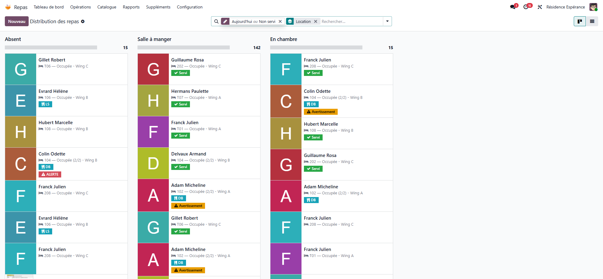

# The meal round

:::{rh-description}
Follow each meal to the resident in WideCare: the places laid by the confirmed menu, served, refused, later or absent, the amount eaten, and the printable sheets by sector.
:::

:::{rh-faq}
Where do I start the meal round?
: Confirm the meal's menu: WideCare lays a place for every resident served at that meal. Then follow the round in **Meals → Operations → Distribution**, or in the **Meals** screen of the care app.

What can happen to a resident's plate?
: It is **To serve**, then **Served**, **Refused** (with a reason), **Later** (still to serve, not late) or **Absent**. A mistake is taken back with **Undo**.

How do I record the amount a resident has eaten?
: On the meal service, click one of the buttons **Not Eaten**, **25%**, **50%**, **75%** or **Fully Eaten**. The plate becomes served if it was not already, and the amount feeds the resident's nutritional follow-up.

Who must have the amount eaten noted?
: The residents followed for nutrition: undernutrition status at risk or confirmed, an intake or fluid deficit, or an **Intake monitoring** care planned at that meal. Their places carry **Intake Required**.

What are the printable distribution sheets for?
: A paper version of the round, one page per sector, with check boxes and a supervisor signature line, for when no screen is at hand.

What happens if a resident eats very little?
: When the family meal e-mails are switched on and the resident is opted in, the family receives an alert the same evening for a meal eaten at 25% or less, or refused.
:::

The **meal round** follows each meal all the way to the resident: who eats
**where**, who has been **served**, who **refused** and why, who is **absent**,
and **how much** each one ate. At the desk it lives in **Meals → Operations**;
on the floor, carers record it on their phone (see [Meals and drinks in the care
app](app-soins.md)). Both write the same records.

:::{admonition} Places are laid by the kitchen
:class: note

A resident's **place** (a meal service) is created when the kitchen
**confirms** the menu, with the menu's dishes. Nobody lays places by hand, and
the care app says so as long as the menu is still a draft. See [Menus, diets and
allergies](menus-regimes.md).
:::

## 1. Confirm the menu

1. Open **Meals → Operations → Menus** and the menu of the meal.
2. Click **Confirm**. Every resident served at that meal gets a place.
3. A resident arrived since? Click **Lay Missing Couverts**: the missing places
   are laid and the list of the meal's places opens.

Residents away follow the attendance on their own:

- A resident in hospital or away that day gets no place, and their places
  already laid are marked **Absent** (**Away from the house**). When they come
  back, the places of the meals still ahead open again.
- A resident who comes only part of the day gets the meals of their hours.
- A place marked absent by hand (a family outing, for example) stays absent.

## 2. Follow the round

**Meals → Operations → Distribution** opens a board of the day's places still
to serve, grouped by place: **Dining Room**, **In Room** and **Absent**. Each
card shows the photo, the **room**, the **sector**, the **diet** codes and,
where relevant, an **ALERT**, **Warning**, **Served**, **Refused**, **Later** or
**Amount to note** badge. The bar on top of each column shows how many are
served, refused, later or still to serve.

<!-- screenshot to update: distribution cards now show Refused, Later and Amount to note badges -->

**Meals → Operations → Meal Services** shows the same places as a list, coloured
by state (red for a critical alert, orange for a warning, green when served,
grey when absent, blue when later). Useful filters:

- **To Serve**, **Served**, **Refused**, **Later**, **Amount to Note**;
- **Dining Room**, **In Room**, **Absent**;
- **Warnings**, **Critical Alerts**;
- group by **Location**, **Outcome**, **Sector** or **Room**.

From the list, select several places and click **Mark Served** or **Mark
Absent**. The **Action** menu also offers **Mark in Dining Room** and **Mark in
Room**. Only places still to serve or later are changed.

## 3. Record each plate

Open a place to act on one resident. The buttons shown depend on the state of
the plate:

| Button | Effect |
| --- | --- |
| **Served** | The plate is served. The hour and the person who served are kept. |
| **Refused** | The resident refused the meal: pick the **Refusal Reason** first (**Not hungry**, **Does not like it**, **Nausea / unwell**, **Asleep**, **Other**). **Other** needs a word in **Outcome Note**. The amount eaten becomes **Not Eaten**. |
| **Later** | The meal is served later (fasting for an exam, not up yet). It stays to serve and is not counted as late; say why in **Outcome Note**. |
| **Absent** | The resident is not at the table. Only a plate still to serve or later can be marked absent. |
| **Undo** | Back to **To serve**: amount, refusal, hour and person are cleared. |

The **Location** field says where the meal is eaten: **Dining Room** or **In
Room**.

:::{admonition} Correct with Undo
:class: tip

A plate already served or refused is a recorded fact: WideCare refuses to mark
it absent or later. Click **Undo** first, then record what really happened.
:::

### Dietary alerts on the plate

A red banner **CRITICAL DIETARY ALERT!** or an orange **Dietary Warning:**
explains the problem (allergen, diet, texture). A plate with a critical alert
**cannot be marked as served**. The **Compatible Dishes** button lists the
dishes of the catalogue that raise no warning for this resident; change the
**Dishes** of the place, then serve it. A dish changed for one resident stays
when the menu changes. See [Menus, diets and allergies](menus-regimes.md).

## 4. Record the amount eaten

After the meal, on the place, click the amount under **Record the amount
eaten:**

| Button | Meaning |
| --- | --- |
| **Not Eaten** | The resident ate nothing. |
| **25%** | About a quarter of the plate. |
| **50%** | About half. |
| **75%** | About three quarters. |
| **Fully Eaten** | The plate is finished. |

- A plate still to serve becomes **Served** with the amount.
- A refused plate stays refused, unless something was eaten after all.
- If an **Intake monitoring** care was planned for this resident at that meal,
  it is marked done with the amount. **Undo** opens it again.

The amount, multiplied by the values per portion of the dishes, gives the
**actual intake** (energy, protein) of the resident. See [Nutritional
monitoring and undernutrition](suivi-nutritionnel.md).

:::{admonition} Amounts owed
:class: note

**Intake Required** is ticked on the places of residents followed for
nutrition. The **Amount to Note** filter lists their served plates without an
amount: note them before the end of the shift.
:::

## 5. Close the meal

On the menu, click **Mark as Served** (or **Complete** on the dashboard card):
the menu moves to **Served**.

:::{admonition} Traceability
:class: note

A plate served or refused, and a menu in the **Served** status, can no longer
be deleted. Correct the information on the existing record.
:::

## The printable sheets by sector

To work on **paper**, open a menu (form or list) and use the **Action** menu:

- **Print Distribution Sheet** — the sheet of that meal;
- **Print All Daily Sheets** — the sheets of all of today's menus that are not
  cancelled.

WideCare lays the missing places along the way, then opens the document in a
new tab. The sheet has:

- **one page per meal and per sector**, with a header: **sector**, **meal
  type**, **date** and **number of residents**;
- a table: **#**, **Resident**, **Room**, **Diets / Allergies** (diet codes and
  the texture when it is a modified one; allergies in red; a red **!** for a
  critical alert), then the boxes **Dining**, **Room**, **Absent** and **Served**,
  and a **Notes** column;
- a footer with a **Supervisor signature** line and the print date and time.

The boxes already reflect what is recorded: the place of the meal is filled in,
**Served** is filled in green for a served plate, and a cross marks a refused
one. Staff tick the rest during the round, the supervisor signs, then the round
is recorded in WideCare.

<!-- screenshot to add: printed distribution sheet for a sector with the check boxes and the signature line -->

## Key points to remember

- Confirming the menu lays the places; residents away get none.
- A plate is **To serve**, **Served**, **Refused**, **Later** or **Absent**;
  **Undo** corrects it.
- A critical dietary alert blocks **Served** until the dish is changed.
- The amount eaten is a button on the place; it feeds the nutritional
  follow-up and closes the **Intake monitoring** care.
- The printable sheets by sector are the paper fallback.

## Going further

- [Meals and drinks in the care app](app-soins.md)
- [Meals on the WideCare app](../soins-mobile/repas.md)
- [Meals in a residence](../residences-services/repas.md) — a serviced residence's residents get a place only for their **Meals taken here**.
- [Menus, diets and allergies](menus-regimes.md)
- [Nutritional monitoring and undernutrition](suivi-nutritionnel.md)
- [Family portal and public menu](portail-familles.md)
