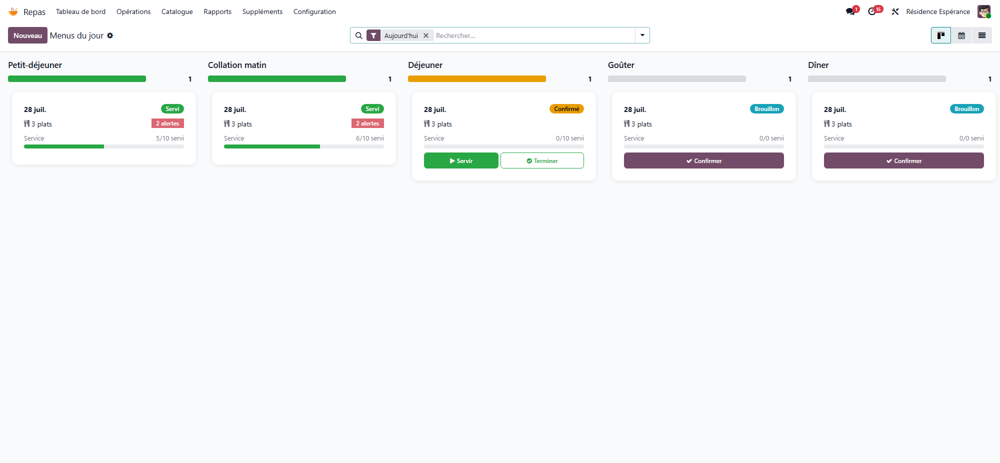

# Meals

:::{rh-description}
The Resthome Meals application: menus, dishes, diets, textures, the meal round, nutritional follow-up, hydration, family portal and public menu.
:::

:::{rh-faq}
Who can use the Meals application?
: Every Resthome user can open it. The **Kitchen Staff** role gives access to diets, allergies, menus and dishes without opening the medical record.

Where do I start every day?
: On the **Dashboard**: click **Create Today's Menus**, fill in the dishes, then **Confirm** each menu. The confirmation lays a place for every resident served at that meal.

Can carers record the meal round on a phone?
: Yes. The care app has a **Meals** screen and a **Hydration** screen: see [Meals and drinks in the care app](app-soins.md).
:::

:::{toctree}
:hidden:

menus-regimes
plats
textures
distribution
app-soins
suivi-nutritionnel
portail-familles
:::

The **Meals** application organises the home's catering: the **menus** of each
day, the **dishes** and their nutritional values, the **diets**, **allergies**
and **textures** of each resident, the **meal round**, the **nutritional
follow-up** and **hydration**, through to the **family portal** and the menu
displayed in the dining room.

## The dashboard

**Meals → Dashboard** shows the day's menus as cards, one column per meal type
(breakfast, morning snack, lunch, afternoon snack, dinner). Each card gives the
menu status, the number of dishes, the number of dietary **alerts** and the
progress of the service (served / total).

- **Create Today's Menus** creates the missing menus of the day, one per meal
  type.
- **Alerts** opens today's dietary alerts.
- On a card, **Confirm** confirms a draft menu, **Couverts** opens the places
  laid for that meal, and **Complete** marks the menu as served.

<!-- screenshot to update: dashboard cards now show the Confirm, Couverts and Complete buttons -->

## What the application covers

- **Menus, diets and allergies** — one menu per meal and per day, the diets and
  allergies of each resident, and the dietary alerts.
  [→ Menus, diets and allergies](menus-regimes.md)
- **Dishes** — the dish catalogue, ingredients and nutritional values.
  [→ Dishes and nutritional values](plats.md)
- **Textures** — the IDDSI textures for residents with swallowing difficulties.
  [→ Food textures (IDDSI)](textures.md)
- **The meal round** — who is served, where, and how much they ate.
  [→ The meal round](distribution.md) ·
  [→ Meals and drinks in the care app](app-soins.md)
- **Nutritional follow-up** — undernutrition screening, targets, intake and
  hydration. [→ Nutritional monitoring and undernutrition](suivi-nutritionnel.md)
- **Families and dining room** — the family portal, the public menu, the
  printable menu and the kiosk. [→ Family portal and public menu](portail-familles.md)

## Main menus

- **Dashboard** — the day's menus, by meal type.
- **Operations** — **Menus**, **Meal Services**, **Distribution**, **Dietary
  Alerts**, **Hydration**.
- **Catalog** — **Dishes**, **Dish Categories**, **Products**.
- **Reporting** — **Statistics**: the day's figures and the nutrition banners.
- **Supplements** — a shortcut to the Supplements application, shown only when
  that application is installed and only to administrative users.
- **Configuration** — **Settings**, **Dietary Regimes**, **Textures**,
  **Allergies**, **Meal Types**.

:::{admonition} A kitchen role
:class: note

The **Kitchen Staff** role lets you entrust the menus, dishes, diets and
allergies to the kitchen team, without opening the medical record to them.
:::

## Going further

- [Menus, diets and allergies](menus-regimes.md)
- [The meal round](distribution.md)
- [Nutritional monitoring and undernutrition](suivi-nutritionnel.md)
- [Meal and nutrition settings](../configuration/reglages-repas.md)
- [Supplements application](../facturation/application-supplements.md)
