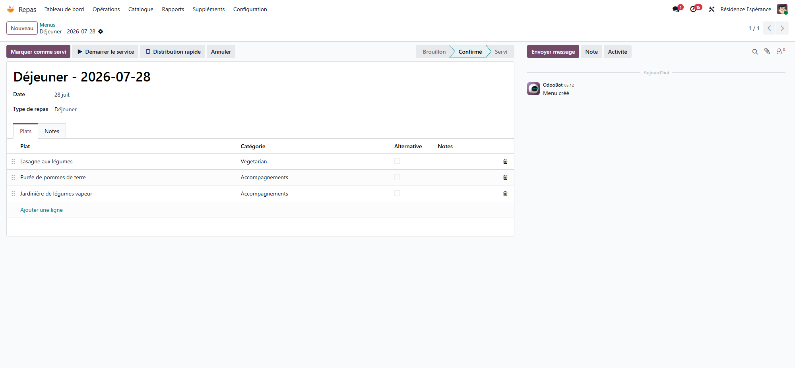
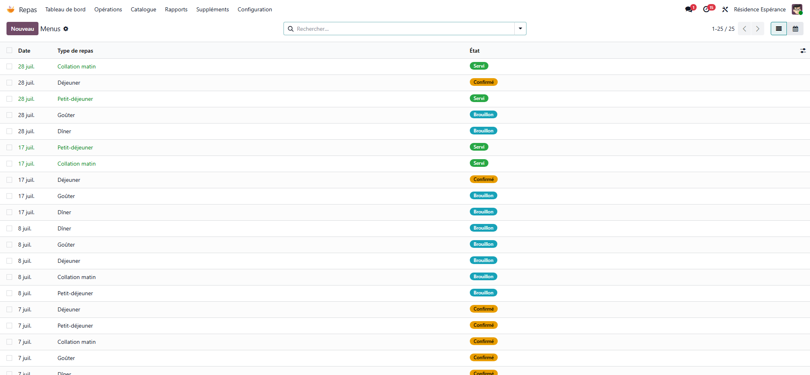
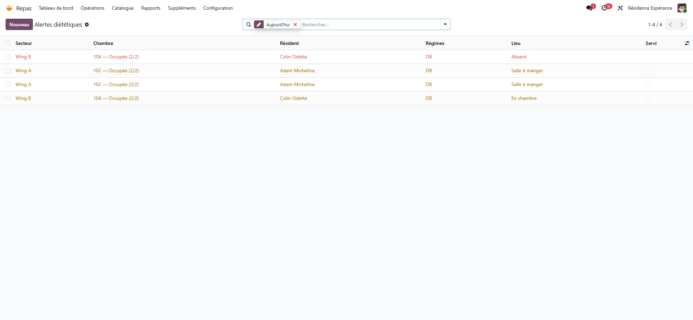

# Menus, diets and allergies

:::{rh-description}
Build the menu of each meal, confirm it so the places are laid, and record each resident's diets and food allergies so WideCare flags the plates that do not suit them.
:::

:::{rh-faq}
How do I build a menu in WideCare?
: In **Meals → Operations → Menus**, create one menu per meal type and per day, add the dishes in the **Dishes** tab, then click **Confirm**.

What does Confirm do?
: It lays a place (a meal service) for every resident served at that meal, with the menu's dishes. Residents in hospital or away that day get no place.

A resident arrived after the menu was confirmed. What do I do?
: Open the menu and click **Lay Missing Couverts**: WideCare lays the places still missing and opens the list.

Can I change a dish after confirming?
: Yes. The places nobody has served yet follow the new dishes. A plate already served or refused, or a dish changed for one resident, is left as it is.

How does WideCare handle diets and allergies?
: Each resident has their diets, food allergies and texture. WideCare compares them with each dish served and raises a warning or a critical alert, listed in **Dietary Alerts**.
:::

Each meal of the day has its **menu**: the dishes the kitchen serves at
breakfast, lunch, dinner or a snack. Once the menu is **confirmed**, every
resident served at that meal gets their **place** (a meal service), and
WideCare checks each plate against the resident's **diets**, **allergies** and
**texture**.

## Meal types

The meal types are set in **Meals → Configuration → Meal Types**: Breakfast,
Morning Snack, Lunch, Afternoon Snack and Dinner are provided. For each type:

- **Default Time** — the usual hour of the meal. It places the meal in the day
  and decides which meals a resident who comes only part of the day is served.
- **Share of the Day's Needs (%)** — the part of the day's energy and protein
  this meal is expected to bring. A resident who eats only some meals in the
  home is judged on those meals only. Left empty on every type, the day is
  shared evenly.

## Building a menu

1. Go to **Meals → Operations → Menus** (or click **Create Today's Menus** on
   the dashboard to create all of today's menus at once).
2. Choose the **Date** and the **Meal Type**. There is one menu per meal type and
   per day.
3. In the **Dishes** tab, add the dishes from the catalogue. For each line:
   - **Category** — starter, main course, dessert…
   - **Alternative** — tick it for a dish offered instead of the main one. An
     alternative is not put on every plate: it is chosen resident by resident.
   - **Notes** — a word for the kitchen.
4. Click **Confirm**.

<!-- screenshot to update: menu header now shows Confirm, Mark as Served, Lay Missing Couverts, Cancel -->

The **Menus** list opens on today's menus; the **Today**, **Tomorrow** and
**This Week** filters and the calendar view show the other days.

## The menu status

| Status | Meaning |
| --- | --- |
| **Draft** | The menu is being prepared. Nothing is laid yet. |
| **Confirmed** | The places are laid: the round can start. |
| **Served** | The meal is over (**Mark as Served**, or **Complete** on the dashboard). |
| **Cancelled** | The meal is not served. |

- **Confirm** lays a place for every resident served at that meal, with the
  menu's dishes. Nobody in hospital or away that day gets one, and a resident who
  comes only part of the day gets the meals of their hours.
- **Lay Missing Couverts** (on a confirmed menu) lays the places of residents
  arrived since the confirmation, then opens the list of the meal's places.
- **Cancel** takes off the round the places nobody has dealt with yet. A plate
  already served or refused stays.
- **Reset to Draft** brings a cancelled menu back to draft.

When you change the dishes of a confirmed menu, the places not served yet follow
the new dishes. A plate already served or refused, or one whose dish was changed
for that resident, keeps its own dishes.

:::{admonition} Traceability
:class: note

A menu in the **Served** status cannot be deleted, nor can a plate already
served or refused: WideCare keeps them. Correct the record instead.
:::

## Diets

The diets are listed in **Meals → Configuration → Dietary Regimes** (Normal,
Diabetic, Low Sodium, Low Fat, Enteral feeding, Enriched are provided). On a
diet:

- **Code** — a short code shown on the round and on the printed sheets (for
  example DIAB).
- **Restrictions** — **Salt-Free**, **Sugar-Free**, **Low Fat**,
  **Gluten-Free**, **Lactose-Free**, **Vegetarian**, **Halal**, **Kosher**.
  WideCare uses them to check the dishes.
- The **Residents** button lists the residents on that diet.

A resident can have **several diets** at once (diabetic and low salt, for
example). Record them on the resident's **Nutrition** tab, in **Diets and
Textures**, or on their care plan (see below).

:::{tip}
On a pathology of the catalogue, the **Dietary Regimes** tab lists the diets to
suggest: when that pathology is diagnosed, WideCare adds them to the resident's
diets.
:::

## Food allergies

The allergens are listed in **Meals → Configuration → Allergies**, each with a
default **severity**: **Low - Monitor**, **Medium - Warning**, **High - Strong
Warning**, **Critical - Block Prescription**.

A resident's food allergies are the food lines of their allergy table, on the
**Care** tab of the resident: the severity recorded there for that resident wins
over the default one. The **Food Allergies** block of the **Nutrition** tab shows
the same list: adding an allergen there records the allergy, removing it deletes
the line.

## Diets on the care plan

The **Nutrition** tab of the care plan edits the same information as the
resident's record: **Dietary Regimes**, **Texture**, **Food Allergens**, the
resident's food preferences and **Food Dislikes**. What a nurse changes there is
what the kitchen reads, and the change is written in the plan's history.

## Dietary alerts

For every place laid, WideCare compares the dishes with the resident's profile:

| What is checked | Result |
| --- | --- |
| An allergen of a dish the resident is allergic to, severity **High** or **Critical** | **Critical alert** |
| The same, lower severity | Warning |
| A sugar-free diet and a dish with more than 5 g of sugar not marked **Diabetic Safe** | **Critical alert** |
| A sugar-free diet and a dish not marked **Diabetic Safe** | Warning |
| A salt-free diet and a dish with more than 1 g of salt not marked **Low Salt** | Warning |
| A gluten-free, vegetarian or halal diet and a dish not marked accordingly | Warning |
| A dish only available in a coarser texture than the resident's | **Critical alert** (choking risk) |
| A dish only available in a finer texture than the resident's | Warning |

**Meals → Operations → Dietary Alerts** lists today's plates with a warning, with
the sector, room, resident, diets and place. The **Critical Alerts** filter keeps
the critical ones.

:::{admonition} A critical alert blocks the plate
:class: warning

WideCare **refuses to mark as served** a plate with a critical alert. Change
the dish first: on the meal service, the **Compatible Dishes** button lists the
dishes of the catalogue that raise no warning for this resident. See [The meal
round](distribution.md).
:::

## Going further

- [Dishes and nutritional values](plats.md)
- [Food textures (IDDSI)](textures.md)
- [The meal round](distribution.md)
- [Nutritional monitoring and undernutrition](suivi-nutritionnel.md)
