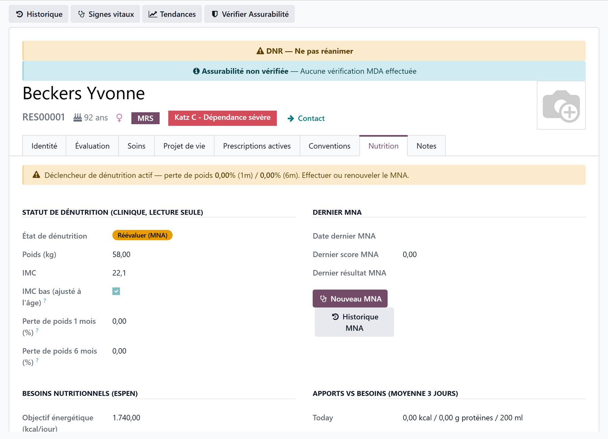
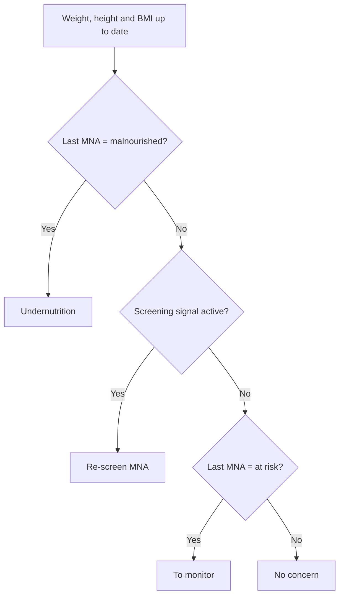
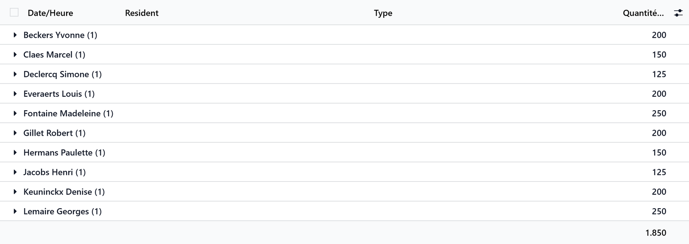

# Nutritional monitoring and undernutrition

:::{rh-description}
Screen for undernutrition and track intake in a nursing home: risk status, MNA, ESPEN targets, food and fluid coverage, and automatic alerts.
:::

:::{rh-faq}
How does Resthome identify a resident at risk of undernutrition?
: Resthome applies screening rules drawn from ESPEN and updates a status: a weight loss of more than 5% in 1 month or more than 10% in 6 months, a BMI below 23 in a resident over 70, or an MNA missing or more than 6 months old move the resident to Re-screen (MNA). A latest MNA of "Malnourished" places the resident directly in Undernutrition. The status is recalculated on every weight change and once a day.

Does the undernutrition status change the care allowance?
: No. Where the country has a care allowance paid by the health insurer, it follows the resident's dependency assessment, not their nutritional status. Undernutrition monitoring is a clinical tool: it triggers assessments (MNA) and alerts, but has no effect on billing.

Where do the energy, protein and fluid targets come from?
: The ESPEN coefficients (30 kcal/kg, 1 g/kg of protein, 1.6 L for women and 2.0 L for men) are facility-wide settings. Resthome then computes each resident's own target from their weight and sex. The energy band rises to 35 kcal/kg for an underweight resident (BMI less than or equal to 21).

How is actual intake calculated?
: From the meal round: for each plate served, you record the amount eaten (Not Eaten, 25%, 50%, 75%, Fully Eaten). Resthome multiplies the per-portion values of the dishes served by this percentage, adds the logged drinks, then compares the 3-day average with the targets.

Why does the Nutrition tab say nothing was recorded?
: No meal was served or refused, or no drink was logged, over the last three days. Resthome then shows no coverage and raises no deficit: an empty record is not a good score. Record the round and the drinks.

Who receives the undernutrition or deficit alerts?
: A daily task creates a to-do activity. The undernutrition alert goes to the head nurse (then the manager); nutritional deficit or hydration deficit alerts go first to the kitchen staff, then to the head nurse, then to the manager. Each alert is repeated at most once every 30 days per resident.
:::

Resthome screens for **undernutrition** and tracks each resident's **intake**,
drawing on the geriatric **ESPEN** recommendations and on established screening
thresholds. Everything is read in the resident's **Nutrition** tab and on the
**Meals** statistics page.

The principle: you enter the **weight** and **height**, record the **meals
served** and the **drinks**; Resthome derives an **undernutrition risk
status**, **targets** for energy, protein and fluids, a **coverage** of intake,
and raises **alerts** when a resident falls behind.

:::{admonition} A screening tool, not a diagnosis
:class: info

Nutritional monitoring helps the team spot frail residents early. It does not
replace the assessment of a **dietitian** or a **physician**: the status and
alerts are signals to be interpreted, not decisions.
:::

## The resident's Nutrition tab

Open a resident, then the **Nutrition** tab. The clinical blocks (status, MNA,
targets, intake) only appear for the residents whose care the home follows; a
resident the home only feeds keeps the diets, texture, allergies and
preferences.

<!-- screenshot to update: Nutrition tab now has the editable Height, the "nothing recorded" notice and the Diets and Textures block -->

### The undernutrition risk status

The **Undernutrition Status** block is computed by Resthome: you do not edit the
status by hand. It shows a coloured badge and the measurements that explain it.

| Displayed status | Meaning | Badge colour |
|---|---|---|
| **No concern** | No screening signal | Green |
| **To monitor** | Last MNA "At Risk" | Blue |
| **Re-screen (MNA)** | A screening signal is active: redo or renew the MNA | Orange |
| **Undernutrition** | Last MNA "Malnourished" | Red |

Below the badge: the **weight**, the **Height (cm)**, the **BMI**, **Low BMI
(age-adjusted)** and the **weight loss** over 1 month and over 6 months.

:::{admonition} Enter the height here
:class: tip

The height is entered directly in the tab. Without it, Resthome shows **Height
missing**: the BMI cannot be computed and the low-BMI criterion is not
evaluated, so a thin resident who has not lost weight is not caught.
:::

:::{admonition} What triggers "Re-screen (MNA)"
:class: note

A **screening signal** is active as soon as one of these conditions is true:

- **weight loss** of more than **5%** over about 1 month;
- **weight loss** of more than **10%** over about 6 months;
- **BMI below 23** in a resident **over 70** (age-adjusted threshold);
- **overdue MNA**: no MNA, or a last MNA more than 6 months old (not for
  someone who only comes by day).
:::

:::{admonition} In Belgium
:class: rh-country rh-country-be

These thresholds are the default values of the AViQ screening (PWNS-be-A). See
[Care in Belgium](../belgique/soins.md).
:::

When the status is **Re-screen (MNA)** or **Undernutrition**, a banner at the
top of the tab recalls the weight loss and asks to perform or renew the MNA.

:::{admonition} Weigh regularly to get the weight loss
:class: warning

The weight loss over 1 and 6 months is computed from the **weights logged in the
vital signs**. Without regular weigh-ins, Resthome cannot compare and these
percentages stay at zero.
:::

### The latest MNA

The **Latest MNA** block shows the resident's most recent **MNA** (Mini
Nutritional Assessment): **date**, **score** and **result** (**Normal**, **At
Risk**, **Malnourished**).

- **New MNA** opens a new MNA pre-filled for this resident, with the **BMI
  band** already chosen from their known BMI.
- **MNA History** opens their previous MNAs.

The MNA-SF is a **14-point** scale: **12–14** = normal, **8–11** = at risk,
**0–7** = malnourished. It is the MNA that switches the status to
**Undernutrition** or **To monitor**. See [Clinical
registers](../soins/registres.md).

### The ESPEN targets

The **Nutritional Needs (ESPEN)** block shows the targets **specific to the
resident**, derived from their weight and sex:

| Target | How it is computed |
|---|---|
| **Energy Target (kcal/day)** | Weight × 30 kcal/kg (or 35 if BMI less than or equal to 21) |
| **Protein Target (g/day)** | Weight × 1 g/kg |
| **Fluid Target (ml/day)** | 1600 ml (women) / 2000 ml (men) |

The coefficients are set once for the whole home in [Meal and nutrition
settings](../configuration/reglages-repas.md).

### Intake vs needs (3-day average)

The **Intake vs Needs (3-day avg)** block compares what the resident actually
consumed with their targets.

- **Today** — the day's intake: kcal, protein (g) and fluids (ml).
- **Energy Coverage**, **Protein Coverage** and **Fluid Coverage** — the
  **3-day average** as a percentage of the target.
- **Nutrition Deficit** and **Hydration Deficit** — ticked when coverage falls
  below the configured threshold (75% by default).
- **Log Drink** records a drink for this resident; **Hydration History** opens
  their drinks.

How the average is read:

- Only the meals **served or refused** count as recorded; a place laid but not
  dealt with is not a meal.
- A resident admitted less than three days ago is averaged over the days since
  their arrival.
- A resident who eats only some meals in the home is compared with the share of
  the day those meals represent (**Share of the Day's Needs** of the meal
  types), on the days they came.

:::{admonition} Nothing recorded is not a good score
:class: warning

When no meal or no drink was recorded over the last three days, the tab says so
(**No meal recorded over the last three days**, **No drink recorded over the
last three days**) instead of showing a coverage, and no deficit is raised.
Record the round and the drinks: see [The meal round](distribution.md).
:::

### Diets, textures and preferences

- **Diets and Textures** — **Dietary Regimes**, **Texture**, **Meal Autonomy**
  (**Autonomous**, **Supervised**, **Assisted**, **Fed**) and **Notify Family of
  Meals** (the family e-mails, see [Family portal and public
  menu](portail-familles.md)).
- **Food Allergies** — the food allergies of the resident.
- **Preferences** and **Dislikes** — what the resident likes and does not like;
  carers see them at the table in the care app.

See [Menus, diets and allergies](menus-regimes.md) and [Food textures
(IDDSI)](textures.md).

## Logging food intake

Energy and protein intake comes from the **meal round**: after each meal, record
the **Amount Eaten** of the plate (**Not Eaten**, **25%**, **50%**, **75%**,
**Fully Eaten**), at the desk or in the care app. A refused plate counts as not
eaten.

Resthome multiplies the **per-portion** values of the dishes served by this
percentage. The dishes must carry their values and portions: see [Dishes and
nutritional values](plats.md).

For the residents followed for nutrition (status at risk or confirmed, a
deficit, or an **Intake monitoring** care at that meal), the amount is **owed**:
their plates carry **Intake Required** and the **Amount to Note** filter lists
the ones still missing.

## Recording hydration

Drinks are logged in **Meals → Operations → Hydration**, a list you fill in
directly. It opens on today's drinks grouped by resident, with the daily total.
Each line records the date and time, the resident, the **Type** (**Water**,
**Coffee / Tea**, **Juice / Soft drink**, **Milk / Dairy**, **Soup / Broth**,
**Oral supplement**, **Other**) and the **Amount (ml)**.

You can also log a drink from the Nutrition tab with **Log Drink**, or on the
floor with the **Hydration** screen of the care app, one tap per glass: see
[Meals and drinks in the care app](app-soins.md). A glass logged there also
marks done the **Hydration round** care of its period.

## The nutrition dashboard

Open **Meals → Reporting → Statistics**. Below the cards **Residents**,
**Menus**, **Warnings** and **Critical** (the last two open the alerts), three
banners appear when they concern at least one resident:

| Banner | Residents concerned | Button |
|---|---|---|
| Undernutrition risk (red) | Re-screen (MNA) or Undernutrition status | **Review** opens these residents |
| Nutritional deficit (orange) | Intake below the ESPEN target | **Review** opens these residents |
| Hydration deficit (blue) | Fluid intake below the target | **Review** opens these residents |

The **Today's Service** card at the bottom shows the meals served, pending and
absent today.

<!-- screenshot to add: Meals Statistics page with the three undernutrition / deficit / hydration banners -->

## The automatic alerts

Every day, Resthome refreshes the screening, the targets and the coverage, then
creates **activities** for the residents who fall behind. Each alert is repeated
at most **once every 30 days** per resident.

| Alert | Condition | Recipient |
|---|---|---|
| **Undernutrition — perform/renew the MNA** | Re-screen (MNA) or Undernutrition status | Head nurse, otherwise manager |
| **Nutrition deficit — intake below target** | Energy or protein coverage below the threshold | Kitchen staff, otherwise head nurse, otherwise manager |
| **Hydration deficit — fluid intake below target** | Fluid coverage below the threshold | Kitchen staff, otherwise head nurse, otherwise manager |

:::{admonition} Set the deficit threshold
:class: note

The **75%** threshold that triggers the deficit alerts is changed in **Intake
deficit alert** of the [Meal and nutrition
settings](../configuration/reglages-repas.md). Lower it to be alerted later,
raise it to be alerted earlier.
:::

## Key takeaways

- The **Nutrition** tab gathers the undernutrition status, latest MNA, targets
  and intake coverage; enter the height there.
- The **undernutrition status** follows the screening rules: weight loss,
  age-adjusted BMI, overdue MNA or "Malnourished" MNA.
- The **targets** are specific to each resident, from their weight and sex.
- The **intake** comes from the **amount eaten** at meals and the **logged
  drinks**; coverage is a 3-day average, and an empty record is said, not
  scored.
- The **Statistics** page and the **daily alerts** surface the residents at
  risk; this monitoring does not change the care allowance.

## Further reading

- [The meal round](distribution.md)
- [Meals and drinks in the care app](app-soins.md)
- [Menus, diets and allergies](menus-regimes.md)
- [Clinical registers (MNA)](../soins/registres.md)
- [Meal and nutrition settings](../configuration/reglages-repas.md)
