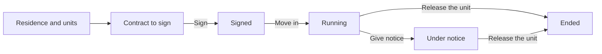

# Serviced residences

:::{rh-description}
The Serviced Living application: residences, units, contracts with one or several occupants, a monthly invoice, the call register and the service requests of independent residents.
:::

:::{rh-faq}
What is the Serviced Living application for?
: For a residence where independent people rent a flat and buy services around it. There is no bed and no care allowance: each unit has a contract, and the contract is billed every month.

Where do I find it?
: In the **Serviced Living** application, with its own tile. Its menus are **Residents**, **Units**, **Contracts**, **Calls**, **Requests**, **Registers** and **Configuration**.

Can a nursing home and a residence share the same database?
: Yes. The residence's units stay apart from the nursing home's rooms, its residents are billed in the same monthly period, and a resident can move from one to the other.

Why do I not see the resident's stay?
: In a residence the contract carries everything, from the signature to the departure. The resident's record shows the unit, the current contract and the move-in date instead.

Does a residence record absences?
: No. The rent does not depend on the days spent at home: nothing about absences shows for a resident of a residence, and a stay in hospital opens none.
:::

:::{toctree}
:hidden:

residences-logements
regimes
contrats
preavis-liberation
facturation
changement-prix
repas
appels
demandes
registres
app-terrain
:::

In a **serviced residence**, independent people rent a flat — a **unit** — and
buy services around it: meals, help on call, cleaning on request. There is no
bed to fill and no care allowance to claim: the residence signs a **contract**
for each unit and sends an ordinary **invoice** every month.

The **Serviced Living** application follows that work, from the first unit to
the day the unit is handed back.

<!-- screenshot to add: the Serviced Living application home, with its menus Residents, Units, Contracts, Calls, Requests, Registers and Configuration -->

## The journey

1. **Set up the residence** — choose the rules it runs under, then generate its
   units in one go. See [Residences and units](residences-logements.md) and
   [Regimes](regimes.md).
2. **Write the contract** — one contract per unit, with one or several
   occupants (a couple pays one rent). See
   [Contracts and occupants](contrats.md).
3. **Sign, then move in** — the signature checks the file; the move-in starts
   the contract.
4. **Bill every month** — the contract's price is billed in the month's billing
   period, beside the other sectors of the house. See
   [Billing a residence](facturation.md) and
   [Changing the price](changement-prix.md).
5. **Notice and release** — the contract runs until the unit is handed back.
   See [Notice and release of a unit](preavis-liberation.md).

Around the contract, the application also keeps the **call register** and the
**duty rota** ([Calls and duty rota](appels.md)), the **service requests**
([Service requests](demandes.md)), the **complaints** and the **residents'
council** ([Complaints and council](registres.md)), and the **meals** taken at
the residence ([Meals in a residence](repas.md)). Whoever is on duty works from
the phone: see [The Residence tab of the care app](app-terrain.md).

## The menus

| Menu | What you find there |
| --- | --- |
| **Residents** | The people living in a unit. **New** opens a new contract. |
| **Units** | The flats of every residence, as a board by status. |
| **Contracts** | The contracts still running, to sign, under notice or to release. |
| **Calls** | The call register (when calls are installed). |
| **Requests** | The service requests to do (when calls are installed). |
| **Registers** | **Duty rota**, **Complaints** and **Council**. |
| **Configuration** | **Residences**, **Regimes**, **Unit types** and **Pieces of the file**. |

## Who sees what

Two roles give access to the application:

- **Serviced Living / User** — keeps the contracts, the occupants, the calls and
  the requests.
- **Serviced Living / Manager** — also sets up the residences, their units and
  their rules, and changes prices. The **Configuration** menu only shows to this
  role. A nursing home manager has it automatically.

:::{admonition} In Belgium
:class: rh-country rh-country-be

The Belgian pack brings the regional regimes, the operating title of the
residence, the health index and the Katz a residence may ask for at
application. See [Serviced residences in Belgium](../belgique/residences-services.md).
:::

## Going further

- [Residences and units](residences-logements.md)
- [Contracts and occupants](contrats.md)
- [Billing a residence](facturation.md)
