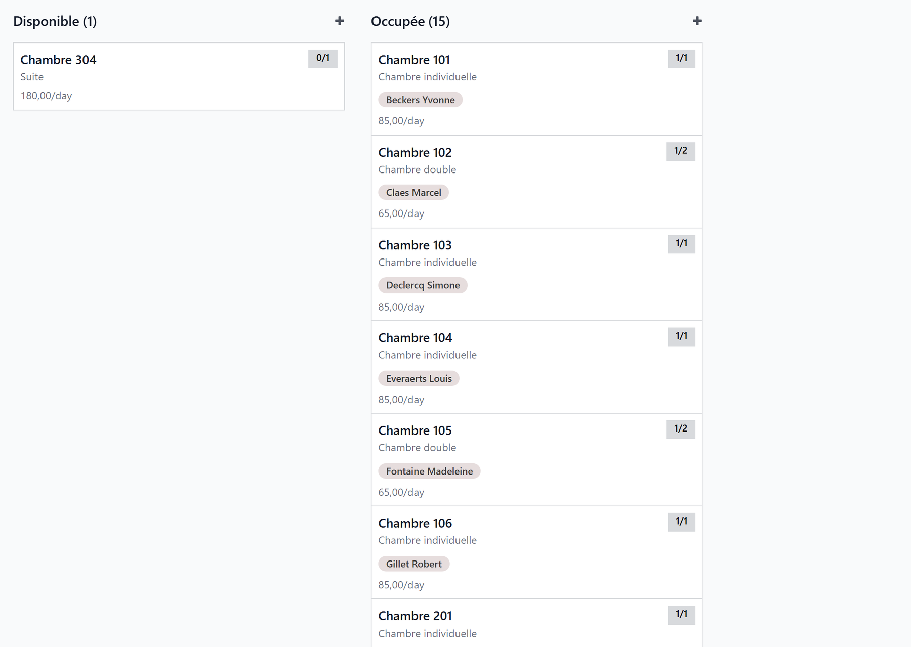
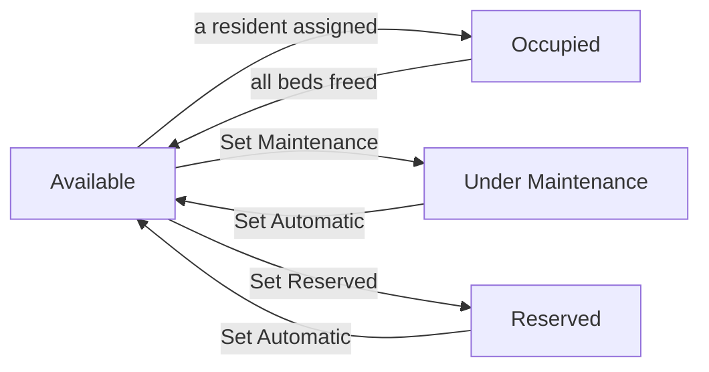

# Rooms and occupancy

:::{rh-description}
Track the occupancy of a nursing home's rooms with Resthome: the board by status, the room record, maintenance and reservation, assigning a resident, generating the rooms of a new home and configuring room types, sectors and equipment.
:::

:::{rh-faq}
Where is the room occupancy board in Resthome?
: In **Nursing Home → Accommodation → Rooms**. Rooms are shown as a kanban, grouped by status: Available, Occupied, Under Maintenance and Reserved.

What does the colored badge on each room mean?
: It shows the occupancy "occupied / capacity" (for example 1/2) and its color reflects the status: green for Available, blue for Occupied, orange for Under Maintenance, cyan for Reserved. A two-bed room with only one bed taken stays Available.

How do I make a room unavailable for works?
: On the room record, click **Set Maintenance** (or **Set Reserved**). The room is then excluded from the assignable rooms. **Set Automatic** puts it back to the automatic status.

How do I create all the rooms of a new home at once?
: In the Rooms screen, open the gear menu and choose **Generate Rooms**: give the number of floors, the rooms per floor and the room type, and Resthome creates them, numbered by floor.

How do I assign a resident directly from a room?
: Open an available room and click **Assign Resident**. Choose the resident and the admission date: Resthome creates the stay, already **Active**, on that room.

Is the daily rate displayed the care allowance paid by the health insurer?
: No. It is the accommodation price (the room), a value specific to your facility, set on the room type. The care allowance follows the country's rules and the resident's dependency category, not the room.
:::

The **Rooms** screen gives a real-time view of the facility's **occupancy**:
which rooms are free, occupied, reserved or under maintenance, how many beds
remain, which free up soon, and at what rate. From a room, you can also
**assign a resident** directly.

You'll find it in **Nursing Home → Accommodation → Rooms**.

## The occupancy board

On opening, the rooms are shown as a **kanban**, grouped by **status**:
**Available**, **Occupied**, **Under Maintenance** and **Reserved**. At a glance,
you can see where space remains.

Each room card shows:

- the room **number**;
- an **occupancy badge** "occupied / capacity" (for example 1/1 or 1/2), coloured
  by status — green (Available), blue (Occupied), orange (Under Maintenance),
  cyan (Reserved);
- the **room type**;
- the **resident(s) present**, if any;
- the **daily accommodation rate**.

:::{admonition} The occupancy / capacity badge
:class: note

A capacity-2 room with only one bed taken shows **1/2** and stays **Available**:
there is still a spot. It only switches to **Occupied** when **all** beds are
taken. A bed counts as taken from the moment its stay is **Confirmed**, before
the resident arrives.
:::

In the top right, switch from the **kanban** to the **list** (number, floor,
sector, type, capacity, occupancy, planned departure, rate, equipment, status)
or the **form**.

### Filtering and grouping

The search bar offers quick **filters**: **Active (not maintenance)** — applied
on opening —, **Available**, **Occupied**, **Maintenance**, **Reserved** and
**Frees up (date known)**. Group the rooms by **State**, **Floor**, **Type**,
**Sector** or **Planned Departure**, and search by number, floor, building,
sector or planned departure.

:::{tip}
**Frees up (date known)** answers the question of a waiting list: which rooms
free up, and when. See [The waiting list](../admissions/liste-attente.md).
:::

## The room record

Click a card to open the **room record**. At the top, the **status bar** shows
the current state, and **ribbons** flag a room as **Maintenance** or
**Reserved**. The **Tasks** smart button opens the open tasks of the room
(preparation, cleaning) — see [Staff tasks](taches.md).

| Field | Purpose |
| --- | --- |
| **Room Number** | Unique identifier of the room. |
| **Room Type** | Determines the **daily rate** and the default capacity. |
| **Floor** / **Building** | Physical location. |
| **Sector** | Sector or floor of the facility; used for grouping, the dashboards and access rights. |
| **Capacity** | Number of beds in the room. |
| **Current Occupancy** | Number of occupied beds (computed). |
| **Planned Departure** | The day a bed actually frees up, when a departure or a room change is planned. |
| **Daily Rate** | Accommodation price, taken from the room type. |
| **Billing Product** | Product linked to the room type (read-only; the **Product** smart button opens it). |

:::{admonition} The daily rate is not the care allowance
:class: info

The **daily rate** is the **accommodation price** (the room), a value **specific
to your facility**, set on the **room type**. It is distinct from the **care
allowance paid by the health insurer**, which follows the country's rules and the
resident's dependency category — not the room.
:::

:::{admonition} In Belgium
:class: rh-country rh-country-be

The care allowance is the INAMI dependency allowance: it is declared with the
resident's Katz category — see [The INAMI package](../belgique/forfait-inami.md).
How many days each room and sector was occupied, or empty, over a period is in
**Occupancy Analysis** — see [Management reports](../belgique/rapports-gestion.md).
:::

### Equipment

The **Equipment** section lists, as tags, what the room provides (television,
private bathroom, medical bed, nurse call…). **Additional Equipment Notes** adds
a free-text detail. The equipment catalogue is the same one the [condition
report](etat-des-lieux.md) uses.

### Current occupancy and history

Three tabs complete the record:

- **Current Occupancy** — the residents present in the room (name, resident code,
  age).
- **Stay History** — all stays that involved this room, with the resident, the
  start and end dates, and the status (**Draft**, **Confirmed**, **Active**,
  **Ended**, **Cancelled**).
- **Notes** — free internal notes about the room.

## Changing a room's status

The **Available / Occupied** status is computed from occupancy. You can,
however, **force** a status from the record header:

- **Set Maintenance** — the room switches to **Under Maintenance** (works, deep
  cleaning, breakdown…) and is no longer offered for assignment.
- **Set Reserved** — the room becomes **Reserved** and drops out of the available
  rooms.
- **Set Automatic** — cancels the manual override: the status is again
  **computed** from occupancy.

:::{admonition} Maintenance and Reserved block assignment
:class: warning

As long as a room is **Under Maintenance** or **Reserved**, the **Assign
Resident** button is hidden and the room does **not** appear in the room lists
of the admission or the room change. Click **Set Automatic** to make it
assignable again.
:::

## Assigning a resident from the room

You can open a stay directly from a free room, without going through the admission
pipeline:

1. Open the record of an **Available** room (neither full, nor under maintenance,
   nor reserved — otherwise the button does not appear).
2. Click **Assign Resident**.
3. In the wizard, choose the **Resident** (only residents are offered).
4. Check the **Admission Date** (today by default) and, if needed, the **Planned
   End Date**.
5. The **Daily Rate** is taken from the room; fill in **Invoice To** if the
   invoice must be addressed to a third party (a relative, a public welfare
   body).
6. Optionally add an **Admission Reason**, then click **Assign Resident**.

Resthome creates the **stay** on this room, already **Active**, and brings you
back to the room record.

<!-- screenshot to add: the Assign Resident wizard, with the Resident, Admission Date, Daily Rate and Invoice To fields -->

### When the resident is already housed: the transfer

If the chosen resident **already occupies a room**, the wizard shows a
**Transfer** warning naming their current room, and the button becomes
**Transfer Resident**. On confirmation, Resthome **ends** the old stay (reason:
internal transfer) and **opens** a new stay in the chosen room.

:::{admonition} Assign ≠ Change Room
:class: note

Assigning an **already-housed** resident from the room performs a simple
**transfer**. For a room change that **splits the accommodation billing** at
the right date, can be **scheduled** ahead and keeps the care allowance paid by
the health insurer **continuous**, use **Change Room** on the **stay** — see
[Room change and transfer](changement-chambre.md).
:::

## Generating the rooms of a new home

On a new database, lay out every room in one go:

1. Open **Nursing Home → Accommodation → Rooms**.
2. Open the **gear** menu next to the title and choose **Generate Rooms**.
3. Fill in:
   - **Building** and **Number Prefix** (optional);
   - **Floors**, **First Floor** and **Rooms per Floor**;
   - the **Room Type** of the rooms;
   - **One Sector per Floor**, to create a sector for each floor.
4. Check the **Numbering** preview (001, 101, 214…), then click **Generate**.

Existing room numbers are left untouched: rename or adjust the generated rooms
afterwards. **Generate Rooms** is offered to managers, on a computer screen.

## Configuring room types, sectors and equipment

The room structure is prepared in **Nursing Home → Configuration → Rooms**:

- **Sectors / Floors** — the wings or floors of the house (**Name**, **Code**,
  **Color**), with their rooms and the number of residents.
- **Room Types** — each type (single, double…) with its **Code**, its
  **Billing Product**, its **Daily Rate**, its **Default Capacity** and, for a
  place used during the day only, **Day Place**. A room's rate derives from its
  type: one type per price.
- **Room Equipment** — the catalogue of equipment (**Name**, **Category**:
  Comfort, Medical, Technology, Outdoor, Other), which you then tick on each
  room.

The default capacity of a new room is set in the settings — see
[Configuration](../configuration/index.md).

## Key takeaways

- The occupancy board lives in **Nursing Home → Accommodation → Rooms**, as a
  **kanban grouped by status**.
- A shared room stays **Available** as long as one bed is free; a bed counts as
  taken from the **Confirmed** stay.
- **Set Maintenance** / **Set Reserved** force a status; **Set Automatic**
  restores it.
- **Frees up (date known)** shows the rooms that free up on a known date.
- **Assign Resident** creates an active stay; for an already-housed resident it
  becomes a **transfer**.
- **Generate Rooms** lays out a new home in one go.

## Going further

- [Manage a resident](gerer-un-resident.md)
- [Room change and transfer](changement-chambre.md)
- [Room housekeeping](entretien-chambres.md)
- [Technical interventions](../interventions/index.md) — the **Interventions** button of the room lists its repair tickets.
- [The waiting list](../admissions/liste-attente.md)
- [Configuration](../configuration/index.md)
