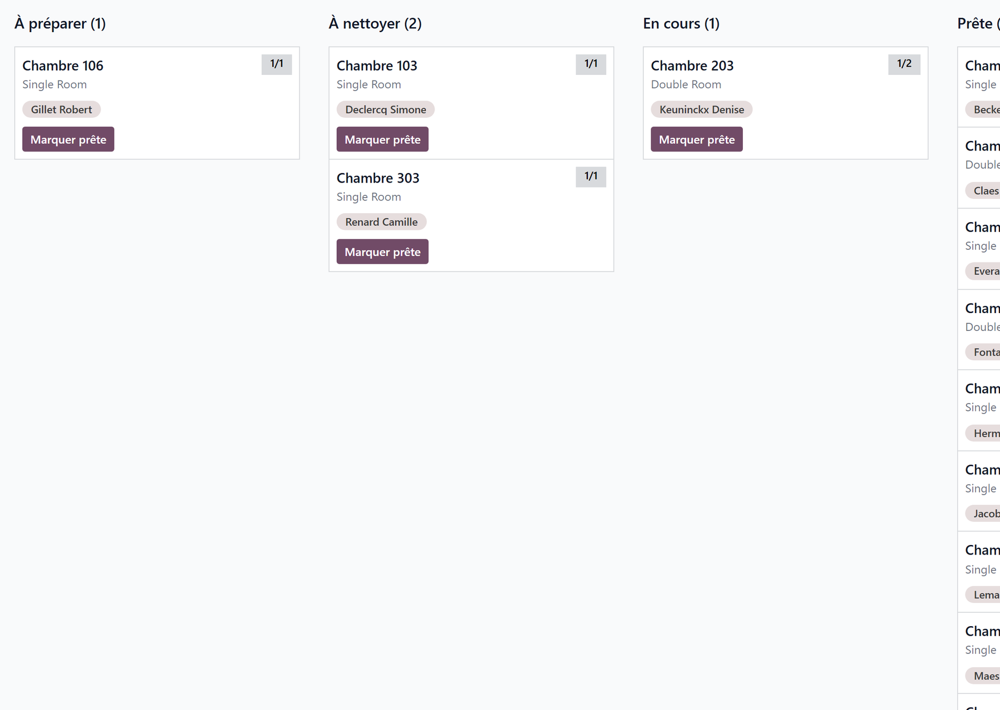

# Room housekeeping

:::{rh-description}
The housekeeping board in Resthome: track the cleaning stage of each room — to prepare, to clean, in progress, ready — independently of who occupies it, from the desk or from the phone.
:::

:::{rh-faq}
Where do I see the rooms to be cleaned in Resthome?
: In **Nursing Home → Accommodation → Housekeeping**. The board shows one column per stage — To prepare, To clean, In progress, Ready — and you move a room from one to the next by drag and drop.

Is the housekeeping stage the same thing as the room being occupied?
: No, and that is deliberate. An occupied room can perfectly well be "to clean", and a free room is not usable until it is "ready". The two states are tracked separately.

Does Resthome set the housekeeping stage automatically?
: It sets the starting point: a room goes to "To prepare" when a resident is due to arrive, and to "To clean" when one leaves it. Each time, a task is created for the housekeeping team.

Do the board and the tasks agree?
: Yes. Starting the task puts the room "In progress", closing it puts the room "Ready". The other way round, dragging the room to "Ready" on the board closes its open tasks.

Can the housekeeping team work from a phone?
: Yes. In the WideCare field app, the rooms to prepare and to clean are listed with one tap to start a room and one to mark it ready.
:::

A room has **two independent states**: who occupies it, and where it stands in
the **housekeeping** cycle. Resthome tracks them separately, because they answer
two different questions.

Menu: **Nursing Home → Accommodation → Housekeeping**.

:::{admonition} Why two separate states
:class: note

An **occupied** room can still be *to clean*, and a **free** room is not usable
until it is *ready*. Merging the two would hide exactly the case that matters:
a room that looks available but is not yet.
:::

## The four stages

| Stage | Meaning |
|---|---|
| **To prepare** | A resident is due to arrive; the room must be made ready. |
| **To clean** | The room has been vacated and awaits cleaning. |
| **In progress** | Cleaning or preparation under way. |
| **Ready** | The room can receive a resident. |

Each card shows the room number, its occupancy badge (the same colours as the
[rooms board](chambres.md)), its type and its occupants.

## How a room moves through them

Resthome sets the **starting point** and creates the matching
[staff task](taches.md) for the housekeeping team:

- an **arrival** (admission, room change, transfer) puts the room in **To
  prepare**, with a **Prepare the room** task due on the arrival day;
- a room being **left** for another one puts it in **To clean**, with a **Put the
  room back in order** task;
- the **end of a stay** (departure, death, transfer elsewhere) puts the freed
  room in **To clean**, with a **Clean the room** task due on the end date.

From there, the team drives the room:

- **drag and drop** the card from one column to the next;
- **Mark ready** on the card closes the cycle in one click;
- or work from the tasks: **Start** puts the room **In progress**, **Done** puts
  it **Ready**.

The board and the tasks always agree. Dragging a room to **Ready** closes its
open housekeeping tasks (with the comment *Marked ready on the board*); dragging
it to **In progress** starts them. A room with an arrival to prepare **and** a
departure to clean only becomes **Ready** once both are done.

:::{note}
A waiting-list room and a shared day place never enter the board: nobody moves
into them.
:::

:::{admonition} Empty columns stay visible
:class: tip

Every stage keeps its column, even with no room in it. An empty **To clean** is
not noise — it is the signal that nothing is pending.
:::

## On the phone

Where the WideCare field app is installed, the shift screen shows two cards,
**To prepare** and **To clean**, with the time of the first arrival or the
number of rooms in progress. They open the **Rooms** screen:

- the rooms are grouped **In progress**, **To prepare** and **To clean**, with a
  **Late** chip when the task is overdue;
- **Start** puts the room in progress, then **Ready** closes it;
- **Undo** takes back a tap made by mistake.

A tap needs a connection: the stage of the room at that moment is what counts.
A room handled at the desk says **Handled at the desk**. See [Care on
mobile](../soins-mobile/index.md).

<!-- screenshot to add: the Rooms screen of the field app, with a room In progress and its Ready button -->

## Key takeaways

- Housekeeping is **independent of occupancy**: the two are tracked separately.
- Arrivals and departures set the **starting point** and create the tasks.
- The board is driven by **drag and drop**, with **Mark ready** as the shortcut;
  the tasks and the phone move the same board.

## Further reading

- [Rooms and occupancy](chambres.md)
- [Staff tasks](taches.md)
- [Rooms on the WideCare app](../soins-mobile/chambres.md)
- [The move-in procedure](procedure-emmenagement.md)
- [The condition report](etat-des-lieux.md)
