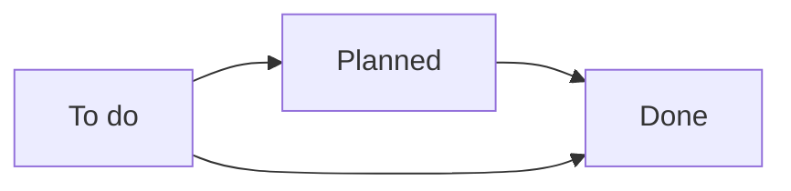
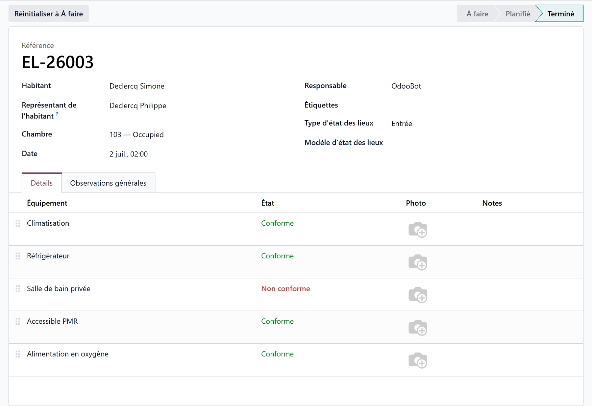
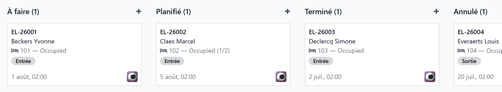

# The condition report (move-in and move-out)

:::{rh-description}
The move-in and move-out condition report of a room in WideCare: each item of equipment rated OK or Not OK with a photo, reusable templates, and a PDF report ready to sign.
:::

:::{rh-faq}
Where do I create a condition report in WideCare?
: In **Nursing Home → Accommodation → Property Inspections**, click **New**. When you select the resident, the room (from their current stay) and the representative are filled in.

What is the difference between a move-in and a move-out condition report?
: The **Inspection Type** field: **Arrival** records the state of the room when the resident moves in, **Exit** when they leave. The PDF report shows the matching badge.

Can I reuse a standard list of equipment?
: Yes, through **Inspection Templates** (Nursing Home → Configuration → Property Inspections). A template fills in the lines, the sections and the general observations, like a quotation template.

Can a finished condition report still be changed?
: Not directly. Once **Done**, it is locked and cannot be deleted: click **Reset to To do** to reopen it — the reopening is recorded in its history.

How do I sign the condition report?
: Print it with **Print → État des lieux**. The PDF carries two signature boxes, for the resident's representative and for the house, placed for an electronic signature request; otherwise, print it in two copies and sign by hand.
:::

The **condition report** records the **state of a room** and its equipment at a
given moment: when the resident **moves in**, then when they **move out**. It is
a **joint assessment**, signed by the resident's representative and by the
house.

Menu: **Nursing Home → Accommodation → Property Inspections**.

Each report links a **resident**, a **room** and a **representative**, lists the
**equipment** assessed (OK or Not OK), and produces a **PDF report** on your
letterhead.

:::{admonition} An optional module
:class: info

Condition reports come with their own module. Once it is installed, **Property
Inspections** appears in the **Accommodation** menu. A new stay also opens the
**Entry / exit condition report** step of the [move-in
procedure](procedure-emmenagement.md), as a reminder.
:::

## 1. Create the condition report

1. Open **Nursing Home → Accommodation → Property Inspections**.
2. Click **New**.
3. Select the **Resident**.
4. Check the **Date** (now by default) and the **Responsible** (you by default).
5. Choose the **Inspection Type**: **Arrival** or **Exit**.
6. **Save**: a **Reference** is assigned (prefix EL-).

:::{admonition} The room and the representative fill themselves in
:class: tip

As soon as you choose the **resident**, WideCare fills in:

- the **Room**, from their **current stay**;
- the **Resident's Representative** — the person who signs —, from their first
  contact person.

Both remain editable, and both are required.
:::

**Tags** classify the reports as you wish; they are managed in **Nursing Home →
Configuration → Property Inspections → Inspection Tags**.

## 2. Fill in the details

Open the **Details** tab. Three buttons sit at the bottom of the list:

- **Add a line** — an item of equipment being assessed;
- **Add a section** — a heading that groups lines ("Bedroom", "Bathroom"…);
- **Add a note** — a free-text line.

For an equipment line:

| Column | Purpose |
|---|---|
| **Equipment** | The item assessed (required). |
| **State** | **OK** or **Not OK** (required). |
| **Photo** | A photo of the item. |
| **Notes** | A free observation. |

Drag the handle on the left of a line to reorder the list. The **General
Observations** tab takes free text about the room as a whole.

### The equipment catalogue

The lines point to the house's **equipment catalogue**, the same one the
[rooms](chambres.md) use: the bed, the wardrobe, the television, the
bathroom… are defined once in **Nursing Home → Configuration → Rooms → Room
Equipment**.

### Reusable templates

To avoid re-entering the same list every time:

1. Create your templates in **Nursing Home → Configuration → Property
   Inspections → Inspection Templates** — a name (for example *Standard single
   room*), its **Lines** (lines, sections and notes) and its **General
   Observations**.
2. On a condition report, choose the **Inspection Template**: its content fills
   in the report, which you then rate.

## 3. Follow the status

| Status | Meaning |
|---|---|
| **To do** | Created, not yet carried out. |
| **Planned** | The inspection is scheduled. |
| **Done** | Carried out and closed. |
| **Cancelled** | Abandoned. |

The buttons at the top move it on: **Plan**, **Mark as Done**, **Cancel**, and
**Reset to To do** to reopen a done or cancelled report. The kanban view shows
one column per status.

:::{admonition} A done report is locked
:class: warning

Once **Done**, the report is a finalised record: its resident, room, date,
lines and observations can no longer be edited, and it cannot be deleted. To
correct it, click **Reset to To do** — the reopening stays in its history —,
then mark it done again.
:::

The search bar filters on **Arrival**, **Exit**, **To do**, **Planned**,
**Done** and **My Inspections**, and groups by **Status**, **Inspection Type**,
**Resident**, **Room** or **Responsible**.

## 4. Print the report

**Print → État des lieux** produces the PDF, named after the reference. It
holds:

- your **letterhead** and your house colour (set in the document layout);
- the **Arrival** or **Exit** badge;
- the resident, the room, the person in charge, the representative, the date
  and the tags;
- the general observations;
- the items assessed, with their state, photo and notes;
- a **summary** of the items, OK and Not OK;
- two **signature** boxes — the resident's representative and the house —
  under the place and date, "in two copies";
- a **photographic appendix**, four photos per page.

:::{admonition} Ready for an electronic signature
:class: info

The signature boxes carry invisible anchors placed for an electronic signature
request: the representative's and the house's signatures land in the right
place. The footer refers to the European eIDAS regulation. Otherwise, print
the report and have both copies signed by hand.
:::

:::{note}
The PDF report is printed in French, whatever the user's language.
:::

<!-- screenshot to add: the first page of the PDF report with the Arrival badge, the summary and the two signature boxes -->

## Interventions in the room

Where the helpdesk is installed, an **Interventions** smart button on the report
lists the technical interventions made in that room during the resident's
occupancy — the history the move-out report is checked against. See
[Following an intervention](../interventions/suivre-une-intervention.md).

## Key takeaways

- The condition report is a **joint assessment**, on arrival then on exit,
  signed by the representative and the house.
- The **room** and the **representative** fill themselves in from the resident.
- Each line carries an **item of equipment** and a **State** (OK / Not OK), with
  a photo and notes; **templates** save re-entering the list.
- A **Done** report is locked and kept; **Reset to To do** reopens it.

## Going further

- [The move-in procedure](procedure-emmenagement.md)
- [Rooms and occupancy](chambres.md)
- [The resident's private furniture](mobilier.md)
- [Room change and transfer](changement-chambre.md)
