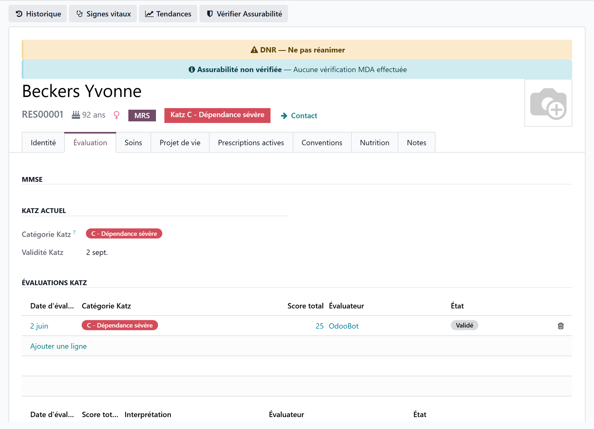
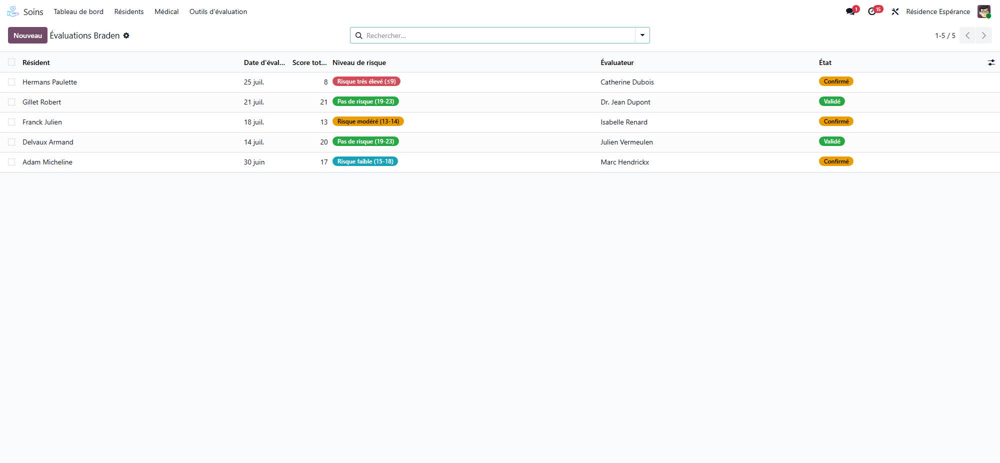
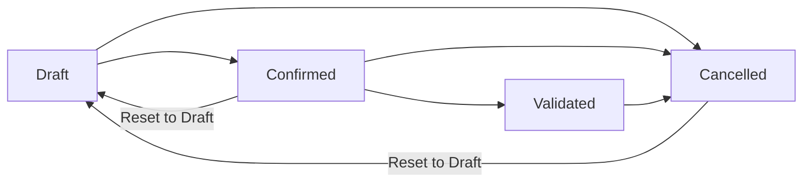

# Geriatric assessments

:::{rh-description}
Geriatric scales in the nursing home with Resthome: MMSE, Braden, MNA, OHAT, Tinetti and pain (EVA / DOLOPLUS-2) — entry, score, interpretation, validation and follow-up.
:::

:::{rh-faq}
Which geriatric scales does Resthome offer?
: Six: MMSE (cognition), Braden (pressure ulcer risk), MNA (nutrition), OHAT (oral health), Tinetti (balance and gait) and pain, on the EVA or DOLOPLUS-2 scale.

Where do I enter a geriatric assessment?
: On the resident's record, **Evaluation** tab, for the first five scales; or in **Nursing Care → Evaluation Tools**, which has one entry per scale, pain included.

Who can validate an assessment?
: Anyone with access can enter and confirm it; the head nurse or the physician validates it. A validated assessment is locked.

How do I correct a validated assessment?
: Cancel it, then the head nurse resets it to draft, corrects it and confirms it again. The history keeps every step.

How do I see every assessment still waiting for validation?
: **Nursing Care → Medical → Assessments → Evaluations to Validate** lists the drafts and confirmed assessments of every scale, by resident and evaluator.

How do I reassess a resident?
: Enter a new assessment on a new date — one per day and per scale. The history of each scale is kept.
:::

Beyond the dependency assessment, which follows each country's scale,
Resthome gathers the main **geriatric scales** of the nursing home, to measure
cognition, pressure ulcer risk, nutrition, oral health, falls and pain. You find
them in two places:

- on the **resident's record**, the **Evaluation** tab: the history of each scale
  and direct entry — shown to the care roles;
- in **Nursing Care → Evaluation Tools**, one list per scale for the whole
  house.

## Available scales

| Scale | What it measures | Score | Reading |
|---|---|---|---|
| **MMSE** | Cognitive function | /30 | Higher = better |
| **Braden** | Pressure ulcer risk | 6–23 | Lower = more at risk |
| **MNA** | Nutritional status | /14 | Lower = more at risk |
| **OHAT** | Oral health | /16 | Higher = more at risk |
| **Tinetti** | Balance and gait (falls) | /28 | Lower = more at risk |
| **Pain** | Pain, self-reported or observed | /10 or /30 | Higher = more pain |

The first five are on the resident's **Evaluation** tab; **Pain** is entered from
**Nursing Care → Evaluation Tools**, then **Pain (EVA / DOLOPLUS-2)**.

:::{admonition} The dependency category stays separate
:class: info

The dependency scale determines the **dependency category**, on which the care
allowance paid by the health insurer relies; it follows the country's rules and
its own renewal cycle. The scales on this page do not change that category.
:::

:::{admonition} In Belgium
:class: rh-country rh-country-be

The dependency scale is **Katz**, with its categories, its renewal due date and
its reminders — see [The Katz assessment](../belgique/katz.md).
:::

## MMSE — cognitive function

Menu: **Nursing Care → Evaluation Tools**, then **MMSE (Mini Mental State)**.

The **MMSE** is a cognitive screening test out of **30 points**. Tick each
item passed, across 7 domains:

| Domain | Points |
|---|---|
| Orientation in time | 5 |
| Orientation in space | 5 |
| Registration (3 words) | 3 |
| Attention and calculation | 5 |
| Recall (3 words) | 3 |
| Language | 8 |
| Visuo-constructive praxis | 1 |

| Score | Interpretation |
|---|---|
| 27–30 | Normal |
| 21–26 | Mild cognitive impairment |
| 11–20 | Moderate cognitive impairment |
| 0–10 | Severe cognitive impairment |

## Braden — pressure ulcer risk

Menu: **Nursing Care → Evaluation Tools**, then **Braden (Pressure Sore Risk)**.

Score **6 subscales**: sensory perception (1–4), moisture (1–4), activity
(1–4), mobility (1–4), nutrition (1–4), friction and shear (1–3). The total
runs from 6 to 23. **The lower the score, the higher the risk.**

| Score | Risk level |
|---|---|
| 19–23 | No risk |
| 15–18 | Mild risk |
| 13–14 | Moderate risk |
| 10–12 | High risk |
| 9 or less | Very high risk |

## MNA — nutritional status

Menu: **Nursing Care → Evaluation Tools**, then **MNA (Nutritional Assessment)**.

The **MNA** short form screens for **malnutrition** out of **14 points**, from
6 questions: reduced food intake over 3 months (0–2), recent weight loss
(0–3), mobility (0–2), acute illness or psychological stress (0 or 2),
neuropsychological problems (0–2) and body mass index (0–3).

| Score | Nutritional status |
|---|---|
| 12–14 | Normal |
| 8–11 | At risk of malnutrition |
| 0–7 | Malnourished |

:::{admonition} Nutritional follow-up
:class: tip

Weight, intake and hydration follow-up are part of the care and meals apps —
see [The clinical registers](../soins/registres.md) and [Nutritional
follow-up](../repas/suivi-nutritionnel.md).
:::

## OHAT — oral health

Menu: **Nursing Care → Evaluation Tools**, then **OHAT (Oral Health)**.

The **OHAT** scores **8 categories** from 0 (healthy) to 2 (needs treatment):
lips, tongue, gums and tissues, saliva, natural teeth, dentures, oral
cleanliness and dental pain. The total runs from 0 to 16. **The higher the
score, the more concerning the situation.**

| Score | Oral health |
|---|---|
| 0–3 | Healthy |
| 4–8 | Changes needed (refer to a dental professional) |
| 9–16 | Unhealthy (urgent referral) |

:::{note}
**Natural teeth** and **Dentures** offer **N/A** (not applicable), which is left
out of the total.
:::

## Tinetti — balance, gait and fall risk

Menu: **Nursing Care → Evaluation Tools**, then **Tinetti (Balance & Gait)**.

The **Tinetti** scale assesses **balance** (9 items, /16) and **gait** (/12),
for a total out of **28**. Resthome computes both subscores and the total.

| Score | Fall risk |
|---|---|
| 25–28 | Low risk |
| 19–24 | Moderate risk |
| Under 19 | High risk |

:::{note}
The **Morse** fall-risk scale and the **falls register** are in the [clinical
registers](../soins/registres.md).
:::

## Pain — EVA or DOLOPLUS-2

Menu: **Nursing Care → Evaluation Tools**, then **Pain (EVA / DOLOPLUS-2)**.

Choose the **Scale**:

- **EVA (self-reported)** — the resident gives a score from 0 to 10;
- **DOLOPLUS-2 (observed)** — for a resident who cannot say it, the team scores
  10 behaviours from 0 to 3, for a total out of 30: **Somatic Complaints**,
  **Protective Posture at Rest**, **Protection of Painful Areas**, **Facial
  Expression**, **Sleep**, **Washing / Dressing**, **Mobility**,
  **Communication**, **Social Life** and **Behaviour Problems**.

| Pain level | EVA (/10) | DOLOPLUS-2 (/30) |
|---|---|---|
| **No Pain** | 0 | under 5 |
| **Mild** | 1–3 | 5–10 |
| **Moderate** | 4–6 | 11–17 |
| **Severe** | 7–10 | 18 and above |

**Analgesia Indicated** is ticked from **4/10** on EVA and from **5/30** on
DOLOPLUS-2. The list filters on **Pain Retained**, **EVA** and **DOLOPLUS-2**,
and groups by resident or by pain level.

## Entering and validating an assessment

Every scale follows the same steps:

1. Open the scale — from the resident's **Evaluation** tab, or from **Nursing
   Home → Evaluation Tools**.
2. **New**: the resident, the **date** (today) and the **evaluator** (you) are
   filled in. Score the items.
3. **Confirm**: the assessment moves from **Draft** to **Confirmed**.
4. **Validate**: the head nurse or the physician validates it; it moves to
   **Validated**, with the validator and the date.

:::{admonition} Correcting a validated assessment
:class: warning

A **validated** assessment is **locked**: its scores can no longer be edited, and
it cannot be deleted — health data is kept. To correct it:

1. click **Cancel**;
2. the head nurse clicks **Reset to Draft**;
3. correct the scores, then **Confirm** and have it validated again.

**Reset to Draft** is offered on a confirmed or cancelled assessment, to the head
nurse. A validated **pain** assessment is the exception: it has no **Cancel**,
and **Reset to Draft** reopens it directly.
:::

:::{admonition} One assessment per day and per scale
:class: note

A resident has **one assessment per date and per scale**; a cancelled one does
not count, so it frees its day. The date cannot be in the future, nor after the
resident's death.
:::

## Assessments waiting for validation

**Nursing Care → Medical → Assessments → Evaluations to Validate** gathers, in
one list, every assessment still in **Draft** or **Confirmed**, whatever the
scale: resident, scale, date, evaluator and status. It filters on **Draft**,
**Confirmed** and **My Evaluations**, groups by scale or resident, and leaves out
deceased or archived residents. See [Evaluations to
validate](../soins/evaluations-a-valider.md).

## Follow-up and reassessment

- The **Evaluation** tab keeps the **dated history** of each scale: to reassess,
  enter a new assessment on a new date.
- The **dependency scale** has its own renewal cycle, set by the country pack.
- For a **periodic reassessment cycle** with a due date and a decision, use the
  [clinical registers](../soins/registres.md).
- Some scales can also be entered at the bedside — see [Assessments on
  mobile](../soins-mobile/evaluations.md).

## Key takeaways

- Six scales: MMSE, Braden, MNA, OHAT, Tinetti on the **Evaluation** tab, and
  pain (EVA / DOLOPLUS-2) from the menu.
- Reading: MMSE and Tinetti, **high** = favourable; Braden and MNA, **low** = at
  risk; OHAT and pain, **high** = concerning.
- **Draft → Confirmed → Validated**; validation by the head nurse or the
  physician.
- A validated assessment is **locked and kept**: cancel, then reset to draft to
  correct it.
- One assessment per resident, per date and per scale.

## Learn more

- [Evaluations to validate](../soins/evaluations-a-valider.md)
- [The clinical registers](../soins/registres.md) — falls (Morse), restraint, wounds, periodic reassessments.
- [Care plans](../soins/plans-de-soins.md)
- [Manage a resident](gerer-un-resident.md)
