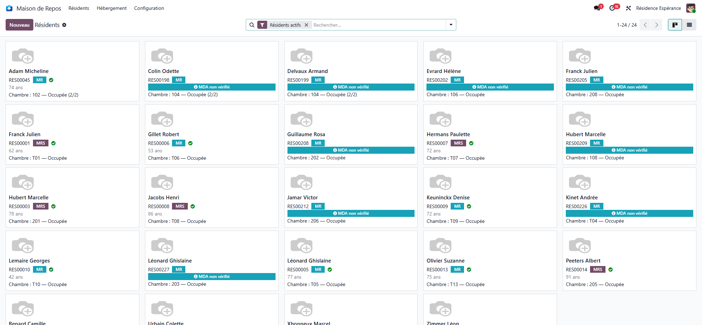
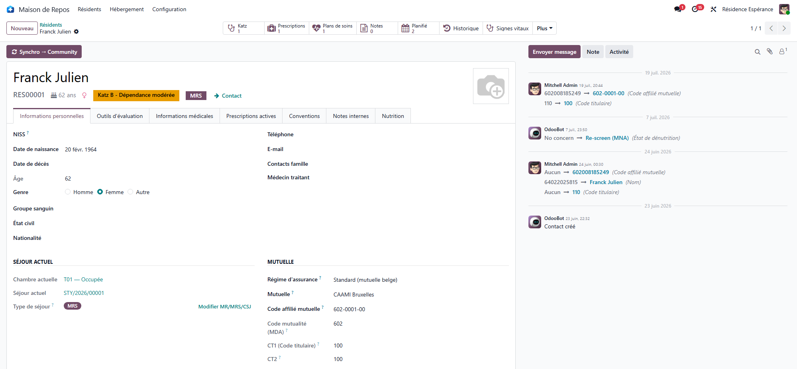
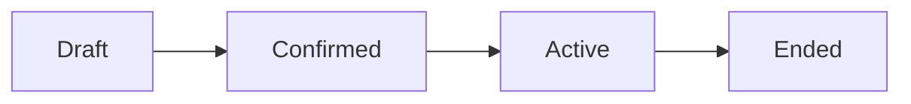

# Manage a resident

:::{rh-description}
The resident list and record in Resthome, the admission guide, and the stay from draft to active: confirm, start, change room, end, readmit.
:::

:::{rh-faq}
How do I create a resident in Resthome?
: Most residents come from an admission request. To create one by hand, open **Nursing Home → Residents → All Residents**, click **New**, enter at least the name and save; then click **Create the stay** at the top of the record.

What do Present, Expected and Left mean?
: **Present**: the resident's stay is active. **Expected**: a stay is booked but not started — a room is held and the arrival is being prepared. **Left**: every stay has ended. The list opens on **Present**.

What is the difference between confirming and starting a stay?
: Confirming holds the room. Starting the stay records that the resident is actually there, with the admission date and time: the stay becomes **Active** and billing runs.

What does Resthome do automatically when a stay starts?
: It adds the resident to the open billing periods, creates the first accommodation invoice for residents billed in advance and opens the month's supplements envelope.

How do I readmit a former resident?
: On their record, **Stay Agreement** tab, click **Readmit**: a new stay opens, pre-filled from the last one. From an admission request, **Link to that resident** does the same.

Where does the resident's dependency category come from?
: From the dependency scale of the country pack installed. Resthome shows the category on file on the resident's card; without a country pack, no category is shown.
:::

This page describes the resident in Resthome: the **list**, the **record**, and
the **stay** that links them to a room, from the admission to the departure.

## The resident list

Open **Nursing Home → Residents → All Residents**. The residents are shown as
cards; switch to the **list** view for a table.

Each card shows:

- the **name** and the **resident code**;
- the **age**, the **sex**, the **dependency category** and the **stay type**
  (with **Short stay** when it applies);
- the **e-mail** and **phone**, when they are known;
- the **room** (a sun instead of a bed for someone who comes by day);
- the **photo**, and badges for what calls for attention: **Expected**, **Left**,
  **In hospital**, **Deceased**.

The list view adds the room, the stay type, the admission and, as optional
columns, the stay start, the admission time and the date of birth.

### Filtering

- **Present**, **Expected**, **Left** and **Deceased** — the list opens on
  **Present**;
- the left panel filters by **Gender** and by **Sector** (the stay type);
- **Group By** **Room** or **Sector/Floor**;
- search by name, resident code, room or sector.

## The resident record

<!-- screenshot to update: the record now has the Evaluation, Stay Agreement, Documents and Notes tabs, and the admission guide button in the header -->

At the top: the photo, the name, the resident code, the age, the sex and the
stay type. Ribbons flag an **Expected** resident (arrival booked), a resident
**In hospital**, and a banner a **deceased** resident. The smart buttons open
the resident's **Tasks**, their **Supplements** and supplements **Envelopes**
and, depending on the apps installed, their care, their **Pocket money**
balance (a red **Pocket money overdrawn** banner warns when it is negative),
their **Interventions** (as soon as a ticket exists, see
[Technical interventions](../interventions/index.md)) and the **Family Portal**
accesses (see [Family portal](../portail-famille/index.md)).

When the care records are installed, a hospital stay goes through the
**Hospital departure** button of the resident's record, then **Return from
hospital**, which comes first in the bar while the resident is away. See
[Hospital departure and return](../soins/hospitalisation.md).

| Tab | Content |
|---|---|
| **Identity** | Date and place of birth, gender, marital status, nationality, **ID Card Number** and expiry, languages, religion, phone, e-mail, **Attending Physician** and **Deputy Physician**; the **Current Stay** (room, stay, stay start, admission dates, stay type); the **Contact Persons** and the **Key Contacts**. |
| **Evaluation** | The geriatric scales — see [Geriatric assessments](evaluations.md). |
| **Stay Agreement** | Every stay of the resident, the **Recurring supplements** agreed with them (**Close supplements** / **Reopen supplements**), and their private furniture — see [The resident's private furniture](mobilier.md). |
| **Documents** | Everything printed or opened for the resident, in one place. |
| **Notes** | Internal notes. |

The **ID Card Number** keeps the number of the identity document presented at
admission. It identifies the card, which expires and is renewed — not the
person.

### Contact persons and key contacts

**Contact Persons** lists the resident's relatives: name, **Relationship**,
phone and e-mail. **Add a line** looks up a known contact — a son who is the
contact of both parents — or creates one in a short form.

Under it, the **Key Contacts**: **Emergency Contact Person**, **Legal
Representative** and **Trusted Person**, each with a box (**No Emergency
Contact**, **No Legal Representative**, **No Trusted Person**) to say that the
question was asked and that there is none.

Where the family portal is installed, each contact line also carries its portal
access — see [Family portal](../portail-famille/index.md).

:::{admonition} In Belgium
:class: rh-country rh-country-be

The Belgian pack adds the **NISS**, the mutuality and the eID card reading,
which fills the identity and the NISS straight from the chip, and the **Verify
Insurability** button runs the MDA check from the record — see [The resident's
file in Belgium](../belgique/dossier-resident.md) and [Reading the eID
card](../belgique/lecture-eid.md).
:::

## The admission guide

While an admission is in progress, the header of the record names the **one
next step**, and nothing else:

1. **Create the stay** — opens a new stay, or the draft already started.
2. **Validate the admission** — opens the confirmed stay, where you enter the
   admission date and click **Start Stay**.

When no button is shown, the admission file is complete.

:::{admonition} In Belgium
:class: rh-country rh-country-be

The guide adds the Belgian steps — the Katz and the admission agreement — in
their order: see [Admitting a resident in Belgium](../belgique/admission.md).
:::

## The stay

The **stay** links the resident to a room for a period. It drives presence,
billing and the end-of-stay procedures.

| Status | Meaning |
|---|---|
| **Draft** | Being prepared; the room, the resident and the stay type can still be changed. |
| **Confirmed** | The room is held; the resident is **Expected**. |
| **Active** | The resident lives here; billing runs. |
| **Ended** | The resident has left. |
| **Cancelled** | The stay was called off. |

### Opening the first stay

An admission request opens the stay for you. For a resident created by hand:

1. On the record, open the **Stay Agreement** tab.
2. Click **Create the first stay**. The button shows only while the resident
   has no stay: later stays are opened by the admission, the room change or the
   readmission, which chain the dates.
3. Choose the **Stay Type** — one of the sectors the home is licensed for —,
   the **Room** and the **Stay start date**.
4. **Save**. The stay is **Draft**.

### Confirming, then starting the stay

1. **Confirm** — the stay becomes **Confirmed** and the room is held. The
   **Admission Date** and **Admission Time** fields appear.
2. **Start Stay** — on the day the resident arrives, fill in the admission date
   and time and click: the stay becomes **Active**.

From **Confirmed** on, the resident, the room and the stay type are read-only:
the room changes through **Change Room**, never by editing the field.

:::{admonition} What starting the stay triggers automatically
:class: tip

When the stay starts, Resthome:

- adds the resident to the open **billing periods**;
- for a resident billed in advance, creates the **first accommodation invoice**
  for the admission month;
- opens the month's **supplements envelope**.
:::

:::{admonition} Two dates not to confuse
:class: note

- **Stay start date**: when accommodation billing begins (the room).
- **Admission Date**: the resident's effective entry, when the care allowance
  paid by the health insurer begins.

They are often identical, but can differ. The **Current Stay** of the record
shows both, with the **Original admission**, which a room change never moves.
:::

### The stay record

Besides the dates, the stay carries the **Daily Rate**, the **Invoice Address**,
the admission request it comes from and three tabs:

- **Admission** — **House rules handed over on**, and the **Admission Reason**
  (the note typed at admission);
- **Departure** — once the stay has ended: the reason, the date and time, the
  notes;
- **Notes** — internal notes.

All the stays of the house are in **Nursing Home → Accommodation → Stays**, with
the **Running**, **Ended** and **Short stay** filters.

### The buttons of an active stay

- **Change Room** — moves the resident, now or on a later date: see [Room change
  and transfer](changement-chambre.md).
- **End Stay** — records the departure or the death: see [Departure and
  death](../facturation/depart-deces.md).
- **Cancel Stay** — calls the stay off entirely (a stay opened by mistake): the
  room is freed and nothing is billed on it any more. A confirmation says what
  is at stake: it does not discard your edits, it cancels the stay.
- **Cancel Room Change** — on a stay opened by a room change: the resident goes
  back to their previous room and stay.

## Readmitting a former resident

When every stay of a living resident has ended, the **Stay Agreement** tab shows
**Readmit**. The new stay opens pre-filled from the last one — room, stay type,
entry date today — with a banner that says so: check the values, then save and
confirm as for a first stay.

:::{admonition} In Belgium
:class: rh-country rh-country-be

The readmission creates its eAgreement request with the right sub-type,
depending on the time since the departure; a change of sector is the **MR ↔
MRS** internal transfer, and an absence can generate an **Annexe 11** — see
[The resident's file in Belgium](../belgique/dossier-resident.md).
:::

## Dependency category

The **dependency category** is what the care allowance paid by the health
insurer relies on. The scale that produces it, and the way an assessment is
entered and validated, come with the country pack: each country grades
dependency on its own scale.

The resident card shows the category currently on file. Without a country pack,
or while the resident has no valid assessment, no category is shown.

:::{admonition} In Belgium
:class: rh-country rh-country-be

The scale is **Katz**: six criteria, categories O, A, B, C and Cd, entered from
the record then confirmed and validated — see [The Katz
assessment](../belgique/katz.md).
:::

## Further reading

- [Admitting a candidate](../admissions/admettre.md)
- [Geriatric assessments](evaluations.md)
- [Room change and transfer](changement-chambre.md)
- [Staff tasks](taches.md)
- [Hospital departure and return](../soins/hospitalisation.md)
- [Billing](../facturation/index.md)
