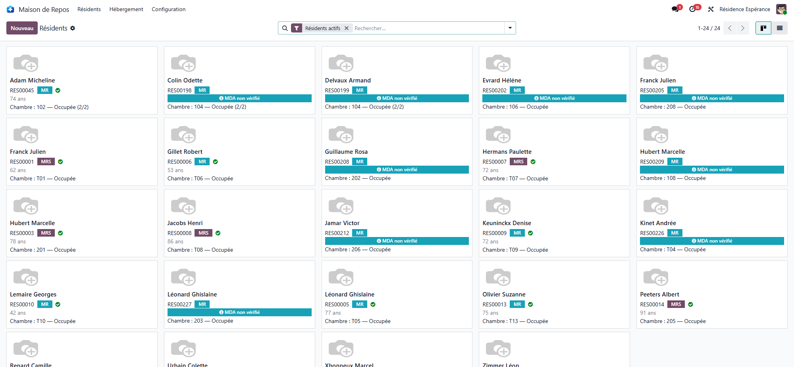

# Residents

:::{rh-description}
Managing residents in a nursing home with WideCare: the record and the stay, geriatric assessments, rooms and room changes, housekeeping, staff tasks, the move-in procedure, the condition report and private furniture.
:::

:::{toctree}
:hidden:

gerer-un-resident
evaluations
chambres
changement-chambre
entretien-chambres
taches
procedure-emmenagement
etat-des-lieux
mobilier
:::

Everything about a resident's life in the facility, from the admission to the
daily record: **stay**, **assessments**, **room**, **move-in** and **condition
report**. The resident is the central record all the other apps build on — care,
meals and billing.

## Key principles

- **Admission**: handled in its own application, from the first enquiry to the
  move-in; it creates the resident and opens their stay. See
  [Admissions](../admissions/index.md).
- **Stay**: the period during which the resident occupies a **room**. It goes
  from **Draft** to **Confirmed** (the room is held), **Active** (the resident
  lives here) and **Ended**. It drives presence, billing and the end-of-stay
  procedures.
- **Residency**: read off the stays — **Expected**, **Present**, **Left** or
  **Deceased**.
- **Dependency assessment**: scores the resident's dependency on the scale the
  country uses; it determines the **category** declared to the health insurer,
  on which the care allowance it pays relies.
- **Room**: its occupancy follows the stays; its **housekeeping** stage is
  tracked separately.
- **Staff tasks**: the chores of the house — preparing a room, the move-in
  steps — handed to the team that does them.
- **Condition report**: a joint move-in/move-out assessment of the room and its
  equipment, signed by the representative and the facility.

:::{admonition} In Belgium
:class: rh-country rh-country-be

The dependency scale is **Katz**, the stay types are the **MR** and **MRS**
sectors, and the resident's file carries the NISS and the mutualité — see
[The resident's file in Belgium](../belgique/dossier-resident.md) and
[The Katz assessment](../belgique/katz.md).
:::

## What's next

- [Manage a resident](gerer-un-resident.md) — the list, the record, the stay.
- [Geriatric assessments](evaluations.md) — MMSE, Braden, MNA, OHAT, Tinetti and pain.
- [Rooms and occupancy](chambres.md) — the board, the room record, generating the rooms.
- [Room change and transfer](changement-chambre.md) — now or on a later date.
- [Room housekeeping](entretien-chambres.md) — to prepare, to clean, ready.
- [Staff tasks](taches.md) — the chores of the house, by team.
- [The move-in procedure](procedure-emmenagement.md) — the tasks every new stay opens.
- [The condition report (move-in and move-out)](etat-des-lieux.md)
- [The resident's private furniture](mobilier.md)
