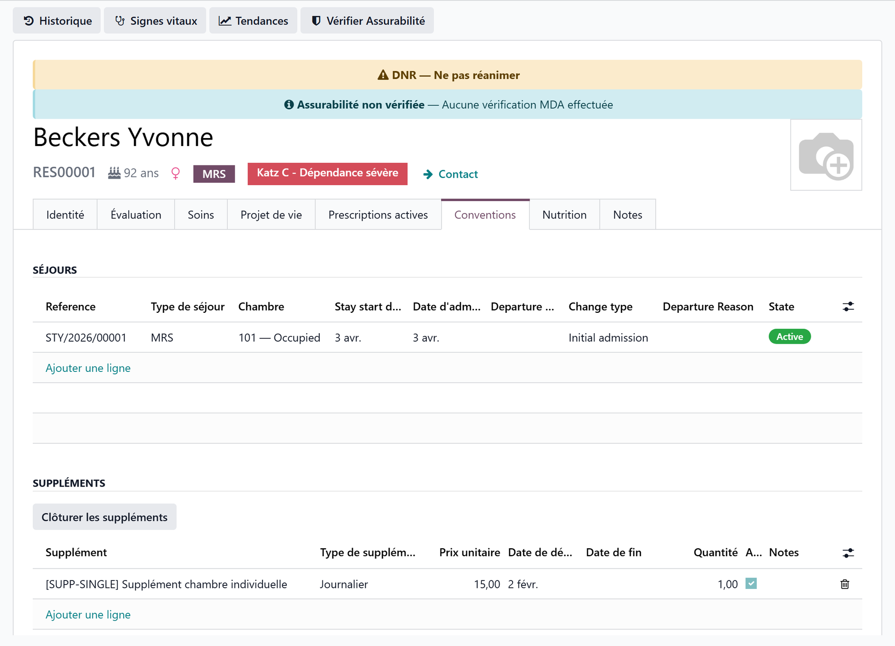

# The resident's private furniture

:::{rh-description}
Keep the inventory of the furniture and belongings a resident brings into the nursing home with Resthome: one line per item on their record, which follows them from room to room.
:::

:::{rh-faq}
Where do I record the furniture a resident brings in?
: On the resident's record, **Stay Agreement** tab, **Resident Furniture** section: one line per item, with a description, a comment and a date.

Does the inventory follow the resident when they change room?
: Yes. The list belongs to the resident, not to the room or the stay: it stays unchanged through a room change or a transfer.

How do I record that the family took a piece of furniture back?
: Untick its **Active** box instead of deleting the line: it leaves the inventory, and the house keeps the record that it was brought in.

Why don't I see the section for some people?
: Someone who comes for the day and sleeps at home brings no furniture: the section is hidden for them, unless a line was already recorded.

Is a module needed for the furniture inventory?
: Yes, an optional one, installed for the houses that need it. Without it, the **Resident Furniture** section does not appear.
:::

Many residents arrive with their own **furniture and belongings**: an armchair,
a television, picture frames, a bookcase, a personal wheelchair… Resthome keeps
a simple **inventory** of them on the resident's record, so the house always
knows what was brought in and what was taken back.

## Where to find the inventory

1. Open the resident's record (**Nursing Home → Residents → All Residents**).
2. Go to the **Stay Agreement** tab.
3. Scroll down to the **Resident Furniture** section, below the stays.

<!-- screenshot to update: the tab is now named Stay Agreement and the section Resident Furniture -->

The section is hidden for someone who **lives at home** and only comes by day,
unless a line was already recorded for them.

## Adding an item

The list is edited **in place**:

1. Click **Add a line** at the bottom of the section.
2. Fill in the **Description** (required) — for example "Leather recliner
   armchair" or "32-inch television with wall mount".
3. Add a **Comment** if useful — "Brought in by the family", "Owned by the
   resident, upkeep at their expense".
4. The **Date** is today's; adjust it to the day the item came in.
5. **Save** the record.

:::{admonition} Fill it in at move-in
:class: tip

A new stay opens the **Update the resident's private inventory** task of the
[move-in procedure](procedure-emmenagement.md): it is the moment to list what
came with the resident, alongside the [condition report](etat-des-lieux.md).
:::

## When an item is taken back

Do not delete the line: **archive** it, so the house keeps the record that the
item was brought in.

1. Show the **Active** column with the column selector at the right of the
   table header.
2. **Untick** **Active** on the line.
3. **Save**.

The item leaves the inventory shown on the record.

:::{admonition} Archive rather than delete
:class: warning

Deleting a line erases it for good. Unticking **Active** takes the item out of
the current inventory while keeping the trace of what the resident had brought.
:::

<!-- screenshot to add: the Active column shown in the Resident Furniture section, with one line unticked -->

## The inventory follows the resident

The inventory belongs to the **resident**, not to the room or the stay:

- on a **room change**, the list does not move — nothing to copy over;
- on a **transfer** between sectors, it follows the resident too.

See [Room change and transfer](changement-chambre.md).

## Key takeaways

- The inventory sits on the resident's record, **Stay Agreement** tab,
  **Resident Furniture** section.
- One line per item: **Description** (required), **Comment**, **Date**.
- An item taken back is **archived** (Active unticked), not deleted.
- The list **follows the resident** from room to room.

## Learn more

- [Manage a resident](gerer-un-resident.md)
- [The move-in procedure](procedure-emmenagement.md)
- [The condition report (move-in and move-out)](etat-des-lieux.md)
