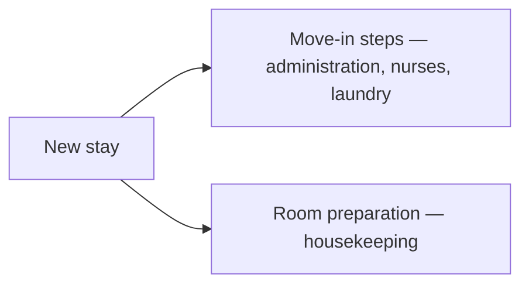
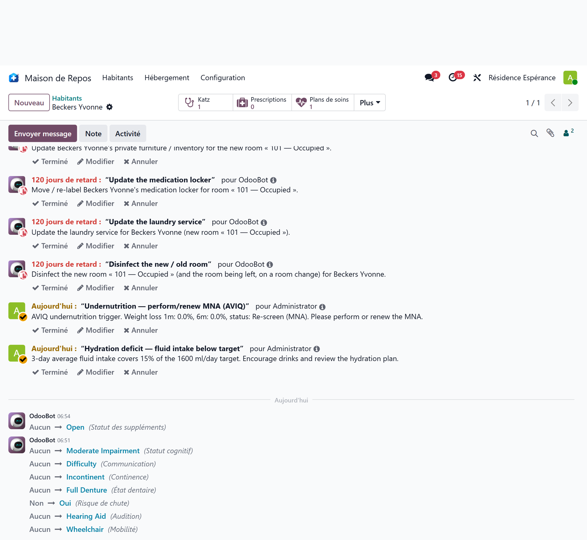

# The move-in procedure

:::{rh-description}
The move-in checklist WideCare opens at every new stay: five staff tasks handed to the administration, the nurses and the laundry, plus the preparation of the room for the housekeeping team.
:::

:::{rh-faq}
How is the move-in checklist created in WideCare?
: On its own, whenever a new stay opens — admission, room change, internal transfer or readmission. WideCare creates one staff task per step, due on the first day of the stay. Nothing to trigger by hand.

What are the steps of the move-in procedure?
: Sign the agreement with the resident's representative, the entry / exit condition report, the resident's private inventory, the medication locker and the laundry service. The room itself is prepared by the housekeeping team, through its own task.

Who receives the tasks?
: Each step goes to the team that does it: the agreement, the condition report and the inventory to the administration, the medication locker to the nursing team, the laundry to the housekeeping and laundry team.

Can I name a person on these tasks?
: Yes, in **Nursing Home → Configuration → General → Settings**, block **Accommodation**: **Named on move-in tasks** for the administrative steps, **Named on room tasks** for the room preparation. Both are optional: left empty, the task goes to the team.

What do I do with a step that does not apply?
: The list is the same for a first admission and for a room change. Close the step with **Done**, or **Cancel task** when it does not apply.
:::

At every **new stay** — admission, room change, internal transfer or
readmission — WideCare opens the resident's **move-in procedure**: one
[staff task](taches.md) per step, handed to the team that does it, and the
**preparation of the room** for the housekeeping team. Nothing to trigger by
hand.

## What triggers at every new stay

As soon as a **stay** is created — by the [admission](../admissions/admettre.md),
a [room change or a transfer](changement-chambre.md), or a readmission —
WideCare creates both parts at once. Every task is **due on the first day of
the stay**; for a room change made on the same stay, on the day of the move.

| Event | Move-in steps | Room tasks |
|---|---|---|
| **Admission** | 5 steps | Prepare the arrival room |
| **Room change** | 5 steps | Prepare the new room **and** put the old one back in order |
| **Internal transfer** | 5 steps | Prepare the new room **and** put the old one back in order |
| **Readmission** | 5 steps | Prepare the room (the old one was cleaned at the previous departure) |
| **Day stay** | The agreement only | None — a day place is shared, nobody moves in |

:::{admonition} No duplicates
:class: note

Saving the stay again never stacks a second copy of a task already created. A
**cancelled** stay, or one without a room or a resident, creates no task. A
genuine later move — a new room, a new date — opens its own checklist.
:::

## The move-in steps

All five tasks carry the category **Move-in** and name the resident:

| Task | Team | What it is for |
|---|---|---|
| **Sign the agreement with the resident's representative** | Management and administration | Have the accommodation agreement signed. |
| **Entry / exit condition report (état des lieux)** | Management and administration | Draw up the joint condition report of the room — see [The condition report](etat-des-lieux.md). |
| **Update the resident's private inventory** | Management and administration | List the furniture brought in — see [The resident's private furniture](mobilier.md). |
| **Update the medication locker** | Nursing care | Move or re-label the resident's medication locker. |
| **Update the laundry service** | Housekeeping and laundry | Update the resident's laundry for the new room. |

:::{admonition} Close what applies, cancel the rest
:class: tip

The list is **the same** for a first admission and for a room change. Close
each step with **Done** — or **Done with a comment** — and use **Cancel task**
for a step that does not apply to this move.
:::

<!-- screenshot to update: the image shows the former chatter activities; replace it with the Tasks list filtered on Move-in for one resident, with the five steps and their teams -->

## Room preparation

In parallel, the housekeeping team receives the room tasks:

- **Prepare the room — arrival of …**, on the **arrival room**, which goes to
  **To prepare** on the housekeeping board;
- **Put the room back in order — departure of …**, on the **room being left**,
  only on a **room change** or an **internal transfer**.

No room task is created for a waiting-list room or a shared day place. See
[Room housekeeping](entretien-chambres.md).

## Naming a person on the tasks

Every task belongs to its **team**; you can also have a person named on it.
In **Nursing Home → Configuration → General → Settings**, block
**Accommodation**:

1. **Named on move-in tasks** — the person named on the **administrative**
   steps (agreement, condition report, inventory). The nursing and laundry
   steps stay with their team.
2. **Named on room tasks** — the person named on the room preparation and
   cleaning tasks.

Both fields are **optional**. Left empty, the task goes to the team, whose
members see it and take it; the procedure runs either way.

<!-- screenshot to add: the Accommodation block of the settings with the Named on room tasks and Named on move-in tasks fields -->

## Key takeaways

- The move-in procedure starts **on its own** with any new stay.
- It creates **five staff tasks**, each for the team that does it, plus the
  **room preparation** for the housekeeping team.
- Every task is **due on the first day of the stay** (or on the day of the move).
- Naming a person is **optional**; the teams receive the tasks anyway.

## Learn more

- [Staff tasks](taches.md)
- [Room housekeeping](entretien-chambres.md)
- [Room change and transfer](changement-chambre.md)
- [The condition report (move-in and move-out)](etat-des-lieux.md)
- [General settings](../configuration/reglages-generaux.md)
