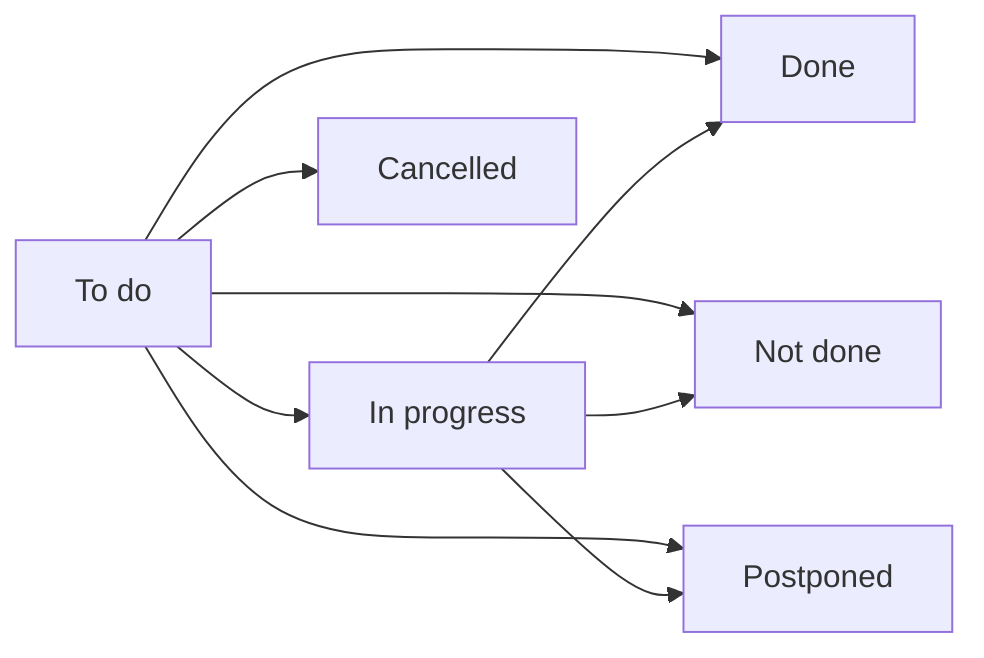

# Staff tasks

:::{rh-description}
The chores of the house in Resthome — preparing a room, the move-in steps, a repair, a reception — as tasks handed to the team that does them, with a due date, a status and an outcome.
:::

:::{rh-faq}
Where are the staff tasks in Resthome?
: In **Nursing Home → Accommodation → Tasks**. The list opens on the tasks still to do; the **Tasks** smart button of a room or a resident opens theirs.

Who creates the tasks?
: Resthome creates most of them on its own — a room to prepare on an arrival, a room to put back in order on a departure, the move-in steps of a new stay. Anyone can add one by hand, from the list or from the field app.

Does a task have to be assigned to a person?
: No. A task always goes to a **team**, filled in from its category; naming a person is optional. The team's members see it, and one of them takes it.

What happens when a task cannot be done today?
: Click **Postpone**, pick the new date and give a reason: the task is closed as postponed and a linked copy is opened on the new date. A date in the past is refused.

How do I reopen a task closed by mistake?
: **Back to to do** reopens it. The person who closed it can do so within 15 minutes; after that, a manager.
:::

The **staff tasks** are the chores of the house that are not care: preparing
a room before an arrival, putting it back in order after a departure, signing
the agreement with the family, updating the medication locker. Each one is
handed to the **team** that does it, with a **due date**, and keeps its
**outcome** once closed.

Menu: **Nursing Home → Accommodation → Tasks**.

:::{admonition} Staff tasks are not care tasks
:class: note

What is done **for a resident's health** — a dressing, a vital sign, a
medication round — lives in the care apps: see [Care tasks](../soins/taches-de-soins.md).
The staff tasks cover the life of the house around the resident.
:::

## Where tasks come from

Most tasks are created **on their own**:

| Event | Tasks created |
|---|---|
| A resident is due to arrive in a room (admission, room change, transfer) | **Prepare the room — arrival of …**, on the arrival room, for the housekeeping team |
| A resident leaves a room for another one | **Put the room back in order — departure of …**, on the room left |
| A stay ends and frees its room (departure, death, transfer elsewhere) | **Clean the room — end of stay of …**, on the room freed, due on the end date |
| A new stay opens | The **move-in steps** — see [The move-in procedure](procedure-emmenagement.md) |

A waiting-list room and a shared day place get no room task: nobody moves in
or out of them.

Resthome never stacks the same task twice: saving the stay again does not
create a second copy. You can also add a task **by hand**: **New** in the list,
or from the WideCare field app.

## The task record

| Field | Purpose |
|---|---|
| **Task** | What has to be done. |
| **Category** | **Housekeeping**, **Technical**, **Administrative**, **Move-in**, **Reception**, **Kitchen** or **Other**. |
| **Due date** | The day it must be done. |
| **Team** | The team in charge — filled in from the category (**Housekeeping** → Housekeeping and laundry, **Technical** → Technical services, **Administrative** and **Move-in** → Management and administration, **Kitchen** → Kitchen), and editable. |
| **Assigned to** | A named person, optional. |
| **Resident**, **Room**, **Sector** | What the task is about; the sector follows the room. |
| **Description** | The details. |

Once the task has started, an **Outcome** block records who started it and
when, who closed it and when, with the reason and the comment, and the task it
was postponed to or from.

A task past its due date carries a **Late** ribbon.

## Statuses and buttons

| Button | Effect |
|---|---|
| **Start** | The task moves to **In progress**. |
| **Done** | The task is closed as **Done**. |
| **Done with a comment** | Closed as **Done**, with a comment. |
| **Not done** | Closed as **Not done**, with a reason. |
| **Postpone** | Closed as **Postponed**; a linked copy opens on the date chosen in **Postpone to**. |
| **Cancel task** | The task no longer applies. |
| **Back to to do** | Reopens a closed task. |

**Done with a comment**, **Not done** and **Postpone** open the same small
window: choose the **Outcome**, add the **Reason** and the **Comment**, then
**Confirm**.

:::{admonition} Reopening is time-boxed
:class: warning

**Back to to do** is open to the person who closed the task during **15
minutes** — enough to undo a wrong tap. After that, only a manager can reopen
it, so the record of what was done stays reliable.
:::

## Finding your tasks

The list opens on the tasks **To do** (to do or in progress). The search bar
adds:

- **Today** and **Late**;
- **My tasks** — those assigned to you;
- one filter per **category**, and per status (**Done**, **Not done**,
  **Postponed**);
- **Group By** **Category**, **Status**, **Sector**, **Team**, **Assigned to** or
  **Due date**.

The **kanban** view groups the tasks by category. On a room or a resident
record, the **Tasks** smart button shows how many are open and lists them.

<!-- screenshot to add: the Tasks list opened on To do, with a Late task, the Team and Assigned to columns and the Start / Done buttons -->

## Tasks and the housekeeping board

The housekeeping tasks and the [housekeeping board](entretien-chambres.md)
move together:

- **Start** on a room task puts the room **In progress** on the board;
- **Done** or **Cancel task** puts it **Ready**, once no other housekeeping task
  is open on that room;
- the other way round, dragging the room to **Ready** on the board closes its
  open housekeeping tasks, with the comment *Marked ready on the board*.

## Key takeaways

- Staff tasks are the **chores of the house**, handed to a **team**, with a due
  date.
- Arrivals, departures and new stays create them **on their own**; anyone can
  add one by hand.
- Each task keeps its **outcome**: done, not done with a reason, postponed to a
  new date, cancelled.
- The housekeeping tasks and the housekeeping board always agree.

## Further reading

- [Room housekeeping](entretien-chambres.md)
- [The move-in procedure](procedure-emmenagement.md)
- [Rooms and occupancy](chambres.md)
- [Care on mobile](../soins-mobile/index.md)
