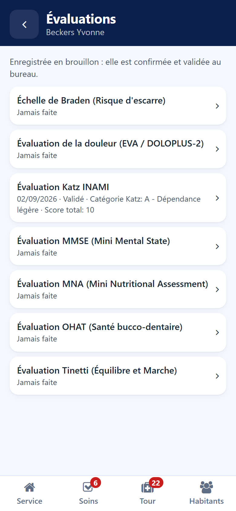

# Evaluations

:::{rh-description}
Filling in an evaluation scale from the WideCare app: the scales available for the resident, what the record already knows, the draft recorded at the bedside and validated at the desk.
:::

:::{rh-faq}
Is an evaluation filled in on the phone final?
: No. It is saved as a draft, then confirmed and validated at the desk.

What does "To do" mean next to a scale?
: The scale is awaited, for example by an admission or by a request of the care meeting.

Why is a scale locked?
: Your role does not allow filling in that scale: the screen says **Not for your role**.

The height is missing for the nutrition scale. Can I enter it?
: Yes. In the **On file** block, tap **Enter the height**, type it in centimetres and confirm: the BMI is computed at once.

I left the form before saving. Are my answers lost?
: No. Coming back, the form says **Your answers were kept**. Tap **Start over** to begin again.
:::

The **Evaluations** button of the resident's sheet lists the evaluation scales
available for that resident. A task that asks for a scale — **To fill in** on
the [Tasks](soins.md) list — opens the scale directly.

<!-- screenshot to update: the Evaluations list with the "Saved as a draft" line at the top -->

## The list of scales

The scales awaited come first, then the others in alphabetical order. Under each
scale:

- the date, the status and the result of the last evaluation, or **Never done**;
- **To do** — the scale is awaited;
- **To validate** — an evaluation is waiting for its validation at the desk;
- a **padlock** and **Not for your role** — your role does not allow this scale.

:::{admonition} In Belgium
:class: rh-country rh-country-be

The Katz scale awaited by an admission shows **To do** in the app until it is
filled in. See [The Katz assessment](../belgique/katz.md).
:::

## Filling in a scale

1. Tap the scale.
2. Read the **On file** block when the scale has one (see below).
3. Answer each question with one tap. A star marks the questions still
   required. A question that does not apply to the answers already given is
   hidden.
4. Add your remarks under **Observations**.
5. Read the score and the result, computed as you answer.
6. Tap **Save as draft**.

Until every required question is answered, the screen says how many are left,
and **Save as draft** stays locked.

The evaluation is recorded as a **draft**. It is confirmed and validated in the
back office — see [Evaluations](../residents/evaluations.md). When the scale was
opened from a task, saving it ticks that task.

## What the record already knows

Some scales ask for facts nobody knows by heart at the bedside. The nutrition
scale (MNA) shows them in an **On file** block at the top:

- **Last weight**, with its date;
- **Weight change** over the last three months, and the weight it compares with;
- **BMI**, with the height — or **Height missing**;
- **Dependency** — the resident's dependency category;
- the last Tinetti and MMSE scores, saying when they are still drafts.

When the height is missing, tap **Enter the height**, type it in **cm** and tap
the check mark. The BMI is computed at once.

## An evaluation already waiting at the desk

A scale holds one evaluation at a time waiting for the desk. While one waits,
the form does not ask the questions again: it says the evaluation is waiting for
its validation. When a task asks for that scale, **Answer with this evaluation**
answers the task with it.

A draft started earlier comes back with its answers. When a request of the care
meeting takes up that draft, a line above the questions says so.
