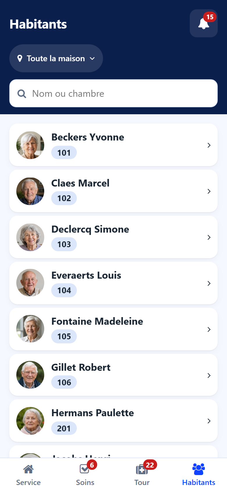
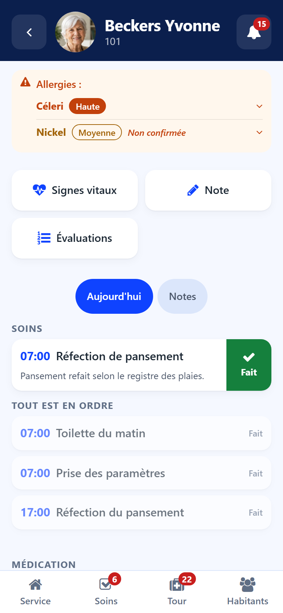

# Residents

:::{rh-description}
The Residents screen and the resident sheet of the WideCare app: search by name or room, the resident in brief, allergies and pathologies, the day's cares and medication, the if-needed doses and the observations.
:::

:::{rh-faq}
How do I find a resident quickly?
: On **Residents**, type part of the name or the room number in the search field.

Why does the sheet say "No allergy recorded"?
: Because no allergy is entered in the resident's record. The sheet says it explicitly so that an empty space is never read as "no allergy".

Can I check it is the right person before an act?
: Yes. Tap the photo on the sheet to enlarge it.

How do I call the resident's family from the sheet?
: Tap a phone number in the top block of the sheet: the phone dials it.

How do I give an if-needed medication?
: On the sheet, under **If needed**, swipe the medication to the right, write the sign that called for it, and tap **Give now**.
:::

## Residents list

The **Residents** screen lists the residents of the chosen sector, with their
photo, their room and, when they are away, where they are.

- Type part of a **name or room** in the search field; the cross clears it.
- Tap a resident to open the sheet.

Opened from a figure of the [shift screen](service.md) — the residents away,
the day's admissions… — the list shows only those residents, with a button
recalling the figure; tap its cross to see everyone again. In a large house, a
line says when the list is cut: narrow your search.

<!-- screenshot to update: the Residents screen with the sector and team strip and the bell -->

## Resident sheet

The sheet gathers what the staff needs in front of the resident. What it shows
depends on your account: the kitchen does not see the medication, for example.

<!-- screenshot to update: the sheet with the "in brief" block, the pathologies, the Today and Observations tabs -->

### Top of the sheet

- **Photo** — tap it to enlarge it and check you have the right person.
- **Room and sector** under the name, and where the resident is when away (in
  hospital, on holiday…).
- The **bell**, as on the lists.

### The resident in brief

What is asked for in a hurry:

- **DNR — do not resuscitate**, in red, when the record says so;
- **Advance directive on file**;
- the **Meal texture** and the **Preferred hospital**;
- the phone numbers to call — emergency contact, legal representative, trusted
  person, the resident: tap a number to dial it;
- the general note of the record, on three lines: **Read all** shows the rest.

### Allergies, pathologies and diets

- **Allergies** — the most severe first, each with its severity. The strip takes
  the colour of the most severe one. Tap an allergy to read the reaction. An
  allergy not yet confirmed says **Not confirmed**. Beyond three allergies, only
  the serious ones show; tap **other allergy(ies)** to see them all. With no
  allergy entered, the sheet shows **No allergy recorded**.
- **Pathologies** — the active diagnoses the cares answer to, the most severe
  first. A question mark marks a diagnosis not confirmed.
- **Diets** and **Texture** — what goes on the resident's plate.

### Points of attention

Under the allergies, the lines that must not be forgotten:

- **To do:** a scale awaited — tap it to fill it in;
- a scale **to validate at the desk** — already filled in, waiting for the desk;
- **Back from hospital: treatments to reconcile at the desk**;
- **Away from the house**.

### Stools and urine

When the resident is followed, a card says where stools and urine stand: the
status, how long since the last one, the volume of urine over 24 hours. See
[Stools and urine](selles-urines.md).

### Quick buttons

- **Vital signs** → [Vital signs](signes-vitaux.md)
- **Stools / urine** → [Stools and urine](selles-urines.md)
- **Observation** → [Observations](notes.md)
- **Evaluations** → [Evaluations](evaluations.md)
- **New task** → [New task](nouvelle-tache.md)
- **Meals** and **Drink** → [Meals](repas.md) and [Hydration](hydratation.md)
- **Capacities**, when the capability observation is installed → [Capability observation (Potentia)](../qualite/observation-capacites.md)

Each button appears only for the accounts that may use it.

## Today

The **Today** tab lists the resident's day. What is still to do comes first;
what is settled follows under **All in order**. When nothing is planned, the
sheet says **Nothing scheduled today**.

### Cares

The day's cares, with the same gestures as on [Tasks](soins.md): swipe right
for **Done**, left for **Not done**, hold for every choice, tap to read the
whole care. A care still owed from an earlier day says which day.

### Medication

The day's doses, with the moment of the round and the hour. A dose of another
day says it (**Yesterday**, a date).

- Swipe right — **Taken**.
- Press and hold — **Distribute only** and **Given earlier** too.

A dose not given is recorded from the [round](tour-medicaments.md).

A recorded dose shows **corrected** or **recorded afterwards** when it was.

#### Correcting a dose record

Past the few seconds of **Undo**, a nurse or a physician corrects a dose record:

1. Tap **Correct** on the dose.
2. Under **What happened**, choose what really happened.
3. Under **Why the record was wrong**, write the reason: ticked on the wrong
   resident, given but not recorded…
4. Tap **Record the correction**.

The record keeps both, the first entry and the correction, and is never
changed afterwards.

### If needed

The medications given on demand, within what the prescriber allowed: how many
were given today out of the maximum, the last one, and the hours to leave
between two doses. A dose that may not be given yet says why.

1. Swipe the medication to the right: **Give**.
2. Under **Given because**, write the sign that called for it: pain,
   agitation… The prescriber's indication is shown above, to read.
3. Tap **Give now**.

### Other tasks

The house's tasks still open about this resident — a move-in step, the room to
prepare — with the same gestures.

## Observations

The **Observations** tab lists the latest observations about the resident. Tap
one to read it whole. See [Observations](notes.md).
