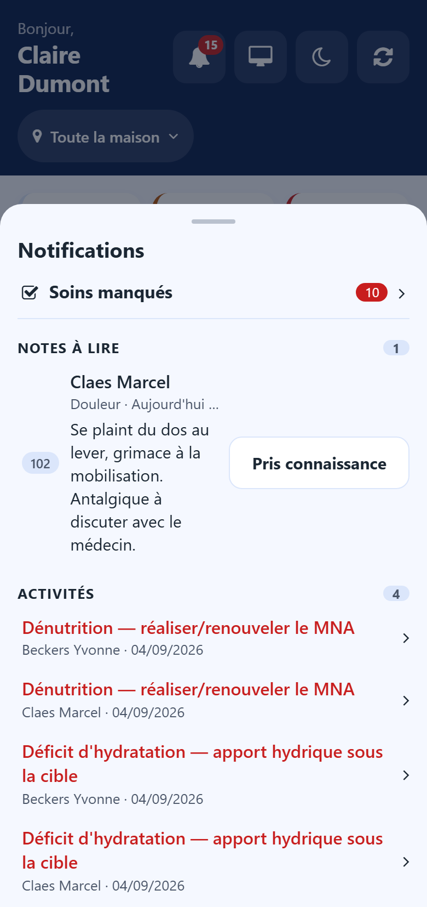

# WideCare app

:::{rh-description}
The WideCare app for phones and tablets: the day's work of the whole staff — cares, medication round, residents, observations, meals, drinks and rooms — at the bedside.
:::

:::{rh-faq}
How do I open the WideCare app?
: Tap the **WideCare** tile on the home menu, or the phone icon in the top bar of the back office. On a phone, open the house's address followed by `/app`, then add it to the home screen with the browser menu.

Can a person land directly in the app at sign-in?
: Yes. Tick **Open the WideCare app at login** on the user, or in the person's own preferences: signing in then opens the app instead of the back office.

Who can use the app?
: Every member of the house's staff. Each account sees only the screens its rights open: a carer sees the cares and the round, a cook the meals, a housekeeper the rooms and the house's tasks.

Why do I not see the back office in the menu?
: The **Back office** entry only appears for the roles that work at a desk: head nurse, nurse, physician, direction, administration, and the kitchen, housekeeping, maintenance and activities staff. Care assistants do not see it.

What happens without a connection?
: The app keeps working. What you record is kept on the phone, marked **On this phone**, and sent as soon as the connection comes back.

I swiped the wrong row. Can I take it back?
: Yes. After each act, a message at the bottom of the screen offers **Undo** for a few seconds.
:::

:::{toctree}
:hidden:

service
soins
nouvelle-tache
tour-medicaments
piluliers
habitants
notes
signes-vitaux
selles-urines
evaluations
repas
hydratation
chambres
:::

The **WideCare app** is the screen made for the phone or the tablet the staff
carries in the corridor. It shows only what the shift needs: what is to be done,
the medication to give, the resident in front of you, and what must be written
down. Everything recorded lands in the same records as the back office.

The app serves the whole staff. Each account sees the screens its rights open:

- **Care staff** — the cares, the medication round, the residents' sheets,
  observations, vital signs and evaluations;
- **Kitchen and dining staff** — the meal round and the drinks;
- **Housekeeping** — the rooms to prepare and to clean;
- **Everyone** — the house's other tasks: a bulb to change, a room to tidy, a
  move-in step.

## Opening the app

- **From the home menu** — tap the **WideCare** tile.
- **From the back office** — click the phone icon in the top bar.
- **On a phone or tablet** — open the house's address followed by `/app`, then
  use the browser menu to add it to the home screen. It then opens like any
  other app, under the house's name.
- **Directly at sign-in** — tick **Open the WideCare app at login** on the user
  (or in the person's own **Preferences**). The person lands in the app instead
  of the back office.

The app uses the same sign-in and the same access rights as the back office.

:::{note}
A phone that added the app to its home screen under the former `/care` address
keeps working: that address leads to `/app`.
:::

## Moving around

A bar at the bottom of the screen gives the main screens. A number on a tab
says how many things are waiting there.

- **My shift** — the overview of the shift. → [Shift screen](service.md)
- **Tasks** — the cares and the house's tasks of the day. → [Tasks](soins.md)
- **Round** — the medication round, for whoever gives doses.
  → [Medication round](tour-medicaments.md)
- **Residents** — the list and each resident's sheet. → [Residents](habitants.md)

From a resident's sheet you write an [observation](notes.md), take the
[vital signs](signes-vitaux.md), record [stools and urine](selles-urines.md) or
fill in an [evaluation](evaluations.md). The cards of the shift screen open the
[meals](repas.md), the [drinks](hydratation.md) and the [rooms](chambres.md).

## Sector, team and bell

The same strip sits at the top of every list:

- **The sector** — filters the cares, the round and the residents. Tap it and
  choose a sector, or **The whole house**. The choice stays when you change
  screen.
- **The team** — narrows the cares and the tasks to one team, or **Every
  team**. On a screen the team does not narrow (the round, the residents), the
  button is dimmed.
- **The bell** — what asks for your attention now.

### The bell

The bell gathers what falls outside the routine. Each line only appears for
whoever may act on it:

- **Missed doses** and **Intakes to confirm** — one line each, opening the round
  concerned;
- **Missed cares** — opening the cares to catch up;
- **Observations to read** — your colleagues' observations marked **Someone
  must read this**, and the vital signs out of range, each with its text and an
  **I have read it** button. Your own observations never appear there;
- **Stools and urine** — the residents to watch or in alert;
- the lines the other applications of the house add.

A line leaves the bell once it is settled: the dose given, the care done, the
observation read by you.

<!-- screenshot to update: the bell with the new look, the "Observations to read" group and its "I have read it" button -->

## Gestures on a row

The lines of the lists carry no buttons. Act on them with your thumb:

- **Swipe right** — the usual act: **Done**, **Taken**, **Served**, **Start**…
- **Swipe left** — its opposite: **Not done**, **Not given**, **Refused**.
- **Press and hold** — every choice for that line, the swipes included, in a
  menu. This is also the way with a keyboard or a screen reader.
- **Tap** — opens the line's detail.

A short reminder of the gestures shows above the list until you have used them.

## Undoing an act

After an act, a message at the bottom of the screen offers **Undo** for a few
seconds. Use it to take back a wrong swipe.

## Working without a connection

The app keeps working when the Wi-Fi drops:

- a **red** band says there is no connection, and how many acts are waiting on
  the phone;
- an **amber** band says the connection is back and the acts are still being
  sent;
- each act not yet sent carries **On this phone**;
- a screen read earlier stays available, with the hour it was last read.

:::{warning}
Until the band has disappeared, what is waiting is not yet in the resident's
record. Keep the app open until everything is sent. Acts recorded by another
account on the same phone are sent when that account signs in again.
:::

Some acts need the connection at the moment of the tap, because the hour of the
tap is what counts: starting a room or marking it ready, for example. Without a
connection, the app says so and the act is not kept.

## The menu behind your initials

On the **My shift** screen, the round button with your initials opens:

- **Back office** — goes back to the back office, for the roles that work at a
  desk;
- **Night mode** / **Day mode** — a dark display for the night shift; the phone
  remembers the choice;
- **Refresh** — reads the shift again.

The open screens also read themselves again every half minute: what a colleague
ticks on another phone or at the desk appears on its own.

## Going further

- [Care](../soins/index.md) — care plans, prescriptions and registers, managed
  in the back office.
