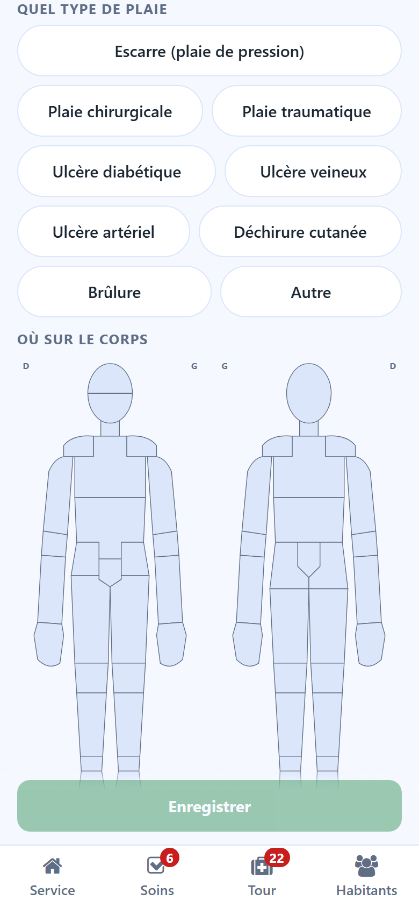
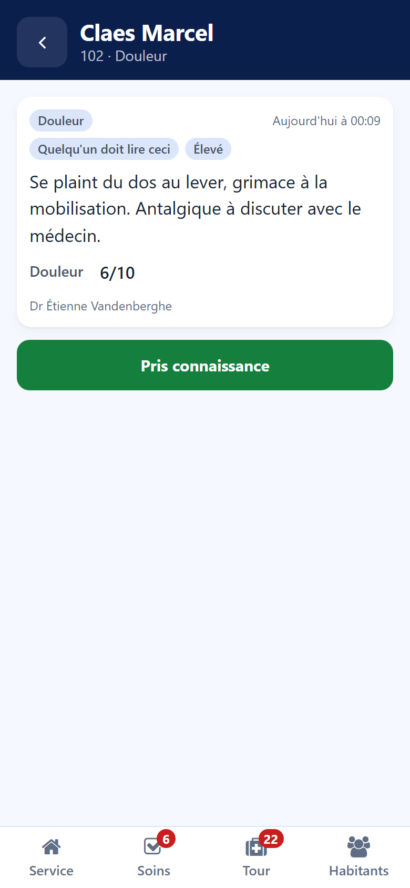

# Observations

:::{rh-description}
Writing an observation from the WideCare app: general, behaviour, pain, fall with witnesses and photos, change, wound with body map and photo, family — and reading the observations someone must read.
:::

:::{rh-faq}
Which types of observation does the app offer?
: General, Behaviour, Pain, Fall, Change, Wound and Family. Some types ask a few extra questions.

How do I make sure a colleague reads my observation?
: Switch on **Someone must read this**. The observation appears in your colleagues' bell until each one presses **I have read it**.

Can I photograph a wound or a fall?
: Yes. Tap **Take a photo**: the phone camera opens. A fall takes up to three photos, a wound one.

Can I write an observation about a precise care?
: Yes. Open the care from the **Tasks** list or the resident's sheet and tap **Observation**: the observation is filed under that care.
:::

An observation is written from the resident's sheet, with the **Observation**
button, or from a care, with the **Observation** button of its detail.

## Writing an observation

1. Choose the type at the top: **General**, **Behaviour**, **Pain**, **Fall**,
   **Change**, **Wound** or **Family**.
2. Write what you saw, in your words.
3. Switch on **Someone must read this** if the team must know.
4. Answer the extra questions, if the type asks for them.
5. Tap **Save**.

## Extra questions by type

The app only asks what the record needs for that type.

- **Pain** — **How bad, 0 to 10**: tap the score.
- **Fall** — see below.
- **Change** — **What kind**, and **How often** the first time only: the answer
  is then kept in the continence register.
- **Wound** — see below.

## Fall

- **What happened** — a fall without injury, with a minor, moderate or major
  injury, or another incident.
- **Where** — tap a usual place (the resident's room, the places the house
  often records, bedroom, bathroom, corridor, dining room…) or type it under
  **Somewhere else? Type it here**.
- **Witnesses** — who saw it, if anyone.
- **Where on the body** — for a fall with an injury, tap the zone on the
  drawing.
- **Photos** — up to three. **Take a photo** opens the camera; **Remove** takes
  one off.

The fall is recorded in the fall register, where the head nurse reads it.

## Wound

Under **Which wound**, choose a wound already followed, **A new wound**, or
**Skin watched, no wound**.

For a new wound:

- **What kind of wound**;
- **Where on the body** — tap the zone on the drawing, or **Elsewhere, not on
  the drawing** and say where;
- **Where it comes from**.

<!-- screenshot to update: the New observation screen with the General type first -->

Then, for a new wound as for a wound followed:

- **Photo** — **Take a photo**, **Retake** to replace it;
- **Measured today, in cm** — length, width, depth;
- **Stage** when the type of wound has one, **Exudate** and **Edges**.

For a wound already followed, **And now** records the decision of the day.

## Reading an observation

Tap an observation on the resident's sheet or in the bell: it opens whole, with
its type, its time, its author, the measures it carries, the body drawing, the
photos (tap one to enlarge it) and the attached files.

- **Newer** and **Older** — or a swipe — go to the resident's other
  observations.
- Tap the resident's name to open the sheet.
- For an observation marked **Someone must read this**, tap **I have read it**
  once it is read. The observation then says who read it.

<!-- screenshot to update: the observation read whole with Newer / Older and "I have read it" -->

The observations also appear in the back office, in the resident's nursing
notes. See [Observations and vital signs](../soins/observations.md).
