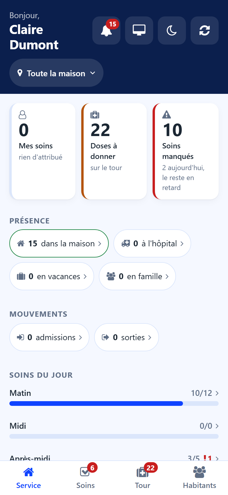

# Shift screen

:::{rh-description}
The My shift screen of the WideCare app: the cards of the shift, residents present, arrivals and departures, the day's cares by period and what comes next.
:::

:::{rh-faq}
What do the cards at the top show?
: One card per kind of work your account does: **My cares**, **Doses due** and **Missed cares** for the care staff, **Tasks** for the house's tasks, and the meals, drinks and rooms when your account works on them. Each card opens its list.

Why is a card red?
: Red means something was let slip and is to handle now: doses or cares missed. A card with work waiting is warm; a card with nothing waiting is calm.

Can I see who is away today?
: Yes. The **Presence** block counts the residents in the house and the residents away. Tap a figure to see the residents concerned.

The screen says nothing is waiting, but my colleagues still have cares. Why?
: A team is chosen in the strip at the top. The screen then counts that team's work only, and says so. Choose **Every team** to see the whole shift.
:::

**My shift** is the first screen of the [WideCare app](index.md). It answers the
question of the start of a shift: where things stand, and what comes next.

<!-- screenshot to update: the new look of My shift (initials button, cards with Tasks, meals, hydration and rooms) -->

## Cards

The cards depend on what your account does in the house. Tap a card to open the
list it counts.

For the care staff:

- **My cares** — the cares assigned to you today.
- **Doses due** — the doses still to give on the round. The card turns red when
  doses were missed, and says how many.
- **Missed cares** — the cares still owed: today's misses, and the cares of an
  earlier day still owed because of their rhythm (a weekly bath, for example).
  The line under the figure says which: **all from today**, **3 today, the rest
  behind**, or **still owed from an earlier day**.

For everyone who carries out the house's tasks:

- **Tasks** — the house's tasks still open, and how many are assigned to you.

When your account works on them, the screen also shows:

- the **meal** in progress — the couverts still to serve, then, after the meal,
  **Amounts to note**. See [Meals](repas.md);
- **Hydration** — the residents without a drink today. See
  [Hydration](hydratation.md);
- **To prepare** and **To clean** — the rooms to get ready before an arrival
  and to clean after a departure. See [Rooms](chambres.md).

:::{admonition} In Belgium
:class: rh-country rh-country-be

A house with a day care centre also gets an **Attendance** card: the day care
users expected and not ticked in yet. See [Recording attendance](../belgique/centre-de-jour/presences.md).
:::

### Card colours

- **Red** — something was let slip: doses or cares missed. To handle now.
- **Warm** — work is waiting.
- **Calm** — nothing is waiting.

Until the shift is read, a card shows a dash instead of a figure: the app never
states a zero it has not checked.

## Presence and movements

- **Presence** — residents **in the house**, residents **away** (hospital,
  holiday, family: one figure for every absence), and residents **back today**.
  A house with a day centre also counts the people **at the day centre**.
- **Movements** — the day's **admissions**, the residents **admitted in the last
  7 days**, the day's **departures**, and the residents **deceased this week**.

Every figure opens the list of the residents it counts. A button above the list
reminds which figure you came from; tap its cross to see everyone again.

## Today's care

One bar per period of the day — morning, noon, afternoon, evening, night —
shows the cares done out of the cares planned. A red number marks the missed
cares of the period. Every period is shown, an empty one too.

Tap a bar to open the cares of the day: the missed ones first, else what is
still to do, else what was done.

## Next

The next cares and doses, in time order, with the resident and the room. A care
that is part of a sequence for the same resident shows its rank. Tap a line to
open the resident's sheet.

When nothing is waiting, the screen says so: **Nothing is waiting. The shift is
up to date.** When a team is chosen, it says the message concerns that team
only.

The foot of the screen gives the number of residents of the sector and the date.
