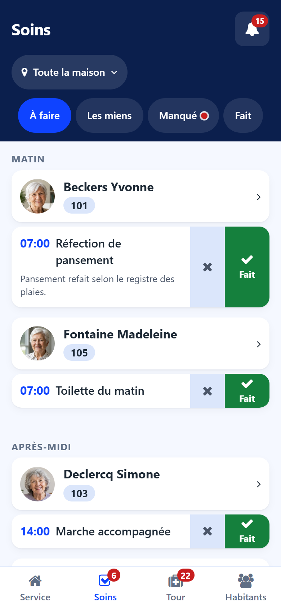
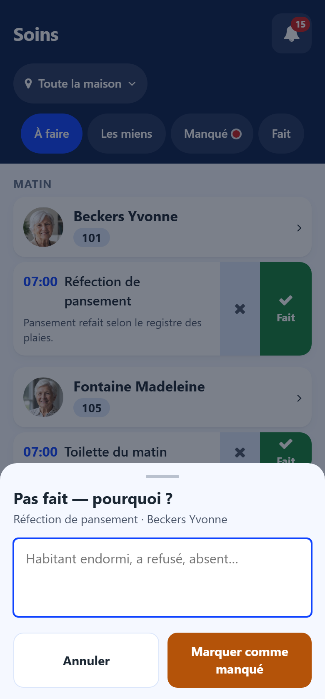

# Tasks

:::{rh-description}
The Tasks screen of the WideCare app: the day's cares and the house's tasks resident by resident, marked done, done with a comment, not done or postponed, with the day and the filters to choose.
:::

:::{rh-faq}
Where do I find only the tasks assigned to me?
: In the **Mine** tab. Your tasks also carry the **you** label in the other tabs.

How do I record a care that could not be done?
: Swipe the line to the left, choose why (resident asleep, refused, away…), add a word if useful and tap **Record as not done**.

Can I move a care to later?
: Yes. Press and hold the line, choose **Postpone**, then the day, the moment or a precise time, and why.

Can a missed care still be done?
: Yes. It stays in the **Missed** tab and can still be swiped **Done**.

Can I look at yesterday or tomorrow?
: Yes. Use the arrows beside the day, or tap the day to pick one. Another day is read only: its cares are ticked on their own day.
:::

The **Tasks** screen lists the work of the day in the chosen sector: the cares
planned in the care plans and the house's other tasks (housekeeping, technical,
move-in steps…). They are grouped by period, then resident by resident with the
face and the room. A task about a room and nobody in particular shows the room.

<!-- screenshot to update: the Tasks screen with the day selector, the filter button, the + button and rows without buttons -->

## Choosing the day

The day sits at the top of the screen.

- The **arrows** go to the previous or the next day.
- Tap the day to choose **Yesterday**, **Today**, **Tomorrow**, or **Pick a day**.

Another day than today is **read only**: a line above the list says so. A past
day shows what it left open; a care it left that is still owed is on today's
list. A day to come shows what is planned for it.

## Tabs

- **To do** — the tasks still to carry out.
- **Mine** — the tasks assigned to you.
- **Missed** — the cares not done in time and still owed. A red dot on the tab
  says some are waiting. Today only, for the care staff.
- **Done** — the tasks closed that day.

## Filters

The **filter** button narrows the list:

- **Which moment?** — **All day** or one period of the day, each with the number
  of tasks it holds;
- **Which type of task?** — **All types** or one type: a type of care, or a kind
  of task (housekeeping, technical…).

A filter on is shown under the tabs, with a cross to remove it. When a filter
leaves nothing, **Show everything** removes them all.

## What a line shows

- the time, the name of the task, and its rank when it is part of a sequence;
- **Still owed** or **Since** a day — a care of an earlier day still owed;
- **High priority** or **Critical** — the care's criticality;
- **Late** — the deadline has passed;
- the kind of task, for the house's other tasks;
- **you** — assigned to you;
- **To fill in** — the task asks for a record (a scale, a weighing): see below;
- the medical devices to know of, on a meal-assistance care;
- **On this phone** — recorded, not sent yet.

## Marking a task done

Swipe the line to the **right**: **Done**. The task leaves **To do** and
appears in **Done**. A wrong swipe is taken back with **Undo**, offered for a few
seconds.

A care that is answered by a record opens that record instead of a bare tick:

- a **stools and urine** care opens [Stools and urine](selles-urines.md);
- a care that asks for a scale or a weighing — **To fill in** — opens the
  [evaluation](evaluations.md) or the [vital signs](signes-vitaux.md). Saving
  it ticks the care. **To fill in at the desk** means the record is made in the
  back office;
- a **hydration round** opens the [drinks](hydratation.md), an **intake
  monitoring** care the [meal round](repas.md).

## Other outcomes

Press and hold a line to see every choice:

- **Done** and **Not done**, as the swipes;
- **Done, with a comment** — a word worth knowing: washed at the sink, ate half…
- **Postpone** — to another moment or day;
- **Details** — the whole task.

### Not done

1. Swipe the line to the **left**, or choose **Not done**.
2. Choose why from the list. **Other** asks for a word.
3. Add a word if useful.
4. Tap **Record as not done**.

<!-- screenshot to update: the "Not done — why?" sheet with its list of reasons and the Record as not done button -->

A care answered **Not done** leaves **Missed**: it has its answer. The head nurse
reads the reason in the back office. It can still be marked done or postponed
afterwards.

### Postpone

The sheet asks one question at a time; each answer folds into a line you can
tap to change it.

1. **To which day** — today or one of the next 7 days.
2. **At what time** — a period of the day, **Same moment** for another day, or
   **Precise time**. The moments already over today are not offered.
3. **Why not now** (or **Why not today**) — the reason.
4. Tap **Postpone**.

The care is moved to the day and the moment chosen, and shows **Postponed to**
on the original line.

## The detail of a task

Tap the name of a task to read it whole: its full instruction, its status, when
it is planned, its type, its criticality, who it is assigned to, its team, who
did it, and how it ended. From the detail:

- **Done**, **Done, with a comment**, **Not done** and **Postpone**, while the
  task is open;
- **Fill in** — for a task that asks for a record, even after a **Not done**:
  the record is still awaited;
- **Observation** — writes an observation about this care, filed under it.
  See [Observations](notes.md).

:::{note}
A care planned in a care plan and never answered is marked missed automatically
two hours after its period (or its hour) is over. It then appears in **Missed**,
in the **Missed cares** card of the [shift screen](service.md) and in the bell.
:::

## Adding a task

The **+** button at the top writes a task on the spot: a care act nobody
planned, or work for the rest of the staff. See [New task](nouvelle-tache.md).
