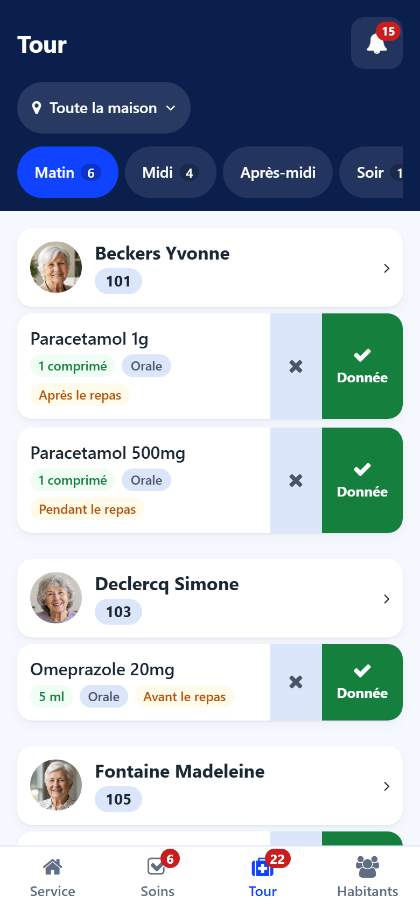
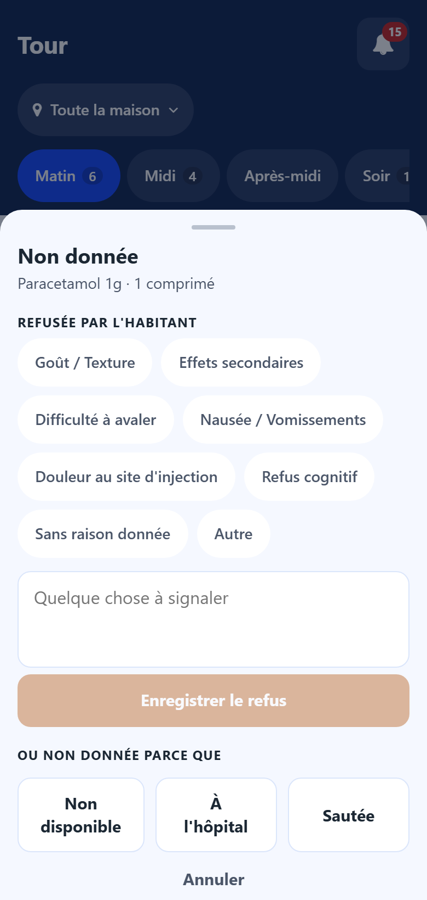

# Medication round

:::{rh-description}
The Round screen of the WideCare app: the doses of each moment of the day, resident by resident, distributed then taken, refused or not given, recorded afterwards, and the glucose before an insulin.
:::

:::{rh-faq}
Why is the round sorted by resident and not by medication?
: Because the round goes from room to room. The residents who still have a dose to receive come first; the ones already done follow under **All in order**.

Why two steps, distributed and taken?
: Handing the medication over and seeing it taken are two acts. **Distribute only** records the first; **Taken** records both, or the second once the dose is distributed.

How do I record a refused medication?
: Swipe the dose to the left, choose the reason under **Refused by the resident**, add a remark if needed and tap **Record refusal**.

I gave a dose at its hour but could not record it then. What do I do?
: Press and hold the dose, choose **Given earlier**, enter the hour it was given and tap **Record as given**. The record keeps that hour, your name, and that it was written afterwards.

I recorded the wrong dose. Can I correct it?
: Within a few seconds, tap **Undo** on the message. Later, a nurse or a physician corrects the record from the resident's sheet, with the reason.
:::

The **Round** screen shows the doses to give at each moment of the day, taken
from the prescriptions entered in the back office. It appears for whoever gives
medication.

<!-- screenshot to update: the Round with the moment button beside the title, the Distribute all and All taken buttons, and rows without buttons -->

## Choosing the moment

The button beside the title gives the moment of the round: morning, noon,
afternoon, evening, night, or **All day**. Tap it to change. Each moment shows
the doses it still holds; a **red dot** says doses of that moment were missed.

When the moment chosen has no dose, the screen says **No dose on this round**
and names the round where doses are waiting, with **Go there**.

## What a dose shows

- the hour, and the day in red when the dose belongs to another day
  (**Yesterday**, a date);
- the medication and the dose;
- the moment of the round, the route (oral, sublingual…) and the moment relative
  to the meal;
- **If needed**, **Narcotic**, and what changes the act: do not crush, in food,
  a glucose first…
- the special instructions of the prescription.

When the house tracks its pillboxes, a dose may also show **Not prepared**,
**Issue at the check** or **Missing: the pharmacy is told**. See
[Pillboxes](piluliers.md).

## Recording a dose

Swipe the dose to the **right**: **Taken**. The line then shows the status, the
time and who gave it.

Press and hold the dose for the other choices:

- **Taken** — handed over and seen taken;
- **Distribute only** — handed over; the intake is still to be seen. The line
  then shows the hand icon and the hour. Swipe it **Taken** once seen;
- **Not given** — see below;
- **Given earlier** — see below.

A wrong swipe is taken back with **Undo**, offered for a few seconds. Later, the
record is corrected from the [resident's sheet](habitants.md) by a nurse or a
physician.

:::{tip}
A distributed dose whose round is over and that nobody confirmed appears in the
bell under **Intakes to confirm**.
:::

## The whole round at once

At the top of the round and under each resident:

- **Distribute all** — records every dose shown as distributed, by you, now;
- **All taken** — records every distributed dose as taken, by you, now.

A sheet first says how many doses and residents are concerned, and lists what is
**Left aside** and why: a dose waiting on the phone, an insulin whose glucose is
to read first… Confirm with the button of the sheet. A refusal or a dose not
taken is then recorded dose by dose.

## Recording a dose not given

1. Swipe the dose to the **left**.
2. Choose:
   - under **Refused by the resident**, the reason of the refusal, add a remark
     under **Anything worth noting** if useful, then tap **Record refusal**;
   - or, under **Or not given because**: **Missing: tell the pharmacy**, **In
     hospital**, **Skipped** — and **Away** for someone who only comes by day.

**Missing: tell the pharmacy** puts the medication in the house's next order to
the pharmacy.

For a dose already distributed, the sheet asks **Distributed, and not taken
because**: choose the reason and tap **Record not taken**.

<!-- screenshot to update: the not-given sheet with "Missing: tell the pharmacy" -->

## A dose given earlier

A dose given at its hour and recorded only now:

1. Press and hold the dose and choose **Given earlier**.
2. Under **Given at**, enter the hour it was given. The hour of the round is
   proposed.
3. Tap **Record as given**.

The record keeps this hour, your name, and that it was written afterwards. The
line then shows **recorded afterwards**. A dose of a day already over can only
be recorded this way. An hour still to come is refused.

## Glucose before an insulin

An insulin asks for the capillary glucose first. When you record it as taken, a
sheet asks the **Capillary glucose (mg/dL)**:

- enter the value and tap **Taken, glucose recorded**;
- or tap **Taken, no glucose read**.

An impossible value is refused with the range accepted.

## Unplanned medication or care

The **+** button at the top records a medication that is not on the treatment
sheet, or a care nobody planned. See [New task](nouvelle-tache.md).

## Pillboxes

For the nurses, the **pillboxes** button at the top opens the preparation and
the check of the pillboxes. See [Pillboxes](piluliers.md).

:::{note}
The administrations recorded here are the same as in the back office: they
feed the resident's history and the refusal counters of the prescription. See
[Prescriptions](../soins/prescriptions.md).
:::

## Going further

- [The medication round at the desk](../medicaments/tour.md) — corrections and incidents.
- [Pillboxes and the pharmacy's sachets](../medicaments/piluliers.md)
- [Medicines](../medicaments/index.md)
