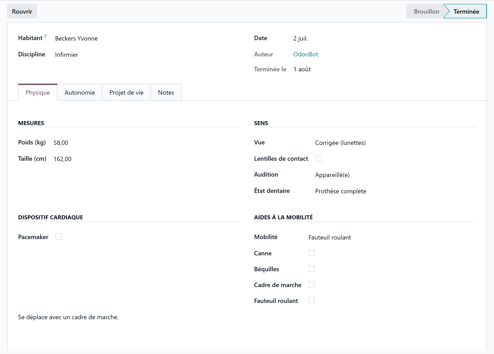

# Multidisciplinary anamnesis

:::{rh-description}
The multidisciplinary anamnesis in Resthome: a dated intake per discipline (nursing, physiotherapy, occupational therapy, speech therapy) that collects the resident's physical particularities and wishes without re-entering what the record already holds.
:::

:::{rh-faq}
What is the multidisciplinary anamnesis in Resthome?
: A dated intake form, one per discipline (nursing, physiotherapy, occupational therapy, speech therapy), that gathers the resident's physical particularities, hospitalisation preferences and end-of-life wishes, together with the remarks of the professional who fills it in.

Do I have to re-enter the allergies, treatments or assessments?
: No. They live in the resident's record and are reached from the anamnesis through smart buttons. The anamnesis composes the existing record instead of duplicating it.

Can several disciplines fill in an anamnesis for the same resident?
: Yes. Each discipline keeps its own anamnesis. A resident can only have one anamnesis per discipline and per date.

What is the difference between the Draft and Complete states?
: A draft can still be edited or deleted. Once marked complete, the anamnesis is part of the clinical record: it can no longer be deleted, only reopened if it was completed by mistake.

Where are the end-of-life wishes recorded?
: In the **Wishes** tab of the anamnesis. They are stored on the resident, so they also show in the **Wishes** tab of the resident's form.
:::

The **anamnesis** is the guided intake of a resident, filled in shortly after
admission, then updated whenever the situation changes. Each discipline writes
its own.

Menu: **Nursing Care → Care → Assessments → Anamneses**, or **New →
Anamnesis** on the [care dashboard](tableau-de-bord.md).

<!-- screenshot to update: the tabs are now Physical, Autonomy, Wishes and Notes; the smart buttons are Allergies, Treatments and Evaluations -->

## The principle: compose, never re-enter

An anamnesis is a **dated snapshot per discipline**, not a second copy of the
record.

- The **resident's facts** (glasses, pacemaker, walking aids, weight, wishes…)
  are stored **once on the resident** and edited straight from the anamnesis.
  Correcting the weight here corrects it everywhere.
- The **structured clinical data** (allergies, treatments, assessment scales)
  is **reached by smart button**, never copied.
- Only the **remarks** and the **general notes** belong to the anamnesis
  itself: what that professional observed, on that date.

## 1. Create the anamnesis

1. Open **Nursing Care → Care → Assessments → Anamneses** and click **New**.
2. Pick the **resident** and the **discipline**: Nursing, Physiotherapy,
   Occupational Therapy or Speech Therapy.
3. The **date** defaults to today and the **author** is you.
4. **Save.**

:::{admonition} One anamnesis per resident, discipline and date
:class: note

Resthome refuses a duplicate for the same resident, discipline and date. To
revise a same-day entry, edit the existing one. Only a resident with a stay in
the house can be picked.
:::

## 2. The Physical tab

| Group | Items |
|---|---|
| **Measurements** | Weight and height |
| **Senses** | Vision, contact lenses, hearing, dental status |
| **Cardiac Device** | Pacemaker, its rhythm and device number |
| **Mobility Aids** | Mobility, cane, crutches, walking frame, wheelchair (with its number) |

A free-text area holds the remarks on the physical assessment. These fields
belong to the resident: they show on the resident's form and in the other apps
that need them.

## 3. The Autonomy tab

Free text for habits, rhythms and preferences for daily care.

## 4. The Wishes tab

- **In Case of Hospitalisation** — preferred hospitals, refused hospitals, room
  type and complementary insurance. They feed the **liaison pack** printed at a
  [hospital departure](hospitalisation.md).
- **Advance Directives** — DNR order, advance directive and its content,
  palliative status with its start date, and whether the resident and their
  representative agreed.
- **End-of-life Wishes** — religion, funeral preference, will, burial
  concession, funeral contract.
- **Contacts** — funeral home and notary, with their city.
- End-of-life and hospitalisation **instructions**, and the remarks on the
  wishes.

:::{admonition} Collected once, honoured everywhere
:class: warning

A DNR order or an advance directive entered here shows up on the resident's
form, where the care team sees it. Gather these wishes with the resident, and
with their representative where applicable: the two agreement boxes record that
this conversation took place.
:::

The resident's life story, habits, likes and projects are written in the
[life project](projet-de-vie.md), not in the anamnesis.

## 5. Notes and clinical context

The **Notes** tab holds the general notes of the anamnesis. Smart buttons open
the existing record without leaving the page:

- **Allergies** and **Treatments**, with their counters;
- **Evaluations** — the scale suited to the discipline: Tinetti for
  physiotherapy, MMSE for occupational therapy.

:::{admonition} In Belgium
:class: rh-country rh-country-be

The anamnesis also reaches the resident's Katz assessments and their current
category. See [Care in Belgium](../belgique/soins.md).
:::

## 6. Complete the anamnesis

When the intake is done, click **Mark Complete**. Resthome records the
completion date.

| State | Meaning |
|---|---|
| **Draft** | Being filled in; editable and deletable |
| **Complete** | Part of the clinical record: no longer deletable |

:::{admonition} A completed anamnesis cannot be deleted
:class: warning

It belongs to the clinical record. If it was completed by mistake, click
**Reopen**: it returns to draft and becomes editable again.
:::

The list filters by state (**Draft**, **Complete**) and by discipline, and
groups by resident, discipline or state.

## Key takeaways

- The anamnesis is a **dated intake per discipline**, not a second record.
- What the record already holds is **composed, never re-entered**.
- The **Wishes** tab writes into the resident's own wishes.
- **Mark Complete** makes the anamnesis part of the clinical record.

## Further reading

- [The life project](projet-de-vie.md)
- [The resident's medical record](dossier-medical.md)
- [Care plans](plans-de-soins.md)
